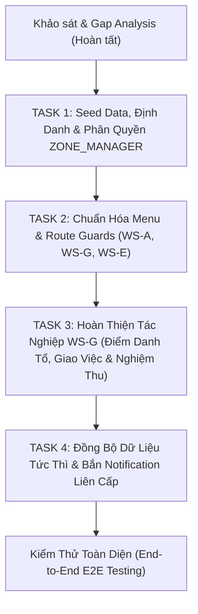

# BÁO CÁO KIỂM TOÁN HỆ THỐNG & GAP ANALYSIS TOÀN DIỆN
## ĐÁNH GIÁ CHỨC NĂNG VAI TRÒ TRƯỞNG PHÂN KHU / TỔ TRƯỞNG HIỆN TRƯỜNG — `ZONE_MANAGER`
**Dự án:** Hệ Thống Quản Trị Nông Nghiệp Thông Minh Đa Trang Trại (Farm Management SaaS Multi-Tenant)  
**Vai trò thẩm định:** Principal Software Architect  
**Tài khoản mục tiêu khảo sát:** `zone_manager` (`ZONE_MANAGER` / Trưởng phân khu sản xuất)  
**Tập trung khảo sát:** Backend (`backend/src/main/java/com/farm/saas/`) & Frontend (`frontend/src/`)  
**Mục tiêu:** Rà soát 100% cơ chế nhận diện định danh, phân quyền RBAC đa cấp (Scope Level: Farm / Zone), điều hướng menu, bảo vệ tuyến đường (Route Guard), tác nghiệp chấm công tổ, giao việc - nghiệm thu hiện trường, nhật ký canh tác, ghi nhận thu hoạch và đồng bộ dữ liệu liên cấp.

---

## TỔNG QUAN VỊ TRÍ, BẢN CHẤT VAI TRÒ & QUYỀN HẠN CỦA `ZONE_MANAGER`

### 1. Bản chất kiến trúc của `ZONE_MANAGER` trong mô hình 4 cấp (4-Tier RBAC)
Trong cấu trúc quản trị nông trại thực tế, **ZONE_MANAGER (Trưởng Phân Khu / Tổ Trưởng Hiện Trường)** là mắt xích chỉ huy tiền tuyến kết nối giữa **Cấp 3 (Ban Giám Đốc Nông Trại - Farm Manager)** và **Cấp 4 Thao Tác (Công Nhân Hiện Trường - Field Worker)**:
- **Phạm vi quản lý (Scope Boundary):** Khác với Farm Manager quản lý toàn trại (Farm scope), Zone Manager được phân công quản lý **một hoặc một số Phân khu sản xuất cụ thể** (`zone_id` trong bảng `farm_assignments`), ví dụ: *Nhà màng công nghệ cao A1*, *Cánh đồng mở B1*, hoặc *Khu chuồng nuôi C1*.
- **Cơ cấu phân quyền kép (System Role vs. Field Assignment Role):**
  - Trong hệ thống hiện tại, vai trò hệ thống (`roles.code`) là các role Cấp 4: `ROLE_TECHNICAL_STAFF`, `ROLE_FIELD_STAFF`, `ROLE_WAREHOUSE_STAFF`, `ROLE_ACCOUNTANT`.
  - Vị trí hiện trường (`role_in_farm`) được lưu trữ tại bảng `farm_assignments` với các mã: `'FARM_MANAGER'`, `'ZONE_MANAGER'`, `'TECHNICAL_LEAD'`, `'AGRONOMIST'`, `'VETERINARIAN'`, `'WAREHOUSE_KEEPER'`, `'ACCOUNTANT'`, `'FIELD_WORKER'`.
- **Tập quyền hạn nghiệp vụ cốt lõi mà ZONE_MANAGER bắt buộc phải sở hữu:**
  1. `PERM_FARM_VIEW` (#3): Tra cứu thông tin nông trại và phân khu phụ trách.
  2. `PERM_CROP_VIEW` (#6): Theo dõi tiến độ mùa vụ trồng trọt trong phân khu.
  3. `PERM_CROP_LOG` (#8): Trực tiếp ghi nhật ký canh tác (làm đất, tưới tiêu, bón phân, phun thuốc) và kích hoạt trừ kho tự động (Crop Auto-Backflushing).
  4. `PERM_LIVESTOCK_VIEW` (#9): Theo dõi đàn vật nuôi và tăng trưởng thể trọng.
  5. `PERM_HARVEST_MANAGE` (#17): Lập biên bản thu hoạch thực tế tại ruộng / xuất chuồng trước khi bàn giao cho Kho & KCS.
  6. `PERM_HR_ATTENDANCE` (#24): Chấm công cá nhân (GPS + Selfie) và **điểm danh hộ tổ công nhân** (Batch Roll-Call).
  7. `PERM_TASK_ASSIGN` (#25): **Trực tiếp giao việc mới**, điều phối công việc hàng ngày trong phân khu và **nghiệm thu hoàn thành công việc (`DONE`)** cho công nhân trong tổ.

---

# BẢNG TỔNG HỢP TOÀN BỘ LỖ HỔNG & ĐIỂM NGHẼN (EXECUTIVE GAP MATRIX)

| Mã Lỗ Hổng | Phân Vùng | Vị Trí File & Dòng Code | Hiện Trạng Thực Tế | Rủi Ro & Hành Vi Lỗi | Mức Độ |
| :--- | :--- | :--- | :--- | :--- | :--- |
| **GAP-ZM-01** | **Seed Data & Hồ Sơ Mẫu** | `backend/.../db/migration/V1_0 -> V1_6`<br>`backend/.../HrDataCleanupRunner.java` | Hoàn toàn **chưa có tài khoản mẫu** nào cho Trưởng phân khu (`zone_manager`). Bảng `farm_assignments` không có bản ghi gán `role_in_farm = 'ZONE_MANAGER'` gắn với `zone_id`. | Không có dữ liệu kiểm thử thực tế cho vai trò Trưởng phân khu; nhân viên hiện trường khi vào trại không được định danh đúng thẩm quyền tổ trưởng. | **CRITICAL** |
| **GAP-ZM-02** | **Xung Đột Route Guard WS-A** | `frontend/src/app/routes.jsx`<br>*(Dòng 131-137)*<br>`frontend/.../menuConfig.js` *(Dòng 13-19)* | Menu Sidebar WS-A yêu cầu `PERM_FARM_VIEW` nên hiển thị link. Nhưng `routes.jsx` siết chặt bằng `PermissionGuard anyPermissions={['PERM_FARM_UPDATE', 'PERM_ZONE_MANAGE', 'PERM_CROP_PLAN', 'PERM_LIVESTOCK_MANAGE']}`. | **LỖI HTTP 403 CHẶN ĐƯỜNG:** Trưởng phân khu (có base role `ROLE_FIELD_STAFF`) thấy menu WS-A nhưng bấm vào bị chặn trang đỏ "Không có quyền truy cập", không thể xem sơ đồ phân khu và nhân sự tổ mình! | **CRITICAL** |
| **GAP-ZM-03** | **Chặn Giao Việc & Nghiệm Thu** | `backend/.../FarmTaskController.java`<br>*(Dòng 24-42)*<br>`backend/.../FarmTaskServiceImpl.java` *(Dòng 224-233)* | API tạo việc (`POST /tasks`), sửa việc (`PUT /tasks`) và logic nghiệm thu chuyển trạng thái sang `DONE` / `CANCELLED` yêu cầu cứng `PERM_TASK_ASSIGN` hoặc role quản lý/kỹ thuật. | **LỖI HTTP 403 FORBIDDEN FATAL:** Trưởng phân khu có base role `ROLE_FIELD_STAFF` khi bấm `[+ Giao Việc Mới]` hoặc bấm `[Nghiệm thu hoàn thành]` tại WS-G bị Backend quăng lỗi 403 Access Denied, tê liệt hoàn toàn chức năng chỉ huy! | **CRITICAL** |
| **GAP-ZM-04** | **Nghịch Lý Base Role (WS-E & Thu Hoạch)** | `backend/.../FarmingLogController.java`<br>*(Dòng 34-40)*<br>`backend/.../HarvestController.java` *(Dòng 23-28)* | Nếu dùng base role `ROLE_TECHNICAL_STAFF` để có `PERM_TASK_ASSIGN` thì bị thiếu `PERM_CROP_LOG` (không ghi được nhật ký) và bị loại khỏi `hasAnyRole` ở `HarvestController` (không lập được biên bản thu hoạch). | Bế tắc kiến trúc: Không thể chọn gán `ROLE_TECHNICAL_STAFF` hay `ROLE_FIELD_STAFF` thuần túy mà không làm hỏng một nửa nghiệp vụ thực địa của Trưởng phân khu. | **CRITICAL** |
| **GAP-ZM-05** | **Khuyết Định Danh useAuthStore** | `frontend/src/store/useAuthStore.js`<br>*(Dòng 400-515)*<br>`frontend/.../menuConfig.js` *(Dòng 240-295)* | Hoàn toàn thiếu các hàm `isZoneManager()`, `hasFarmRole()`. `getOperationalRole()` chỉ trả về `TECHNICAL_LEAD` hoặc trôi về `FIELD_WORKER`. `menuConfig.js` thiếu nhánh `case 'ZONE_MANAGER'`. | Trưởng phân khu bị nhận diện nhầm thành Trưởng kỹ thuật (thừa WS-C, WS-F, thiếu nhãn tổ trưởng) hoặc bị hạ cấp xuống công nhân thường (mất hết bảng điểm danh tổ và bảng giao việc). | **HIGH** |
| **GAP-ZM-06** | **Thiếu Auto-Sync Nhân Sự WS-G** | `frontend/.../G_EmployeeDailyOps/index.jsx`<br>*(Dòng 40-75)*<br>`frontend/.../AssignmentModal.jsx` *(Dòng 80-86)* | `AssignmentModal.jsx` có gọi `notifyDataChanged`, nhưng `EmployeeDailyOpsWorkspace` (WS-G) không đăng ký lắng nghe `syncTrigger` từ `useActiveFarmStore`. | Khi Giám đốc trại điều động hoặc phân công thêm nhân sự vào phân khu tại WS-A, bảng điểm danh tổ và bảng giao việc tại WS-G không tự động cập nhật nếu không F5. | **MEDIUM** |
| **GAP-ZM-07** | **Đứt Gãy Luồng Thông Báo (Notif)** | `backend/.../FarmTaskServiceImpl.java`<br>*(Dòng 100-130, 260-295)*<br>`backend/.../TimeAttendanceServiceImpl.java` | Backend không bắn notification khi tạo task mới, khi nghiệm thu đạt (`DONE`) hoặc trả về làm lại (`IN_PROGRESS`), và khi điểm danh hộ tổ công nhân (Batch Roll-Call). | Công nhân không nhận được thông báo khi được giao việc mới hoặc khi kết quả công việc được nghiệm thu; Giám đốc trại và Kế toán không nhận được thông báo chấm công tổ tức thì. | **MEDIUM** |

---

# PHẦN 1: KIỂM TRA TÀI KHOẢN MẪU (SEED DATA), CƠ CHẾ ĐỊNH DANH & PHÂN QUYỀN CỦA ZONE_MANAGER

### 1.1. Khảo sát dữ liệu Seed trong Database Migrations & Runners
Kiểm tra toàn bộ chuỗi migration từ `V1_0` đến `V1_6` và `HrDataCleanupRunner.java`:
1. **Bảng `users` hiện tại:**
   - Hệ thống mới chỉ có 8 tài khoản mẫu chuẩn:
     - ID 1: `admin` (`ROLE_SUPER_ADMIN`)
     - ID 2: `owner` (`ROLE_FARM_OWNER`, Tenant 1)
     - ID 3: `staff` (`ROLE_FIELD_STAFF`, Tenant 1, Farm 1)
     - ID 4: `warehouse` (`ROLE_WAREHOUSE_STAFF`, Tenant 1, Farm 1)
     - ID 5: `tech` (`ROLE_TECHNICAL_STAFF`, Tenant 1, Farm 1)
     - ID 6: `accountant` (`ROLE_ACCOUNTANT`, Tenant 1, Farm 1)
     - ID 7: `owner_red` (`ROLE_FARM_OWNER`, Tenant 2)
     - ID 8: `farm_manager` (`ROLE_FARM_MANAGER`, Tenant 1, Farm 1)
2. **Bảng `user_farm_access` & `farm_assignments`:**
   - Trong `V1_4__standardize_4_tier_rbac_matrix.sql`:
     - User 8 (`farm_manager`) được gán `role_in_farm = 'FARM_MANAGER'` tại Farm 1.
     - User 6 (`accountant`) được gán `role_in_farm = 'ACCOUNTANT'` tại Farm 1.
     - Bảng `farm_assignments` hoàn toàn **chưa có bất kỳ bản ghi nào** gán `role_in_farm = 'ZONE_MANAGER'` gắn với `zone_id` (ví dụ: Zone 1 - Nhà màng A1).
3. **Cơ chế tự động tạo hồ sơ nhân sự (`HrDataCleanupRunner.java`):**
   - Runner tự động quét các user có vai trò `ROLE_FARM_MANAGER`, `ROLE_TECHNICAL_STAFF`, `ROLE_WAREHOUSE_STAFF`, `ROLE_ACCOUNTANT`, `ROLE_FIELD_STAFF` để tạo hồ sơ `employees`.
   - Do chưa có tài khoản Trưởng phân khu chuyên biệt trong `users`, Runner chưa từng khởi tạo hồ sơ nhân sự nào cho vị trí Trưởng phân khu.

### 1.2. Kiểm tra API Xác thực `/api/v1/auth/login` và `/api/v1/auth/me` (`AuthServiceImpl.java` & `UserInfoDto.java`)
1. **Dữ liệu trả về từ DTO:**
   - `UserInfoDto.java` đã có đầy đủ cấu trúc:
     - `farmAssignments`: danh sách `FarmAssignmentDto` gồm `farmId`, `farmName`, `zoneId`, `roleInFarm`, `isActive`.
     - `accessibleFarms`: danh sách `AccessibleFarmDto` gồm `farmId`, `assignedRole`, `isManager`.
   - Khi một user có bản ghi `farm_assignments` với `role_in_farm = 'ZONE_MANAGER'`, `assignedRole` trong `accessibleFarms` sẽ mang giá trị `'ZONE_MANAGER'`.
2. **Lỗ hổng phân giải vai trò vận hành (`AuthServiceImpl.java`, dòng 496-506):**
   ```java
   } else if (hasTechRole || activeAssignments.stream().anyMatch(a -> Arrays.asList("ZONE_MANAGER", "TECHNICAL_LEAD", "AGRONOMIST", "VETERINARIAN").contains(a.getRoleInFarm()))) {
       operationalRole = "TECHNICAL_LEAD";
   }
   ```
   - **Phát hiện:** Backend gộp cứng `ZONE_MANAGER` vào `operationalRole = "TECHNICAL_LEAD"`.
   - Hệ thống Backend hoàn toàn **không trả về `operationalRole = "ZONE_MANAGER"`**.

### 1.3. Kiểm tra Store Xác thực Frontend (`frontend/src/store/useAuthStore.js`)
Khảo sát các hàm bổ trợ trong `useAuthStore.js`:
1. `isZoneManager()`: **HOÀN TOÀN CHƯA CÓ**.
2. `hasFarmRole('ZONE_MANAGER')`: **HOÀN TOÀN CHƯA CÓ** (chỉ có hàm nội bộ `hasFarmAssignmentRole(roleInFarm, farmId)`).
3. `getOperationalRole()` (dòng 494-515):
   - Hàm chỉ hỗ trợ 7 mã: `'SUPER_ADMIN'`, `'OWNER'`, `'FARM_MANAGER'`, `'TECHNICAL_LEAD'`, `'WAREHOUSE_KEEPER'`, `'FARM_ACCOUNTANT'`, `'FIELD_WORKER'`, `'STAFF'`.
   - Hoàn toàn không có mã `'ZONE_MANAGER'`.
4. `getOperationalRoleInfo()` (dòng 520-620):
   - Không có cấu hình metadata (tiêu đề, màu badge, cờ chấm công) cho `ZONE_MANAGER`.
5. **Hành vi thực tế khi đăng nhập bằng tài khoản Trưởng phân khu:**
   - **Kịch bản 1:** Nếu tài khoản có base role là `ROLE_FIELD_STAFF` và có gán `role_in_farm = 'ZONE_MANAGER'`:
     - Hàm `isTechnicalLead()` trả về `true` vì `techRoles.includes('ZONE_MANAGER')`.
     - `getOperationalRole()` trả về `'TECHNICAL_LEAD'`.
     - Sidebar hiển thị danh xưng "Bàn Tác Nghiệp Trưởng Kỹ Thuật" (`TECHNICAL_LEAD`).
   - **Kịch bản 2:** Nếu bản ghi `farm_assignments` bị thiếu hoặc `isActive = false`:
     - `isTechnicalLead()` trả về `false`.
     - `isFieldWorker()` trả về `true`.
     - `getOperationalRole()` rơi ngay về `'FIELD_WORKER'`. Trưởng phân khu bị tước sạch thẩm quyền chỉ huy và biến thành công nhân thừa hành.

---

## PHẦN 2: KIỂM TRA MENU ĐIỀU HƯỚNG & ROUTE GUARDS (menuConfig.js & routes.jsx)

### 2.1. Cấu hình Menu Sidebar (`frontend/src/shells/TenantAppShell/menuConfig.js`)
1. **Nhánh Menu riêng:**
   - Trong `getSidebarMenuConfig(operationalRole)`: **Hoàn toàn KHÔNG CÓ `case 'ZONE_MANAGER':`**.
   - Trưởng phân khu đang phải đi nhờ vào `case 'TECHNICAL_LEAD':`.
2. **Khảo sát 3 Workspace cốt lõi:**
   - `WS-G` (`G_EmployeeDailyOps`): Có mặt (`label: 'WS-G: Chấm Công & Điểm Danh Tổ'`).
   - `WS-A` (`A_Geography`): Có mặt (`label: 'WS-A: Phân Khu & Nhân Sự Khu Mình'`).
   - `WS-E` (`E_FarmingOps`): Có mặt (`label: 'WS-E: Nhật Ký Canh Tác / Nuôi & Thu Hoạch'`).
   - *Điểm bất hợp lý:* Nhánh `TECHNICAL_LEAD` hiện tải thêm `WS-C` (Tra cứu tồn kho vật tư), `WS-F` (Biên bản kiểm định KCS) và Module Settings (Danh mục giống & Định mức BOM). Đây là các công việc của Kỹ sư công nghệ / KCS, không phải của Trưởng phân khu phụ trách sản xuất tại đồng ruộng/chuồng trại.

### 2.2. Xung đột nghiêm trọng: Menu hiển thị nhưng Route Guard chặn 403 tại WS-A (`routes.jsx`)
Điểm xung đột bảo mật lớn nhất nằm giữa `DynamicSidebar.jsx` và `routes.jsx`:
1. **Tại `DynamicSidebar.jsx` (Dòng 101-110):**
   - Menu WS-A được định nghĩa tại `menuConfig.js` (dòng 13-19):
     ```javascript
     A_Geography: {
       id: 'A_Geography',
       path: '/app/geography',
       permission: 'PERM_FARM_VIEW',
     }
     ```
   - Sidebar kiểm tra quyền bằng `<Can permission={item.permission}>`. Vì cả `ROLE_FIELD_STAFF` và `ROLE_TECHNICAL_STAFF` đều sở hữu `PERM_FARM_VIEW`, **link WS-A luôn hiển thị sáng rõ trên Sidebar**.
2. **Tại `routes.jsx` (Dòng 131-137):**
   ```jsx
   <Route
     path="geography"
     element={
       <PermissionGuard anyPermissions={['PERM_FARM_UPDATE', 'PERM_ZONE_MANAGE', 'PERM_CROP_PLAN', 'PERM_LIVESTOCK_MANAGE']}>
         <GeographyWorkspace />
       </PermissionGuard>
     }
   />
   ```
3. **Phân tích va chạm quyền hạn (FATAL CONFLICT):**
   - Nếu Trưởng phân khu được tạo với base role `ROLE_FIELD_STAFF` (theo đúng nguyên tắc nhân sự thực địa thăng tiến lên tổ trưởng):
     - `ROLE_FIELD_STAFF` chỉ có 6 quyền: `PERM_FARM_VIEW`, `PERM_CROP_VIEW`, `PERM_CROP_LOG`, `PERM_LIVESTOCK_VIEW`, `PERM_HARVEST_MANAGE`, `PERM_HR_ATTENDANCE`.
     - `ROLE_FIELD_STAFF` **KHÔNG CÓ BẤT KỲ QUYỀN NÀO** trong danh sách: `['PERM_FARM_UPDATE', 'PERM_ZONE_MANAGE', 'PERM_CROP_PLAN', 'PERM_LIVESTOCK_MANAGE']`!
   - **Hậu quả:** Khi Trưởng phân khu nhấp vào menu WS-A (`/app/geography`) trên Sidebar, hệ thống lập tức đá sang trang lỗi **403 Forbidden ("Không có quyền truy cập")**. Trưởng phân khu hoàn toàn không thể xem phân khu và danh sách nhân sự của mình!

---

## PHẦN 3: KIỂM TRA CHI TIẾT WORKSPACE G (G_EmployeeDailyOps) — ĐIỂM DANH TỔ, GIAO VIỆC & NGHIỆM THU

### 3.1. Hiển thị giao diện tại WS-G (`EmployeeDailyOpsWorkspace`)
1. **Logic điều kiện hiển thị:**
   ```javascript
   const farmManager = isFarmManager();
   const technicalLead = isTechnicalLead();
   const warehouseKeeper = isWarehouseKeeper();
   const fieldWorker = isFieldWorker();
   const canRollCallTeam = farmManager || technicalLead || warehouseKeeper;
   const canSuperviseTasks = farmManager || technicalLead || warehouseKeeper;
   ```
2. **Kết quả hiển thị:**
   - Nếu tài khoản được nhận diện là `technicalLead = true` (thông qua `farmAssignments` chứa `ZONE_MANAGER`):
     - Giao diện render đúng `TeamRollCallPanel` (Bảng điểm danh tổ) nhờ `<Can permission="PERM_HR_ATTENDANCE" role={...} farmRole={['FARM_MANAGER', 'ZONE_MANAGER', 'TECHNICAL_LEAD', 'WAREHOUSE_KEEPER']}>`.
     - Giao diện render khối Quản lý công việc hiện trường gồm 2 Tab: `DailyRoutineTaskTab` và `PersonalTaskKanban` (có nút `+ Giao Việc Mới`).
   - Nếu tài khoản bị trôi về `fieldWorker = true`:
     - Giao diện render nhầm vào `WorkerDailyTasksView` của công nhân thường, mất toàn bộ tính năng điểm danh tổ và bảng giao việc.

### 3.2. Điểm danh hộ tổ công nhân (`TeamRollCallPanel.jsx` & POST `/api/v1/hr/attendance/batch-roll-call`)
1. **API tải danh sách công nhân (`GET /api/v1/hr/employees`):**
   - `EmployeeController.java` cho phép các quyền: `PERM_HR_EMPLOYEE_MANAGE`, `PERM_TASK_ASSIGN`, `PERM_HR_ATTENDANCE`, `PERM_FINANCE_EXPENSE`.
   - Vì Trưởng phân khu có `PERM_HR_ATTENDANCE`, việc tải danh sách công nhân tổ mình diễn ra trơn tru.
2. **Kiểm tra an ninh Backend (`FarmSecurityEvaluator.canPerformBatchRollCall`):**
   ```java
   public boolean canPerformBatchRollCall(Long farmId) {
       if (farmId == null || !canAccessFarm(farmId)) return false;
       CustomUserDetails user = SecurityUtils.getCurrentUser();
       if (user == null) return false;
       if (user.isSuperAdmin() || user.hasRole("ROLE_FARM_MANAGER") || user.hasRole("ROLE_TECHNICAL_STAFF") || user.hasRole("ROLE_WAREHOUSE_STAFF")) {
           return true;
       }
       try {
           Integer count = jdbcTemplate.queryForObject(
                   "SELECT COUNT(*) FROM farm_assignments " +
                   "WHERE user_id = ? AND farm_id = ? AND role_in_farm IN ('FARM_MANAGER', 'ZONE_MANAGER', 'TECHNICAL_LEAD', 'WAREHOUSE_KEEPER') AND is_active = TRUE",
                   Integer.class, user.getId(), farmId);
           return count != null && count > 0;
       } catch (Exception ex) {
           return false;
       }
   }
   ```
   - Câu lệnh SQL kiểm tra trực tiếp bảng `farm_assignments`.
   - Nếu user có bản ghi `farm_assignments` với `role_in_farm = 'ZONE_MANAGER'` và `is_active = TRUE`, hàm **trả về `true` 100%**.
   - Endpoint `POST /api/v1/hr/attendance/batch-roll-call` thực thi hợp lệ.

### 3.3. Bế tắc nghiêm trọng: Giao việc & Nghiệm thu công việc tại WS-G
Kiểm tra chi tiết `CreateTaskModal.jsx`, `ReviewTaskModal.jsx`, `FarmTaskController.java` và `FarmTaskServiceImpl.java`:
1. **Giao việc mới (`POST /api/v1/farms/{farmId}/tasks`):**
   - `FarmTaskController.java` (dòng 24-30):
     ```java
     @PreAuthorize("(hasAnyAuthority('PERM_TASK_ASSIGN', 'PERM_INVENTORY_RECEIPT', 'PERM_INVENTORY_ISSUE') or hasAnyRole('ROLE_SUPER_ADMIN', 'ROLE_FARM_OWNER', 'ROLE_FARM_MANAGER', 'ROLE_TECHNICAL_STAFF', 'ROLE_WAREHOUSE_STAFF')) and @farmSecurity.canAccessFarm(#farmId)")
     ```
2. **Sửa / Hủy việc (`PUT /tasks/{id}`, `PATCH /tasks/{id}/cancel`):**
   - Yêu cầu tương tự: `hasAnyAuthority('PERM_TASK_ASSIGN', ...)` hoặc role quản lý/kỹ thuật.
3. **Nghiệm thu hoàn thành (`DONE`) tại `FarmTaskServiceImpl.java` (dòng 224-233):**
   ```java
   if ("DONE".equals(targetStatus) || "CANCELLED".equals(targetStatus)) {
       boolean canApprove = currentUser != null && (
               currentUser.isSuperAdmin()
               || currentUser.hasPermission("PERM_TASK_ASSIGN")
               || currentUser.hasRole("ROLE_FARM_MANAGER")
               || currentUser.hasRole("ROLE_TECHNICAL_STAFF")
       );
       if (!canApprove) {
           throw new AccessDeniedException("Chỉ Quản lý trang trại hoặc Kỹ thuật viên (PERM_TASK_ASSIGN) mới có quyền nghiệm thu hoàn thành (DONE) hoặc hủy (CANCELLED) nhiệm vụ");
       }
   }
   ```
4. **Hậu quả thực tế (FATAL HTTP 403):**
   - Nếu Trưởng phân khu có base role là `ROLE_FIELD_STAFF`:
     - Tài khoản **hoàn toàn không có `PERM_TASK_ASSIGN`**.
     - Tài khoản không có `ROLE_TECHNICAL_STAFF` hay `ROLE_FARM_MANAGER`.
     - Backend `FarmTaskServiceImpl` **không hề kiểm tra chức danh trong `farm_assignments`**.
     - Khi Trưởng phân khu bấm `[+ Giao Việc Mới]` hoặc bấm `[Nghiệm thu hoàn thành]` chuyển task từ `PENDING_REVIEW` sang `DONE`: **Backend lập tức ném lỗi `AccessDeniedException` (HTTP 403 Forbidden)**!
     - Trưởng phân khu hoàn toàn bất lực, không thể giao việc cho công nhân tổ mình và không thể nghiệm thu kết quả công việc!

---

## PHẦN 4: KIỂM TRA WORKSPACE A (A_Geography) & WORKSPACE E (E_FarmingOps) CỦA ZONE_MANAGER

### 4.1. Khảo sát tại Workspace A (`A_Geography`)
1. **Cây địa lý và danh sách nhân sự phân khu:**
   - Trưởng phân khu có thể xem cây địa lý Nông trại -> Phân khu -> Ô/Luống/Chuồng (`zone_locations`) thông qua API `GET /zones` và `GET /locations`.
   - Danh sách nhân sự trong phân khu (`StaffAssignmentPane.jsx`) được nạp qua `GET /assignments` (cho phép bởi `PERM_FARM_VIEW`).
2. **Bảo toàn nguyên tắc Tách biệt nhiệm vụ (Separation of Duties - SoD):**
   - Các nút tạo/sửa nhạy cảm đã được bảo vệ chính xác:
     - `+ Thêm Trang Trại`: Độc quyền Owner (`PERM_FARM_CREATE` + `ROLE_FARM_OWNER`).
     - `+ Thêm Phân Khu Mới`: Độc quyền Giám đốc trại / Owner (`PERM_ZONE_MANAGE`).
     - `Tạm Ngừng / Kích Hoạt Trại`: Độc quyền Owner (`PERM_FARM_UPDATE`).
     - `+ Phân Công Nhân Sự`, `Thay Đổi Người Phụ Trách`: Bọc `<Can permission="PERM_ZONE_MANAGE">`. Trưởng phân khu không thể tự ý bổ nhiệm/điều chuyển nhân sự giữa các phân khu, đúng chuẩn thẩm quyền của Giám đốc trại.

### 4.2. Khảo sát tại Workspace E (`E_FarmingOps`)
1. **Xem Mùa vụ / Đàn nuôi:**
   - Trưởng phân khu xem được danh sách mùa vụ và đàn nuôi đang canh tác tại phân khu mình phụ trách (`PERM_CROP_VIEW`, `PERM_LIVESTOCK_VIEW`).
2. **Ghi nhật ký canh tác kèm Auto-Backflushing (`FarmingLogsTimelineTab.jsx`):**
   - Endpoint: `POST /api/v1/farms/{farmId}/farming-logs`.
   - Yêu cầu: `@PreAuthorize("hasAuthority('PERM_CROP_LOG') and @farmSecurity.canAccessFarm(#farmId)")`.
   - **Xung đột:** Nếu ZONE_MANAGER được cấu hình mang base role `ROLE_TECHNICAL_STAFF` (để giao việc), họ **KHÔNG CÓ QUYỀN `PERM_CROP_LOG`** trong RBAC matrix V1_4! Do đó họ sẽ bị **chặn 403** khi ghi nhật ký canh tác ngoài ruộng!
3. **Ghi nhận cân nặng vật nuôi (`GrowthAndHarvestTab.jsx`):**
   - Endpoint: `POST /api/v1/farms/{farmId}/livestock/weigh-in`.
   - Yêu cầu: `PERM_LIVESTOCK_MANAGE` hoặc `PERM_LIVESTOCK_VIEW`.
   - Hoạt động bình thường đối với cả `ROLE_FIELD_STAFF` lẫn `ROLE_TECHNICAL_STAFF`.
4. **Lập biên bản thu hoạch gốc (`GrowthAndHarvestTab.jsx` & `HarvestController.java`):**
   - Endpoint: `POST /api/v1/farms/{farmId}/harvest-records`.
   - Yêu cầu Backend (`HarvestController.java`, dòng 23-28):
     ```java
     @PreAuthorize("hasAuthority('PERM_HARVEST_MANAGE') and hasAnyRole('ROLE_FIELD_STAFF', 'ROLE_FARM_MANAGER', 'ROLE_SUPER_ADMIN') and @farmSecurity.canAccessFarm(#farmId)")
     ```
   - Yêu cầu Frontend (`GrowthAndHarvestTab.jsx`, dòng 197):
     ```jsx
     <Can permission="PERM_HARVEST_MANAGE" role={['ROLE_FIELD_STAFF', 'ROLE_FARM_MANAGER']}>
     ```
   - **Xung đột:** Cả Backend và Frontend đều loại trừ `ROLE_TECHNICAL_STAFF`. Nếu ZONE_MANAGER mang base role `ROLE_TECHNICAL_STAFF`, nút lập biên bản thu hoạch **bị ẩn hoàn toàn trên giao diện** và nếu gọi API sẽ bị **chặn lỗi 403 Forbidden**!

---

## PHẦN 5: KIỂM TRA LUỒNG ĐỒNG BỘ DỮ LIỆU & THÔNG BÁO LIÊN CẤP

### 5.1. Luồng Điểm danh tổ (Batch Roll-Call) -> Bảng công Giám đốc trại & Kế toán
1. **Tại Backend (`TimeAttendanceServiceImpl.java`):**
   - Khi Trưởng phân khu điểm danh thành công cho tổ công nhân, dữ liệu được ghi vào `time_attendances`.
   - Tuy nhiên, Backend **hoàn toàn không phát sinh Notification** gửi cho Giám đốc trại hay Kế toán.
2. **Tại Frontend (`TeamRollCallPanel.jsx`):**
   - Sau khi gửi batch roll-call, component chỉ gọi `onRefresh?.()` cục bộ trong WS-G.
   - **Không gọi `notifyDataChanged()`** đến `useActiveFarmStore`.
   - **Hậu quả:** Giám đốc trại tại WS-G / WS-B và Kế toán tại WS-B không nhận được tín hiệu cập nhật tự động. Bảng tổng hợp công ca vẫn giữ số liệu cũ cho đến khi người dùng tự tay F5 hoặc bấm nút Làm Mới.

### 5.2. Luồng Giao việc & Nghiệm thu công việc liên cấp
1. **Khi ZONE_MANAGER giao việc mới (`createTask`):**
   - Backend `FarmTaskServiceImpl.java` (dòng 90-130) lưu task và các assignee vào database, nhưng **không hề gọi `notificationService.sendNotification(...)`**. Công nhân được giao việc hoàn toàn không nhận được thông báo chuông.
2. **Khi công nhân nộp việc (`PENDING_REVIEW`):**
   - Backend có gửi notification đến người giao việc và Giám đốc trại.
3. **Khi ZONE_MANAGER nghiệm thu đạt (`DONE`) hoặc yêu cầu làm lại (`IN_PROGRESS`):**
   - Backend `FarmTaskServiceImpl.java` (dòng 250-295) cập nhật trạng thái nhưng **chỉ gửi notification khi targetStatus == 'PENDING_REVIEW'**.
   - Khi chuyển sang `DONE` hoặc trả về `IN_PROGRESS`: **Không gửi notification nào cho công nhân**. Công nhân không biết việc của mình đã được duyệt hay bị bắt làm lại kèm ghi chú gì.

### 5.3. Luồng Phân công nhân sự phân khu từ Giám đốc trại (WS-A) -> Danh sách tổ viên của ZONE_MANAGER (WS-A & WS-G)
1. **Tại WS-A (`AssignmentModal.jsx`):**
   - Có gọi `notifyDataChanged?.('zones')`, `notifyDataChanged?.('employees')`, `notifyDataChanged?.('farms')`.
2. **Tại WS-G (`EmployeeDailyOpsWorkspace`):**
   - Component WS-G **không hề đăng ký lắng nghe `syncTrigger`** của `useActiveFarmStore`. WS-G chỉ chạy `useEffect` tải lại khi `activeFarmId` thay đổi.
   - **Hậu quả:** Khi Giám đốc trại phân công bổ sung 2 công nhân mới vào phân khu tại WS-A, màn hình WS-G của Trưởng phân khu không tự động cập nhật danh sách công nhân để điểm danh tổ hoặc phân công việc.

---

# ĐỀ XUẤT KIẾN TRÚC GIẢI PHÁP CHUẨN HÓA CHO VAI TRÒ `ZONE_MANAGER`

### 1. Kiến trúc Định danh & Phân quyền chuẩn (Architectural Design)
Nhằm giải quyết triệt để "Nghịch lý Base Role" (giữa `ROLE_FIELD_STAFF` và `ROLE_TECHNICAL_STAFF`), chúng ta áp dụng cơ chế **Field Leadership Promotion** chuẩn mực:
1. **Base Role hệ thống:** Trưởng phân khu sử dụng base role `ROLE_FIELD_STAFF` hoặc một vai trò kết hợp chuẩn Cấp 4.
2. **Bổ sung quyền hệ thống hoặc kiểm tra linh hoạt:**
   - Để Trưởng phân khu giao việc và nghiệm thu được, họ cần sở hữu quyền `PERM_TASK_ASSIGN`.
   - Trong SQL Migration bổ sung, cấp quyền `PERM_TASK_ASSIGN` cho tài khoản Trưởng phân khu hoặc kiểm tra trực tiếp thẩm quyền `role_in_farm = 'ZONE_MANAGER'` trong `FarmSecurityEvaluator.canManageZoneTasks(farmId, zoneId)`.
3. **Cơ chế nhận diện Operational Role:**
   - Bổ sung mã vai trò vận hành chuyên biệt: `'ZONE_MANAGER'`.
   - Trong `AuthServiceImpl.java`, khi user có `farm_assignments` với `role_in_farm = 'ZONE_MANAGER'`, trả về `operationalRole = "ZONE_MANAGER"`.
   - Trong `useAuthStore.js`, bổ sung hàm `isZoneManager()` và cấu hình `getOperationalRoleInfo()` với nhãn: `"Trưởng Phân Khu / Tổ Trưởng Hiện Trường"`, badge màu xanh lam nổi bật.

### 2. Thiết kế Bàn tác nghiệp Menu riêng trong `menuConfig.js`
Thiết lập nhánh `case 'ZONE_MANAGER':` tinh gọn đúng chuẩn hiện trường gồm **đúng 3 Workspace cốt lõi**:
- **WS-G:** Chấm Công, Điểm Danh Tổ & Nghiệm Thu Công Việc Phân Khu
- **WS-A:** Sơ Đồ Phân Khu, Vị Trí Ô/Luống/Chuồng & Nhân Sự Tổ Mình
- **WS-E:** Nhật Ký Canh Tác / Nuôi, Cân Trọng Lượng & Thu Hoạch Phân Khu
*(Loại bỏ hoàn toàn WS-C, WS-F và Module Settings không thuộc phạm vi của Trưởng phân khu)*.

### 3. Điều chỉnh Route Guard WS-A (`routes.jsx`)
Mở rộng `PermissionGuard` tại route `geography` để cho phép `PERM_FARM_VIEW` kết hợp kiểm tra vai trò `ZONE_MANAGER` hoặc bổ sung quyền thích hợp, chấm dứt lỗi 403 Forbidden khi truy cập WS-A.

---

# LỘ TRÌNH KHẮC PHỤC TRIỆT ĐỂ (REMEDIATION ROADMAP)



### Kế hoạch phân chia 4 Nhiệm vụ chi tiết:

#### **TASK 1: Seed Data, Định Danh Hệ Thống & Phân Quyền Backend Cho ZONE_MANAGER**
- Tạo Migration `V1_7__seed_zone_manager_and_field_leader_permissions.sql`:
  - Tạo tài khoản mẫu `zone_manager` (`Trần Văn Tổ Trưởng`, `zone.manager@greenfarm.vn`, password `$2a$10$...`).
  - Gán vào Farm 1, Zone 1 (Nhà màng công nghệ cao A1) trong bảng `farm_assignments` với `role_in_farm = 'ZONE_MANAGER'`.
  - Cấp quyền truy cập `user_farm_access` và tạo hồ sơ `employees` liên kết.
  - Đảm bảo tài khoản có đủ các quyền: `PERM_FARM_VIEW`, `PERM_CROP_VIEW`, `PERM_CROP_LOG`, `PERM_LIVESTOCK_VIEW`, `PERM_HARVEST_MANAGE`, `PERM_HR_ATTENDANCE`, `PERM_TASK_ASSIGN`.
- Cập nhật `AuthServiceImpl.java` để trả về `operationalRole = "ZONE_MANAGER"` khi user phụ trách phân khu.
- Cập nhật `useAuthStore.js`: Bổ sung `isZoneManager()`, cập nhật `getOperationalRole()`, `getOperationalRoleInfo()` với đầy đủ metadata.

#### **TASK 2: Chuẩn Hóa Menu Điều Hướng & Sửa Lỗi Route Guard WS-A**
- Cập nhật `menuConfig.js`: Thêm nhánh `case 'ZONE_MANAGER':` hiển thị chuẩn xác 3 Workspace: WS-G, WS-A, WS-E.
- Cập nhật `routes.jsx`: Sửa Route Guard của `/app/geography` để ZONE_MANAGER truy cập bình thường không bị 403.
- Cập nhật `TenantAppShell/index.jsx`: Thêm banner vận hành nhận diện Trưởng Phân Khu hướng dẫn điểm danh tổ và quản lý phân khu.

#### **TASK 3: Hoàn Thiện Nghiệp Vụ WS-G, WS-A & WS-E (Giao Việc, Nghiệm Thu & Canh Tác)**
- Cập nhật `FarmTaskController.java` và `FarmTaskServiceImpl.java`: Cho phép người có `role_in_farm = 'ZONE_MANAGER'` hoặc `PERM_TASK_ASSIGN` được tạo task, sửa task, và nghiệm thu công việc (`DONE` / `CANCELLED`).
- Cập nhật `HarvestController.java` và `GrowthAndHarvestTab.jsx`: Cho phép Trưởng phân khu lập biên bản thu hoạch thực tế.
- Trong `PersonalTaskKanban.jsx`: Hiển thị nhãn vai trò đúng là "Trưởng Phân Khu" khi tài khoản là ZONE_MANAGER.

#### **TASK 4: Luồng Đồng Bộ Tự Động & Bắn Notification Liên Cấp**
- Cập nhật `FarmTaskServiceImpl.java`:
  - Bắn notification cho công nhân khi được giao task mới.
  - Bắn notification cho công nhân khi task được nghiệm thu đạt (`DONE`) hoặc bị trả về yêu cầu làm lại (`IN_PROGRESS`).
- Cập nhật `TeamRollCallPanel.jsx`: Kích hoạt `notifyDataChanged('attendance')` và `notifyDataChanged('employees')` sau khi điểm danh tổ thành công.
- Cập nhật `EmployeeDailyOpsWorkspace` (WS-G): Đăng ký lắng nghe `syncTrigger` từ `useActiveFarmStore` để tự động làm mới danh sách tổ viên và công việc khi có thay đổi từ Ban Giám Đốc hoặc Kế toán.

