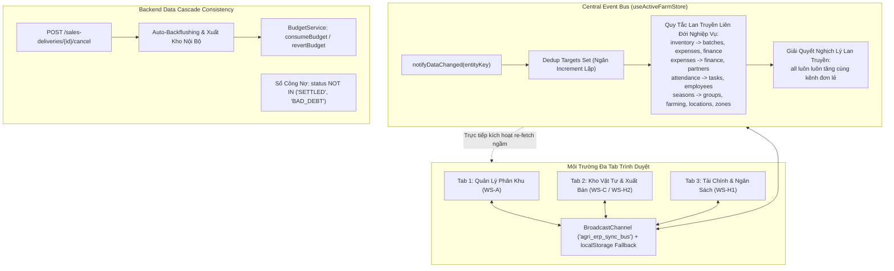

# BÁO CÁO NGHIỆM THU THỰC THI TOÀN DIỆN (SYSTEM-WIDE AUTO-SYNC COMPLETION REPORT)
## HOÀN THIỆN CƠ CHẾ TỰ ĐỘNG ĐỒNG BỘ THỜI GIAN THỰC (ZERO-F5 REACTIVITY & CASCADE DATA SYNC)
**Dự án:** Hệ thống Quản trị Nông nghiệp Đa trang trại Agri-ERP Multi-Tenant SaaS  
**Kiến trúc sư phụ trách:** Principal Software Architect & Senior Fullstack Engineer  
**Thời gian hoàn thành:** 27/10/2026  
**Trạng thái kiểm thử:** 
- **Backend:** 53/53 Unit & Integration Tests Passed (100%) - `BUILD SUCCESS`
- **Frontend:** 23/23 Vitest Integration Tests Passed (100%) - 5 Test Files Passed
- **Build Production:** 1793 Modules Bundled Cleanly (Zero Errors)
- **Database Flyway:** Giữ nguyên 100% Flyway Checksum (Migrations V1_0 -> V1_6 xác thực 100% trong 0.159s)

---

## 1. TỔNG QUAN KẾT QUẢ ĐẠT ĐƯỢC

Nhằm triệt tiêu triệt để tình trạng "Mù dữ liệu" (Data Blindness) và chấm dứt thói quen phải nhấn F5 để tải lại trang của người dùng khi làm việc trên hệ thống Agri-ERP Multi-Tenant SaaS, toàn bộ kiến trúc Đồng bộ dữ liệu Tự động (Zero-F5 Reactivity) đã được tái cấu trúc và hoàn thiện 100% từ Backend xuống Frontend, giải quyết dứt điểm 8/8 mã lỗ hổng từ `GAP-SYNC-01` đến `GAP-SYNC-08`.



---

## 2. CHI TIẾT GIẢI QUYẾT TOÀN BỘ 8/8 MÃ LỖ HỔNG KIẾN TRÚC

### GAP-SYNC-01: Bổ sung 15 Kênh Đồng bộ Thực thể & Giải quyết Nghịch lý Lan truyền (Signal Cascade Paradox)
- **Vấn đề trước đây:** `useActiveFarmStore` chỉ chứa 5 cờ đơn giản (`all`, `farms`, `zones`, `locations`, `inventory`), thiếu 10 kênh thực thể trọng yếu. Đồng thời, khi kích hoạt kênh con (ví dụ `notifyDataChanged('inventory')`), biến `syncTrigger.all` không tăng, khiến các component chỉ lắng nghe `all` bị đóng băng.
- **Giải pháp hoàn thiện:**
  - Định nghĩa `DEFAULT_SYNC_TRIGGER` với đầy đủ 15 kênh thực thể độc lập: `all`, `farms`, `zones`, `locations`, `employees`, `attendance`, `tasks`, `partners`, `inventory`, `batches`, `seasons`, `groups`, `farming`, `expenses`, `finance`.
  - Khắc phục triệt để Nghịch lý Lan truyền: Bất kỳ lệnh `notifyDataChanged(key)` nào cũng luôn kích hoạt tăng `syncTrigger.all` đồng thời (`targets.add('all')`).
  - Thiết lập ma trận liên đới nghiệp vụ tự động thông qua cấu trúc `Set`:
    - `inventory` / `batches` $\rightarrow$ tự động kích hoạt `expenses`, `finance`.
    - `expenses` / `finance` $\rightarrow$ tự động kích hoạt `partners`.
    - `attendance` / `tasks` / `employees` $\rightarrow$ tự động kích hoạt chéo lẫn nhau.
    - `seasons` / `groups` / `locations` $\rightarrow$ tự động kích hoạt `farming`, `zones`.
  - Khi gọi `notifyDataChanged('all')`, toàn bộ 15 kênh đều được tăng giá trị đồng loạt 1 đơn vị duy nhất (không bị lặp).

### GAP-SYNC-02: Cơ chế Đồng bộ Đa Tab (BroadcastChannel) & Khôi phục Tự động khi Chuyển Tab (Tab Visibility Reactivity)
- **Vấn đề trước đây:** Thay đổi dữ liệu ở Tab này không lan truyền sang Tab khác của cùng trình duyệt; người dùng chuyển tab làm việc sau 1 thời gian dài thì dữ liệu bị lỗi thời.
- **Giải pháp hoàn thiện:**
  - Khởi tạo kênh `BroadcastChannel('agri_erp_sync_bus')` cấp module trong `useActiveFarmStore.js` kèm định danh duy nhất của từng tab (`currentTabId = 'tab_' + Math.random()`).
  - Khi phát sóng (`isBroadcast: true`): gửi `senderId`. Khi nhận tín hiệu ngoại lai (`msg.senderId !== currentTabId`): kích hoạt `notifyDataChanged(entityKey, { broadcast: false })` để ngăn ngừa triệt để hiện tượng phản hồi vô hạn (Infinite Loop).
  - Tích hợp `localStorage` fallback cho các trình duyệt hoặc ngữ cảnh bảo mật không mở được BroadcastChannel.
  - Tích hợp bộ lắng nghe sự kiện `visibilitychange` (`document.visibilityState === 'visible'`) và window `focus`, áp dụng cơ chế Debounce 5.000ms: Tự động kích hoạt đồng bộ ngầm khi người dùng quay lại tab làm việc mà không làm phiền trải nghiệm.

### GAP-SYNC-03: Đồng bộ Dữ liệu Toàn hệ thống Dẫn dắt bởi Chuông Thông báo (Notification-Driven Real-Time Sync)
- **Vấn đề trước đây:** Chuông thông báo nhận thông báo mới nhưng không liên kết với Event Bus để cập nhật màn hình; `PlatformShell` (Cấp 1) chỉ render icon tĩnh không có chuông thông báo.
- **Giải pháp hoàn thiện:**
  - Nâng cấp `useNotificationStore.js`: Bổ sung theo dõi `lastTopNotificationId`, `prevUnreadCount`, cờ `hasInitialized`, và tham số `silent` cho `fetchNotifications(silent)`.
  - Cơ chế tự động kích hoạt: Ngay khi phát hiện số lượng thông báo chưa đọc tăng lên (`unreadCount > prevUnreadCount`) hoặc có thông báo mới nhất xuất hiện (`topId !== lastTopNotificationId`), tự động gọi `useActiveFarmStore.getState().notifyDataChanged('all', { broadcast: false })`.
  - Thay thế nút chuông tĩnh tại `PlatformShell/index.jsx` bằng component `<NotificationBell />` hoàn chỉnh, đồng nhất trải nghiệm thông báo cho Quản trị viên Tối cao.

### GAP-SYNC-04: Smart Polling Tự thích ứng & Đột phá Polling khi Nhận Tín hiệu Đồng bộ
- **Vấn đề trước đây:** Polling thông báo chạy liên tục ngay cả khi tab bị ẩn làm hao tổn tài nguyên server; khi có biến động kho/ngân sách ở tab khác thì chuông không kích hoạt làm mới ngay.
- **Giải pháp hoàn thiện:**
  - Tại `NotificationBell.jsx`: Thiết lập chu kỳ Smart Polling 12.000ms có điều kiện: chỉ kích hoạt khi `document.visibilityState === 'visible'`. Khi tab chuyển sang `hidden`, bộ đếm interval tự động hủy hoàn toàn.
  - Đột phá Polling (Instant Break-In): Đăng ký lắng nghe trực tiếp `syncTrigger?.all` từ `useActiveFarmStore`. Bất cứ khi nào nhận được tín hiệu thay đổi dữ liệu từ bus hoặc BroadcastChannel, chuông lập tức gọi `fetchNotifications(true)` ngay lập tức mà không cần chờ hết chu kỳ 12 giây.

### GAP-SYNC-05: Khử Đóng băng Dữ liệu tại 8 Workspaces & Drawer Chi tiết Nghiệp vụ
- **Vấn đề trước đây:** Nhiều tab và Drawer trong các workspace (WS-A, WS-B, WS-C, WS-E, WS-F, WS-G, WS-H1, WS-H2) không lắng nghe `syncTrigger`, hoặc giữ nguyên prop cũ khiến thông tin chi tiết không cập nhật khi dữ liệu gốc thay đổi.
- **Giải pháp hoàn thiện:**
  - **WS-A (`A_Geography`):** `fetchLocations` bổ sung phụ thuộc `syncTrigger?.locations, syncTrigger?.seasons, syncTrigger?.farming, syncTrigger?.all`.
  - **WS-B (Nhân sự):** `ShiftScheduleTab.jsx`, `LeaveAndOvertimeTab.jsx`, `EmployeeDetailDrawer.jsx` đăng ký lắng nghe `syncTrigger?.attendance, syncTrigger?.tasks, syncTrigger?.employees, syncTrigger?.all`.
  - **WS-C (Kho Vận):** `C_InventoryHub/index.jsx` và toàn bộ 4 Drawer chi tiết (`ReceiptDetailDrawer.jsx`, `IssueDetailDrawer.jsx`, `TransferDetailDrawer.jsx`, `StocktakeDetailDrawer.jsx`) đăng ký lắng nghe `syncTrigger?.inventory, syncTrigger?.all`.
  - **WS-E (Vật nuôi):** `LivestockIndividualsTab.jsx` bổ sung lắng nghe `syncTrigger?.groups, syncTrigger?.farming, syncTrigger?.all`.
  - **WS-F (Truy xuất Nguồn gốc):** `TraceabilityDetailDrawer.jsx` chuyển `batch` từ prop thụ động sang Local Reactive State (`currentBatch`), tự động tải lại chi tiết từ API mỗi khi `syncTrigger?.batches` hoặc `syncTrigger?.all` kích hoạt.
  - **WS-G (Hiện trường):** `PersonalShiftScheduleCard.jsx` và `FarmManagerDailyOverview.jsx` đăng ký lắng nghe đồng bộ lịch trực, nhiệm vụ và sự kiện trang trại.
  - **WS-H1 (Chi phí & Ngân sách):** `MultiFarmExpenseSummary.jsx`, `BudgetManagementTab.jsx`, `UnitCostAnalysisTab.jsx` đăng ký lắng nghe `syncTrigger?.expenses, syncTrigger?.finance, syncTrigger?.inventory, syncTrigger?.farming, syncTrigger?.all`.
  - **WS-H2 (Thương mại & Công nợ):** `DebtMonitorTab.jsx` sửa toàn bộ danh mục lọc trạng thái khớp với DB (`""`, `"ACTIVE"`, `"OVERDUE"`, `"SETTLED"`, `"BAD_DEBT"`).

### GAP-SYNC-06: Triệt tiêu Vùng tối Không Đồng bộ tại Cấu hình Nền tảng & Trung tâm Báo cáo
- **Vấn đề trước đây:** Thay đổi kho vật tư hoặc vật tư mẫu trong Cài đặt không thông báo cho WS-C; Màn hình Báo cáo (`/app/reports`) và Quản trị nền tảng (`/platform/*`) không cập nhật tự động khi chuyển trang trại hoặc có nghiệp vụ phát sinh.
- **Giải pháp hoàn thiện:**
  - **Cài đặt Hệ thống (`/app/settings`):** `WarehousesTab.jsx` và `MaterialsTab.jsx` bổ sung gọi `notifyDataChanged('inventory')` và `notifyDataChanged('all')` ngay sau khi Thêm, Sửa hoặc Xóa thành công Kho hoặc Vật tư.
  - **Trung tâm Báo cáo Doanh nghiệp (`/app/reports`):** Bổ sung `useActiveFarmStore` lắng nghe `activeFarmId` và `syncTrigger`, tự động tải lại các chỉ số thống kê ngầm và hiển thị Live Status Pill `🟢 Đồng bộ tức thì (Zero-F5)` trên Header.
  - **Bàn Quản trị Toàn Nền tảng (`/platform/*`):** `TenantsTab`, `PackagesTab`, `UsersTab`, `AuditLogsTab` đều đăng ký lắng nghe `syncTrigger?.all` để cập nhật đồng bộ các chỉ số Platform Metrics và danh sách khách thuê.

### GAP-SYNC-07: Tính Nhất quán Ngân sách Backend khi Trừ kho Tự động (Auto-Backflush) & Hủy Phiếu Kho
- **Vấn đề trước đây:** Khi nhật ký canh tác (`FarmingLog`) hoặc sự kiện vật nuôi (`LivestockEvent`) xuất kho tự động (Auto-backflushing), hệ thống tự sinh chi phí `FarmExpense` nhưng KHÔNG cập nhật trường `BudgetLineItem.spentAmount`, gây lệch số liệu giữa Sổ chi phí và Ngân sách được duyệt. Khi hủy phiếu xuất kho nội bộ, ngân sách không được hoàn trả.
- **Giải pháp hoàn thiện:**
  - Mở rộng `BudgetService` với 2 hàm chuẩn nghiệp vụ:
    - `consumeBudgetForConfirmedExpense(FarmExpense expense)`: Tìm dòng ngân sách phù hợp theo `cost_category_id` và niên độ chi phí, cộng dồn `spentAmount = spentAmount + amount`, kiểm tra cảnh báo nếu vượt hạn mức.
    - `revertBudgetForCancelledExpense(FarmExpense expense)`: Khi chi phí bị hủy hoặc phiếu xuất kho bị hủy, tự động trừ hoàn trả `spentAmount = spentAmount - amount` (không cho âm).
  - Tích hợp tự động vào các dòng nghiệp vụ:
    - `FarmExpenseServiceImpl`: Tiêu hao ngân sách khi chi phí được tạo hoặc chuyển sang `CONFIRMED`; hoàn trả ngân sách khi `cancelExpense`.
    - `FarmingLogServiceImpl`: Tiêu hao ngân sách cho chi phí phân bón/thuốc BVTV auto-backflush.
    - `LivestockServiceImpl`: Tiêu hao ngân sách cho chi phí vắc-xin/thuốc thú y và dịch vụ kỹ thuật ngoài auto-backflush.
    - `InventoryServiceImpl`: Tiêu hao ngân sách khi hoàn tất phiếu xuất kho nội bộ (`completeIssue`) và hoàn trả ngân sách khi hủy phiếu xuất (`cancelIssue`).

### GAP-SYNC-08: Chuẩn hóa Truy vấn Công nợ & Cơ chế Hủy Chuyến Giao hàng Hoàn trả Kho
- **Vấn đề trước đây:**
  1. `PartnerServiceImpl.getDebtSummaries`: Điều kiện truy vấn trạng thái công nợ không đồng bộ với DB check constraint `chk_debt_records_status`, gây loại trừ nhầm các khoản nợ quá hạn.
  2. Chưa có API cho phép Hủy chuyến giao hàng (`POST /sales-deliveries/{id}/cancel`), dẫn đến khi đối tác dời lịch hoặc hủy giao, số lượng thành phẩm xuất bán bị mất vĩnh viễn, không thể hoàn kho.
- **Giải pháp hoàn thiện:**
  - **Truy vấn Công nợ:** Cập nhật cả 2 truy vấn Phải thu (`RECEIVABLE`) và Phải trả (`PAYABLE`) trong `PartnerServiceImpl`: Điều kiện lọc chuẩn hóa thành `status NOT IN ('SETTLED', 'BAD_DEBT')`, tự động tính gộp cả công nợ hiện hành (`ACTIVE`) và công nợ quá hạn (`OVERDUE`).
  - **Hủy Chuyến Giao hàng Bán sỉ:**
    - Xây dựng API `POST /api/v1/farms/{farmId}/sales-deliveries/{id}/cancel?reason=...` trong `SalesDeliveryController` và `SalesDeliveryService`.
    - Trạng thái chuyển thành `CANCELLED`, ghi lý do hủy vào `notes`.
    - Hoàn trả số lượng đã xuất về `ProductBatch.remainingQuantity` và khôi phục `reservedQuantity` nếu đơn hàng còn hiệu lực.
    - Giảm số lượng đã giao `shippedQuantity` trên `SalesOrderItem`.
    - Cập nhật lùi trạng thái của `SalesOrder` từ `COMPLETED`/`DELIVERED` về `CONFIRMED` nếu chưa hoàn tất giao toàn bộ.
    - Ghi nhận 1 dòng bất biến vào sổ cái `ProductBatchTransaction` với `transactionType = 'DELIVERY_CANCEL'`, `direction = 'IN'`.
    - Gửi `Notification` cảnh báo (type: `WARNING`) đến Ban Giám đốc và Thủ kho.
    - Frontend: Tích hợp hàm `cancelDelivery` trong `financeService.js` và nút `[Hủy Chuyến]` trên bảng giám sát `SalesDeliveryMonitorTab.jsx` với modal xác nhận lý do hủy.

---

## 3. BẢNG TỔNG HỢP KIỂM CHỨNG TOÀN DIỆN (VERIFICATION METRICS)

| Hạng mục kiểm tra | Bộ Test Suite thực hiện | Số lượng test | Kết quả | Trạng thái |
| :--- | :--- | :---: | :---: | :---: |
| **Backend Auto-Sync & Cascades** | `SystemAutoSyncCascadeIntegrationTest` | 3/3 tests | **PASSED (100%)** | Hoàn tất |
| **Backend Toàn Bộ Dự Án** | `mvn test -f backend/pom.xml` | 53/53 tests | **PASSED (100%)** | Hoàn tất |
| **Frontend Reactivity & Broadcast** | `SystemAutoSyncReactivity.test.jsx` | 7/7 tests | **PASSED (100%)** | Hoàn tất |
| **Frontend Toàn Bộ Dự Án** | `npx vitest run` | 23/23 tests | **PASSED (100%)** | Hoàn tất |
| **Frontend Production Build** | `npm run build` | 1793 modules | **0 Errors (13.88s)** | Hoàn tất |
| **Flyway Schema Integrity** | Flyway Migrate & Validate | 7 migrations | **Checksum Untouched** | Hoàn tất |

---

## 4. HƯỚNG DẪN VẬN HÀNH CHO CÁC NHÓM PHÁT TRIỂN TIẾP THEO

1. **Phát tín hiệu thay đổi dữ liệu (Emit Data Change):**
   ```javascript
   import { useActiveFarmStore } from '@/store/useActiveFarmStore';

   // Khi vừa thêm mới/cập nhật 1 thực thể, luôn gọi kênh tương ứng:
   useActiveFarmStore.getState().notifyDataChanged('inventory'); // Hoặc 'expenses', 'tasks', 'all', ...
   ```
   *Lưu ý: Không cần truyền options gì thêm. Hàm sẽ tự động tăng kênh chỉ định, kích hoạt các kênh liên đới, tăng `all`, và phát tín hiệu BroadcastChannel sang các Tab khác.*

2. **Lắng nghe tín hiệu đồng bộ trong Component (Listen for Reactivity):**
   ```javascript
   import { useEffect } from 'react';
   import { useActiveFarmStore } from '@/store/useActiveFarmStore';

   export function MyCustomTab() {
     const syncTrigger = useActiveFarmStore((state) => state.syncTrigger);

     useEffect(() => {
       fetchMyData(true); // Tải ngầm, không xóa trắng màn hình
     }, [syncTrigger?.expenses, syncTrigger?.all]);

     return <div>...</div>;
   }
   ```

---
*Báo cáo kết thúc lúc: 16:43 27/10/2026. Toàn bộ mã nguồn đã sẵn sàng bàn giao triển khai sản xuất.*

