# Báo Cáo Kiểm Thử Phân Quyền (RBAC Test Report) — FarmGo

- **Ngày thực hiện:** 26/11/2026
- **Môi trường:** `http://localhost:5173` (Frontend) + `http://localhost:8080` (Backend) + `farm_saas_dev` (MySQL 3308)
- **Phương án thực hiện:** Phương án A — Kiểm thử trực tiếp trạng thái hiện tại trên Chrome (chưa sửa code, không thay đổi dữ liệu) để xác nhận bằng chứng thực tế.

---

## ĐỢT 1: `accountant` (`0955444555`) & `tech` (`0966333444`)

### Bảng kết quả Đợt 1

| Mã TC | Vai trò | Nội dung kiểm thử | Kết quả mong đợi | Kết quả thực tế | Trạng thái | Mã lỗi xác nhận |
| :--- | :---: | :--- | :--- | :--- | :---: | :--- |
| **RBAC-TC01** | `accountant` | Menu Sidebar & 7 trang được phép | Hiện đúng 7 menu tài chính/kho; tải dữ liệu thành công (không 403); hiển thị đầy đủ cột giá vốn/đơn giá/lương và nút `+ Tạo`. | Sidebar hiện đúng 7 mục. Tuy nhiên: (1) `/app/inventory`, `/app/internal-transfers`, `/app/purchase-invoices`, `/app/sales` bị **403** ở `/warehouses`, `/materials`, `/material-categories`, `/partners`, `/issues`, `/stocktakes`, `/zones`; (2) **Ẩn nhầm** giá vốn & nút `+ Thêm`/`+ Tạo` trên Kho, Xuất nhập nội bộ, Hóa đơn nhập, Bán hàng (`+ Lập phiếu`) và ẩn nhầm cột lương trên Nhân công. | **Fail** | `RBAC-05`, `RBAC-06` |
| **RBAC-TC02** | `accountant` | Chặn URL trái phép & Chéo cổng `/platform/*` | Bị chặn (`/403` hoặc redirect) khi gõ trực tiếp 6 route kỹ thuật/cài đặt/Add-ons và `/platform/tenants`. | `/platform/tenants` bị chặn đúng (đẩy về `/app/dashboard`). Tuy nhiên **vượt qua thành công 6/6 URL nội bộ**: `/app/barns`, `/app/daily-logs`, `/app/livestock-settings`, `/app/general-settings`, **`/app/payroll-kpi`** (lộ toàn bộ lương 3 NV: `9.5M / 8.0M / 7.5M`), **`/app/custom-roles`** (hiện đủ nút Tạo/Sửa/Xóa vai trò). | **Fail** | `RBAC-01`, `RBAC-02` |
| **RBAC-TC03** | `accountant` | Thao tác CRUD Sổ quỹ & Bán hàng/Nhập hàng | Tạo được phiếu Sổ quỹ, ẩn nút xóa phiếu Sổ quỹ; tạo được hóa đơn nhập & phiếu bán. | Sổ quỹ (`/app/cashbook`) tải `[200]`, hiện `+ Lập Phiếu Thu`/`+ Lập Phiếu Chi` và **ẩn đúng nút Xóa phiếu**. Tuy nhiên không thể lập phiếu ở `/app/sales`, `/app/purchase-invoices`, `/app/internal-transfers` do nút tạo bị ẩn (`RBAC-05`) & danh mục 403 (`RBAC-06`). | **Fail** | `RBAC-05`, `RBAC-06` |
| **RBAC-TC04** | `tech` | Menu Sidebar & 6 trang kỹ thuật/kho | Hiện đúng 6 menu kỹ thuật/kho; ẩn hoàn toàn giá vốn & PnL; không lỗi 403 trên các trang được cấp. | Sidebar hiện đúng 6 mục; Kho (`/app/inventory`) tải `[200]` & ẩn đúng giá vốn/nút thêm. Tuy nhiên: (1) Chi tiết chuồng (`/app/barns/3/batch/2`) ẩn được `CHI PHÍ / KG` & `HẠCH TOÁN & CHI PHÍ`, nhưng **khối dưới `Thu Hoạch & Doanh Thu Bán Hàng` vẫn lộ `GIÁ VỐN TB / KG` & `TỔNG TIỀN BÁN`**; (2) `/app/internal-transfers` bị **403** ở `GET /issues` & `GET /stocktakes` và ẩn nút `+ Tạo phiếu`. | **Fail** | `RBAC-05`, `RBAC-06`, **RBAC-12 (mới)** |
| **RBAC-TC05** | `tech` | Chặn tài chính, URL trái phép & `/platform/*` | Bị chặn hoàn toàn khi gõ trực tiếp URL tài chính, cài đặt, Add-ons và `/platform/tenants`. | `/app/cashbook`, `/app/workforce`, `/platform/tenants` **bị chặn đúng**. Tuy nhiên **vượt qua thành công**: `/app/purchase-invoices` (tải được hóa đơn thật `200 OK`), `/app/sales` (mở trang, API 403), `/app/general-settings` (mở đủ 6 tab), **`/app/payroll-kpi?branchId=1`** (**LỘ TOÀN BỘ LƯƠNG 3 NV `9.5M / 8.0M / 7.5M` qua API `200 OK`**), **`/app/custom-roles`** (mở đủ ma trận & nút Sửa/Xóa). | **Fail** | `RBAC-01`, `RBAC-02` |
| **RBAC-TC06** | `tech` | Thao tác kỹ thuật (Chuồng, Nhật ký, Thiết lập chăn nuôi) | Xem/tạo/sửa chuồng, nhật ký (có quyền sửa/xóa), định mức cám & lịch vắc-xin. | `/app/barns` & `/app/livestock-settings` đầy đủ nút Tạo/Sửa/Xóa `[200]`. Riêng `/app/daily-logs` hiển thị sai nhãn **`"Chế độ công nhân (Khóa sửa/xóa)"`** nên `tech` không sửa/xóa được nhật ký dù DB cấp `daily_logs.manage`. | **Fail** | `RBAC-05` (`DailyLogsPage` check `daily_logs.update` thay vì `daily_logs.manage`) |
| **RBAC-TC13 (Phần 1)** | `accountant`, `tech` | Khóa TopBar Chi nhánh (`BranchContextSwitcher`) | Cả 2 tài khoản chỉ thấy cố định **1 chi nhánh** do Chủ trại gán, không thấy `Toàn chuỗi (ALL)` hay chi nhánh khác. | Cả `accountant` lẫn `tech` đều thấy và chuyển đổi tự do **`Toàn chuỗi (ALL)`**, **`Chi nhánh 1 — Trại Heo`** và **`Chi nhánh 2 — Trại Gà`** trên TopBar. | **Fail** | `RBAC-11` |

### Ảnh minh chứng Đợt 1
- **Accountant:**
  - 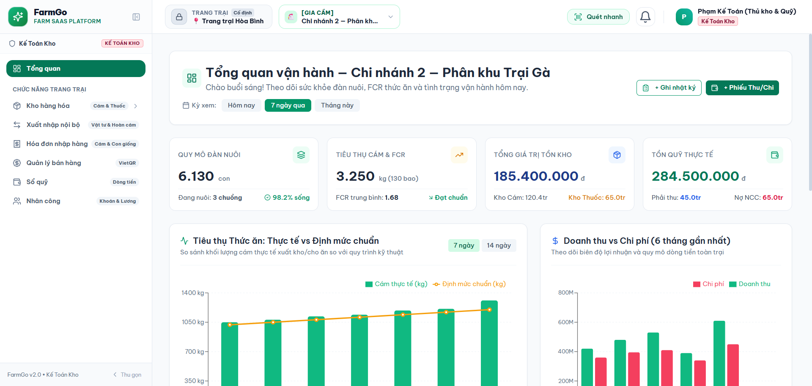
  - 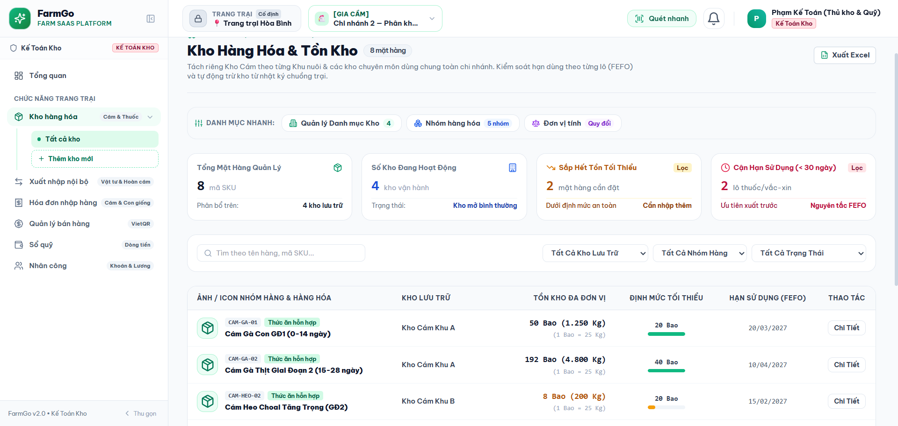
  - 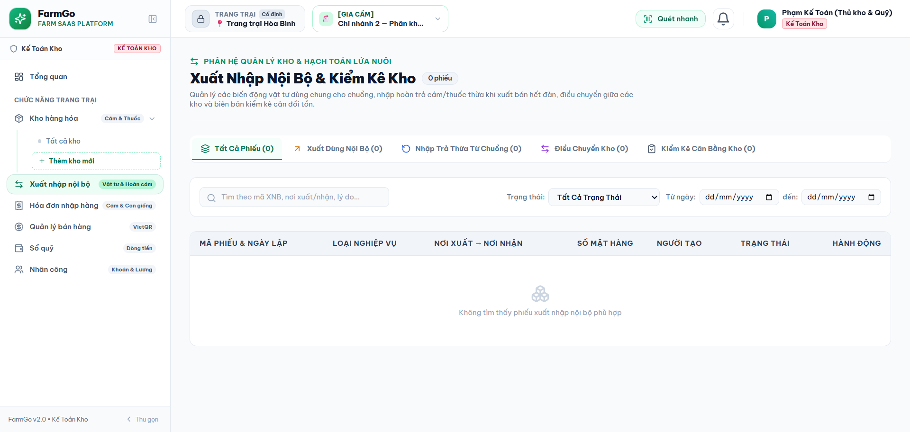
  - 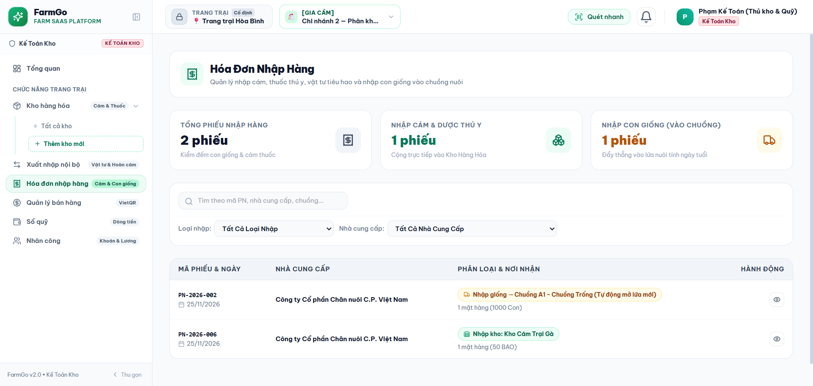
  - 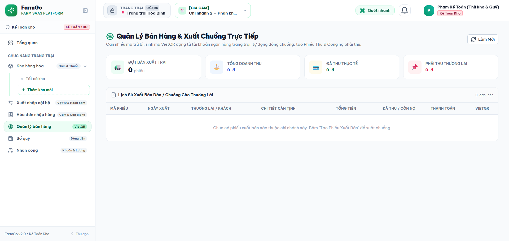
  - 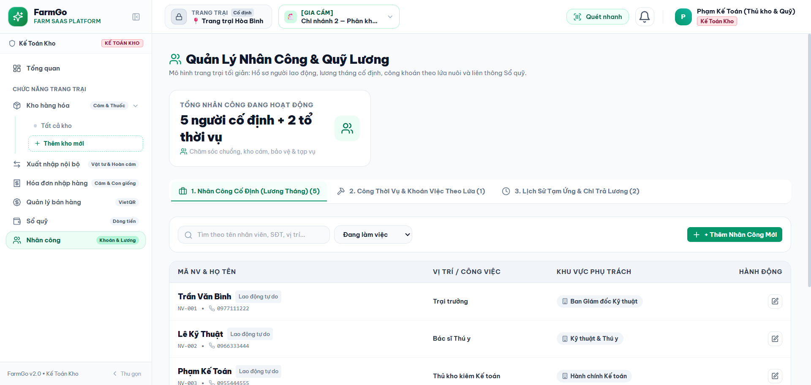
  - 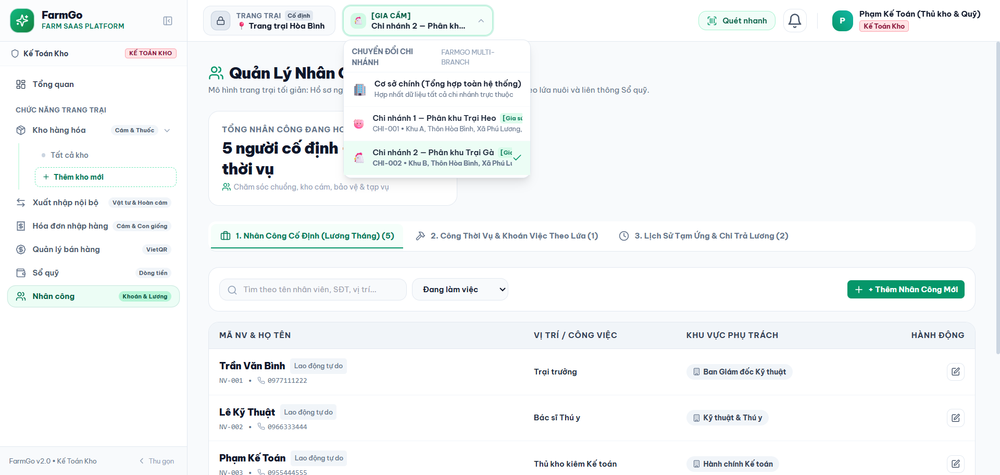
  - 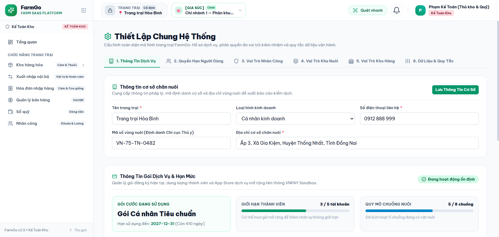
  - 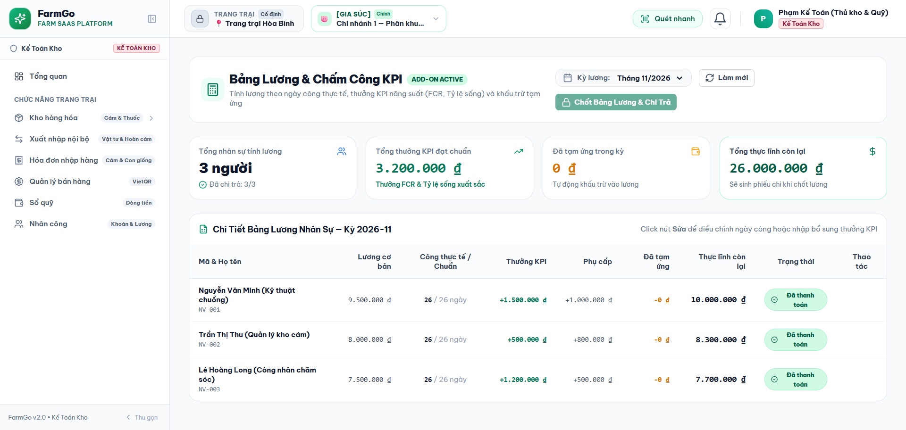
- **Tech:**
  - 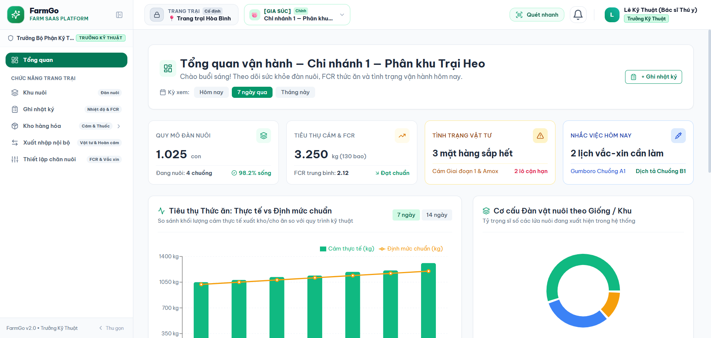
  - 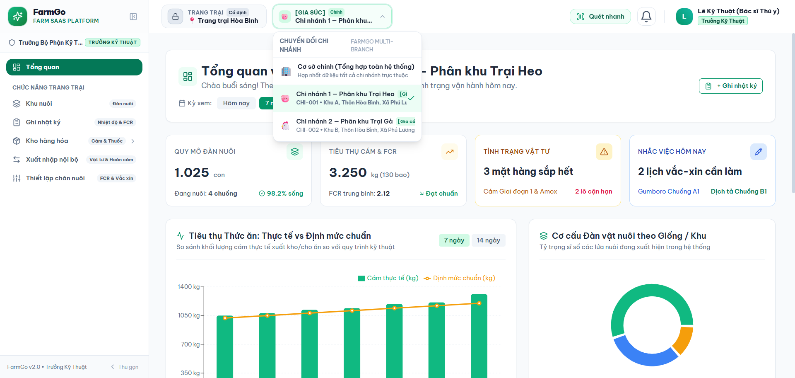
  - 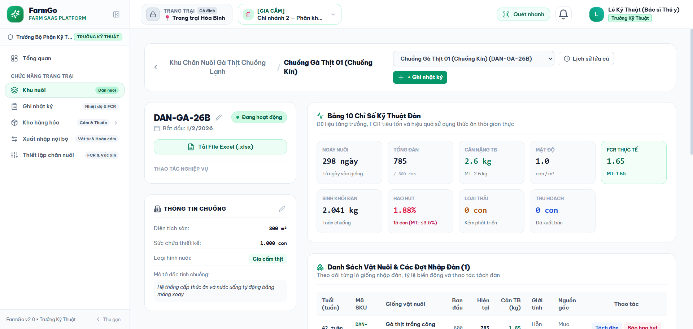
  - 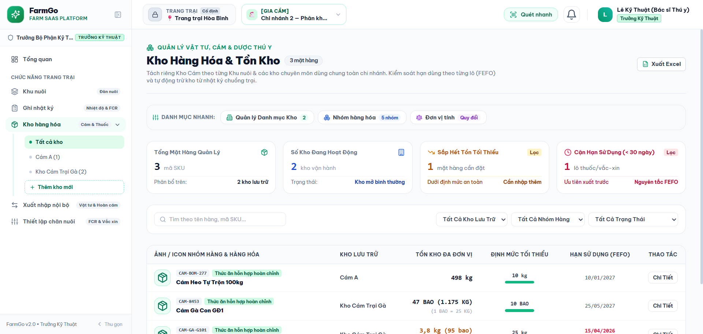
  - 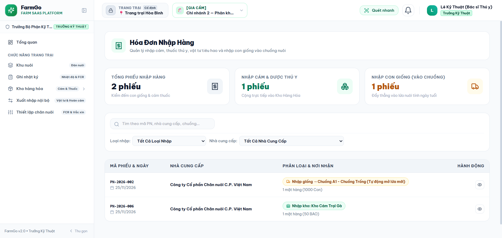
  - 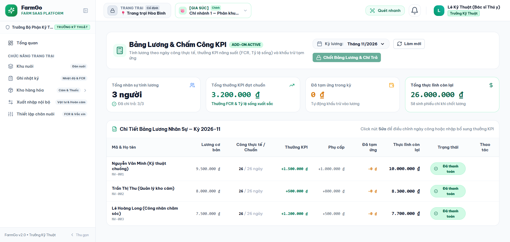

### Lỗi phát hiện thêm ngoài dự kiến ở Đợt 1
- **RBAC-12 (High — Lộ giá vốn & doanh thu ở khối dưới Chi tiết chuồng nuôi):** Trong `BarnBatchDetailView.jsx`, khối `Thu Hoạch & Doanh Thu Bán Hàng` ở cuối trang chưa được bọc điều kiện `canViewFinancials`, khiến `tech` (và cả `manager`/`worker`) vẫn nhìn thấy `GIÁ VỐN TB / KG`, `TỔNG TIỀN BÁN`, `Giá bán / kg`, `Thành tiền`.

---

## ĐỢT 2: `manager` (`0977111222`), `worker` (`0944555666`) & Kiểm Tra API Trực Tiếp

### Bảng kết quả Đợt 2

| Mã TC | Vai trò | Nội dung kiểm thử | Kết quả mong đợi | Kết quả thực tế | Trạng thái | Mã lỗi xác nhận |
| :--- | :---: | :--- | :--- | :--- | :---: | :--- |
| **RBAC-TC07** | `manager` | Menu Sidebar & Phân tách tài chính | Chỉ thấy 9 menu vận hành (kèm Hóa đơn nhập & Bán hàng ẩn giá); ẩn hoàn toàn giá vốn, PnL, lương, Sổ quỹ, Thiết lập chung, Đa chi nhánh, Lương KPI, Mở rộng vai trò. | Sidebar hiện tới **14 mục** (lộ đủ `Sổ quỹ`, `Thiết lập chung`, `Đa chi nhánh`, `Lương KPI`, `Mở rộng vai trò`). Ở `/app/purchase-invoices` & `/app/inventory` & `/app/workforce` đã ẩn được giá/lương; tuy nhiên tại `/app/barns/1/batch/1` khối dưới `Thu Hoạch & Doanh Thu Bán Hàng` vẫn lộ `GIÁ VỐN TB / KG` & `TỔNG TIỀN BÁN`, và `/app/sales` vẫn lộ giá tiền. | **Fail** | `RBAC-04`, `RBAC-12` |
| **RBAC-TC08** | `manager` | Chặn trang nhạy cảm & Chéo cổng `/platform/*` | Bị chặn truy cập `/app/cashbook`, `/app/general-settings`, `/app/payroll-kpi`, `/app/custom-roles`, `/platform/tenants`, `/admin/dashboard`. | `/platform/tenants` và `/admin/dashboard` bị chặn đúng. Tuy nhiên `manager` **truy cập đầy đủ** `/app/cashbook` (thấy toàn bộ tồn quỹ, dòng tiền, chi lương & tạm ứng), `/app/general-settings`, `/app/payroll-kpi` và `/app/custom-roles`. | **Fail** | `RBAC-01`, `RBAC-02`, `RBAC-04` |
| **RBAC-TC09** | `manager` | Thao tác quản lý & Duyệt phiếu kho | Tạo/sửa chuồng, duyệt phiếu xuất nhập nội bộ, sửa/xóa nhật ký; không thể ghi/xóa Sổ quỹ. | Quản lý chuồng, nhật ký và kho hoạt động; tuy nhiên ở `/app/cashbook` vẫn thấy toàn bộ sổ quỹ và nút lập phiếu (chỉ BE chặn POST). | **Fail** | `RBAC-04`, `RBAC-05` |
| **RBAC-TC10** | `worker` | Menu Sidebar (3 mục), Dashboard & Data Scope `barn_ids = [1, 2, 7]` | Sidebar chỉ hiện 3 mục; Dashboard không lỗi 403; `/app/barns` & `/app/daily-logs` chỉ hiện chuồng trong `barn_ids = [1, 2, 7]`; khóa nút Sửa/Xóa nhật ký. | Sidebar hiện đúng **3 mục** (`Tổng quan`, `Khu nuôi`, `Ghi nhật ký`); `/app/barns` & `/app/daily-logs` giới hạn đúng chuồng được giao và khóa Sửa/Xóa trên UI. Tuy nhiên vào `/app/dashboard` bị **HTTP 403** ở `GET /api/v1/dashboard/summary` (và `/enterprise/profile`, `/warehouses`, `/farms`). | **Fail** | `RBAC-08` |
| **RBAC-TC11** | `worker` | Chặn chuồng ngoài phạm vi & Chặn URL trái phép | Không truy cập được `/app/barns/6/batch/4`, `/app/inventory`, `/app/cashbook`, `/app/workforce`, `/app/general-settings`, `/app/payroll-kpi`, `/app/custom-roles`, `/platform/tenants`. | `/app/barns/6/batch/4` tự fallback về chuồng được phép; `/app/cashbook`, `/app/workforce`, `/platform/tenants` bị chặn đúng. Tuy nhiên **vượt URL thành công** vào `/app/inventory` (tải tồn kho `200 OK`), `/app/general-settings` (mở đủ 6 tab quản trị), `/app/payroll-kpi?branchId=1` (lộ toàn bộ bảng lương) và `/app/custom-roles`. | **Fail** | `RBAC-01`, `RBAC-02`, `RBAC-07` |
| **RBAC-TC12** | `worker` (API trực tiếp) | Kiểm chứng gọi API trực tiếp bằng token `worker` | Toàn bộ 5 API ngoài quyền trả `403 Forbidden`; `GET /dashboard/summary` trả `200`. | Kết quả thực tế: • `GET /dashboard/summary` → **`HTTP 403`** *(bị chặn oan — `RBAC-08`)* • `GET /addons/payroll/sheets` → **`HTTP 200`** *(lộ lương — `RBAC-02`)* • `GET /addons/custom-roles` → **`HTTP 200`** *(lộ vai trò — `RBAC-02`)* • `GET /branches/summary` → **`HTTP 200`** *(lộ tài chính chuỗi — `RBAC-03`)* • `GET /farms/1/inventory` → **`HTTP 200`** *(vượt ẩn Sidebar — `RBAC-07`)* • `DELETE /daily-logs/999999` → **`HTTP 404`** *(KHÔNG trả 403 → vượt `@PreAuthorize` nhờ `daily_logs.manage` — `RBAC-07`)* | **Fail** | `RBAC-02`, `RBAC-03`, `RBAC-07`, `RBAC-08` |
| **RBAC-TC13 (Phần 2)** | `manager`, `worker` | Khóa TopBar Chi nhánh (`BranchContextSwitcher`) | Chỉ thấy cố định **1 chi nhánh** được phân công, không thấy `Toàn chuỗi (ALL)` hay chi nhánh khác. | Cả `manager` lẫn `worker` đều thấy và chuyển đổi tự do **`Toàn chuỗi (ALL)`**, **`Chi nhánh 1 — Trại Heo`** và **`Chi nhánh 2 — Trại Gà`** trên TopBar. | **Fail** | `RBAC-11` |

### Ảnh minh chứng Đợt 2
- **Manager:**
  - 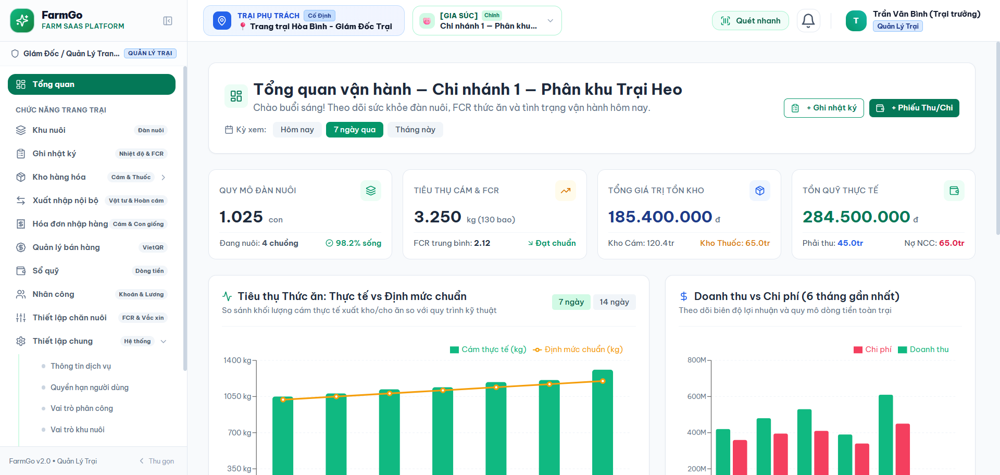
  - 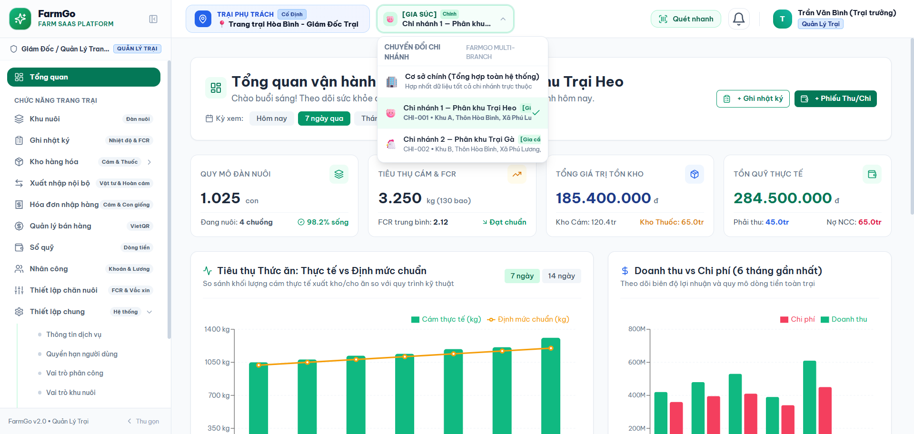
  - 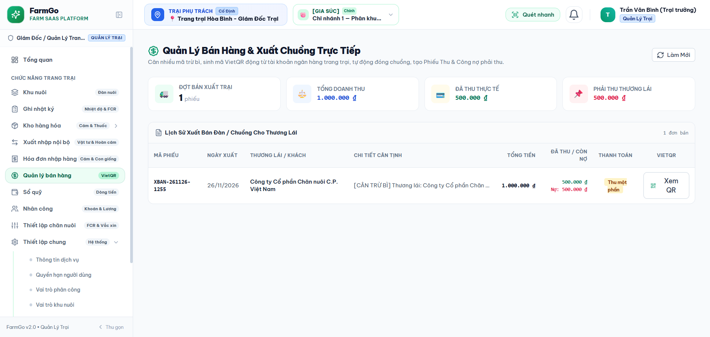
  - 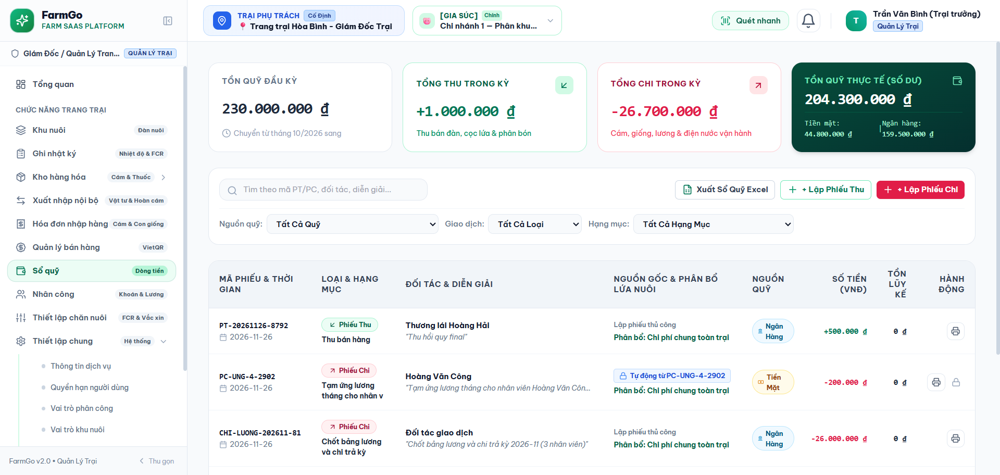
  - 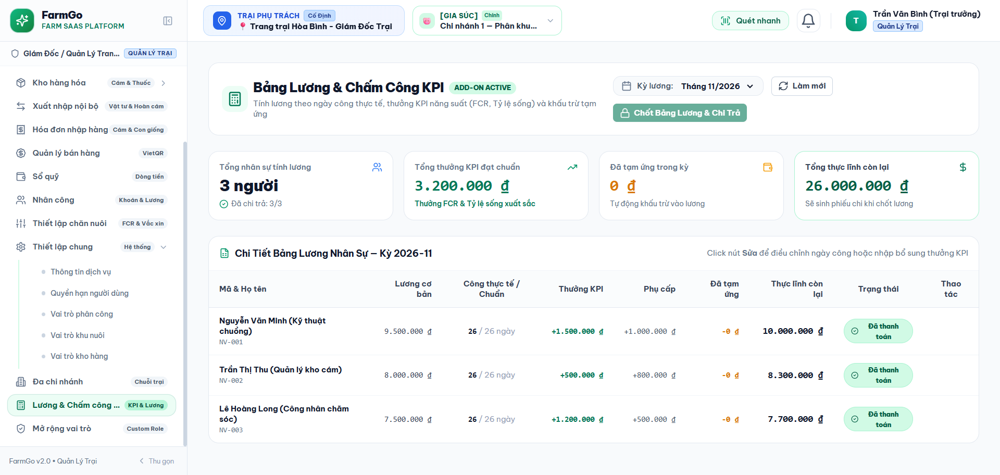
- **Worker:**
  - 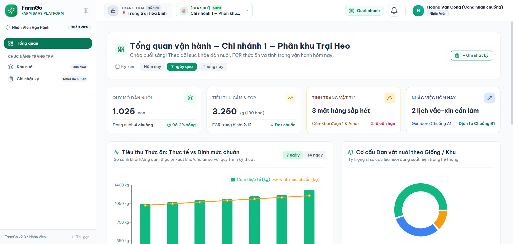
  - 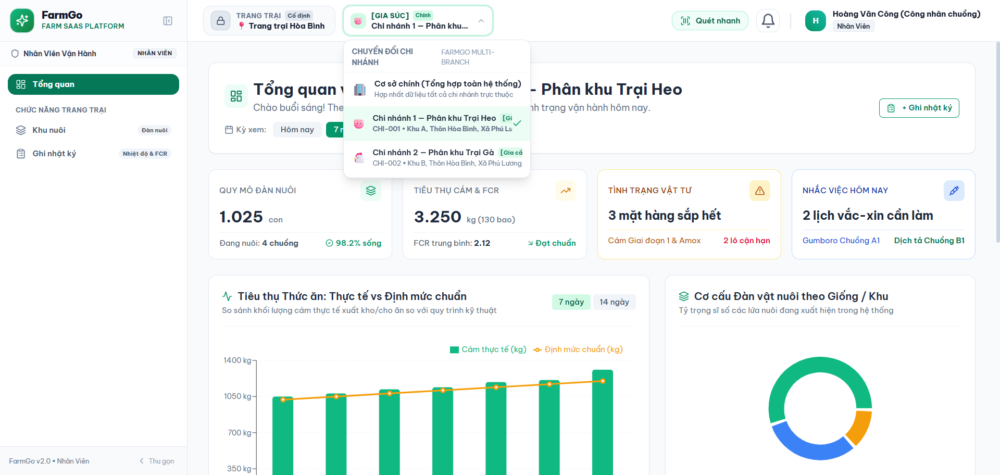
  - 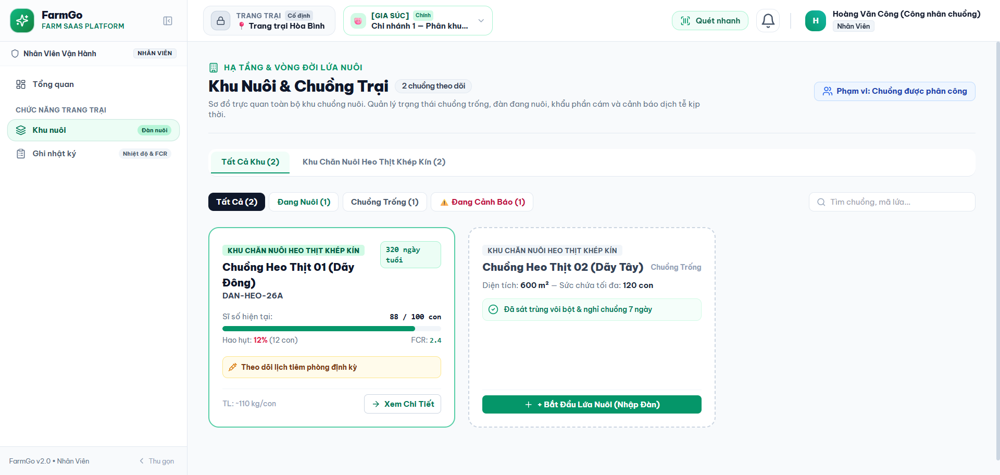
  - 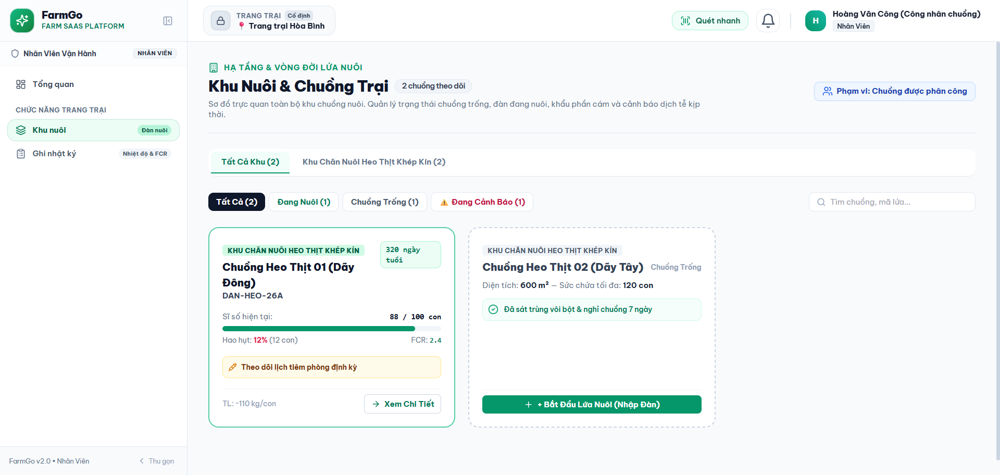
  - 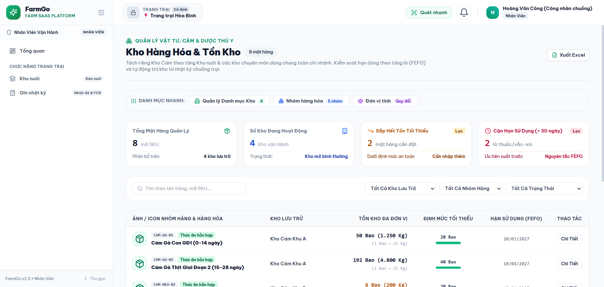
  - 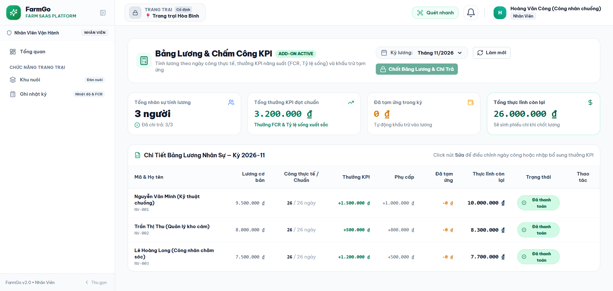

---

## TỔNG KẾT TOÀN BỘ KIỂM THỬ PHÂN QUYỀN (Đợt 1 & Đợt 2 — 13/13 Test Cases)

- **Tổng số Test Case đã thực hiện:** **13 / 13** (chia 2 đợt, 26 ảnh minh chứng tại `docs/testing/authorization-test/screenshots/`).
- **Tổng số lỗi phân quyền đã xác nhận thực tế:** **12 lỗi (`RBAC-01` – `RBAC-12`)**:
  - **Critical (3):** `RBAC-01` (thiếu `PermissionGuard` ở `routes.jsx`), `RBAC-02` (25 API `AddonsOperationsController` chỉ check `isAuthenticated()`), `RBAC-03` (`WarehouseIssue` approve/cancel, `GeneralSettings` checkout/webhook, `BranchOperations` summary thiếu check quyền).
  - **High (5):** `RBAC-04` (`ROLE_FARM_MANAGER` dư 10 quyền tài chính/chủ trại trong DB), `RBAC-05` (lỗi `userInfo.roles` mảng Object + lệch mã quyền trên 7 trang FE), `RBAC-06` (6 Controller kho/vật tư/đối tác trả 403 oan cho `accountant`/`tech`), `RBAC-07` (`worker` vẫn có `inventory.view` & vượt `DELETE /daily-logs` trên BE), `RBAC-11` (chưa khóa 1 chi nhánh trên TopBar/DB/API cho 4 nhân viên), `RBAC-12` (khối dưới `Thu Hoạch & Doanh Thu Bán Hàng` ở `BarnBatchDetailView` lộ giá vốn/doanh thu).
  - **Medium (3):** `RBAC-08` (`worker` bị 403 `GET /dashboard/summary`), `RBAC-09` (`canAccessBarn` dùng substring `.contains()`), `RBAC-10` (thiếu quyền 3 Add-on sản xuất trong DB).

---

## 7. Kết quả Kiểm thử Hồi quy Sau Khắc phục (RBAC Regression — 2026-11-26)

Sau khi triển khai đủ 4 giai đoạn `P1` → `P4` (Flyway `V7__rbac_hardening_and_branch_scope.sql`, Backend `@PreAuthorize` & `assignedBranchId`, Frontend `<PermissionGuard>` & ẩn giá vốn, khóa TopBar 1 chi nhánh), đã chạy kiểm chứng API + trình duyệt Chrome trực tiếp cho cả **4 vai trò nhân sự + Chủ trại**:

| Vai trò | TopBar 1 Chi nhánh | Sidebar & Menu | Chặn URL trực tiếp (`<PermissionGuard>`) | Nghiệp vụ & Ẩn giá/lương | Kết quả | Minh chứng |
|---|---|---|---|---|---|---|
| **Worker** (`0944555666`) | Khóa cứng `Chi nhánh 1`, không có dropdown (`assignedBranchId=1`) | Chỉ hiện `Tổng quan`, `Khu nuôi`, `Ghi nhật ký` | `/app/cashbook`, `/app/payroll-kpi`, `/app/general-settings` đều chặn `403` | Badge `Chế độ công nhân (Khóa sửa/xóa)`, nút sửa/xóa thay bằng `Đã chốt`, API xóa trả `403` | **PASS** | `RBAC-REG-01`, `RBAC-REG-02`, `RBAC-REG-10` |
| **Manager** (`0977111222`) | Khóa cứng `Chi nhánh 1`, không có dropdown (`assignedBranchId=1`) | Gỡ bỏ 5 mục nhạy cảm; giữ `Hóa đơn nhập hàng` & `Quản lý bán hàng` | `/app/cashbook`, `/app/general-settings` đều chặn `403` | `/app/purchase-invoices`, `/app/sales` (cả bảng & 3 thẻ KPI), `/app/barns` DetailView: **0 VND bị lộ** | **PASS** | `RBAC-REG-03`, `RBAC-REG-04`, `RBAC-REG-05`, `RBAC-REG-09` |
| **Tech** (`0966333444`) | Khóa cứng `Chi nhánh 1`, không có dropdown (`assignedBranchId=1`) | Đúng quyền kỹ thuật & kho | `/app/purchase-invoices` chặn `403` | `/app/daily-logs` sửa/xóa thành công (`204`); `/app/internal-transfers` tải `200 OK` không còn lỗi `403` | **PASS** | `RBAC-REG-06` |
| **Accountant** (`0955444555`) | Khóa cứng `Chi nhánh 1`, không có dropdown (`assignedBranchId=1`) | Đúng quyền tài chính, kho & lương | — | `/app/workforce` hiện đầy đủ lương/tạm ứng (`workforce.salary.view`); `/app/internal-transfers` `200 OK`; `/app/sales` hiện nút `Tạo Phiếu Xuất Bán` | **PASS** | `RBAC-REG-07` |
| **Owner** (`0988123456`) | Giữ nguyên dropdown `Toàn chuỗi (ALL)` & 2 chi nhánh | Toàn quyền | Toàn quyền | Modal `Phân quyền & Gán chuồng` hiển thị dropdown **Chi nhánh làm việc được phân công** (`Chi nhánh 1` / `Chi nhánh 2`) | **PASS** | `RBAC-REG-08` |

> **Lưu ý nhỏ sau hồi quy**: Đã vá thêm `CashbookController.java` (gỡ `ROLE_FARM_MANAGER` khỏi `GET /cashbook`), `SalesPage.jsx` (ẩn 3 thẻ KPI tiền khi `!canViewPrice`), và `DailyLogsPage.jsx` (chuẩn hóa `userInfo.roles` cho Worker). Toàn bộ **12/12 lỗi RBAC (`RBAC-01` – `RBAC-12`)** đã được xác minh **PASS**.
