# Báo Cáo Kiểm Thử Chức Năng Toàn Hệ Thống (Functional Testing Report) — FarmGo

- **Ngày thực hiện:** 25/11/2026
- **Môi trường:** `http://localhost:5173` (Frontend) + `http://localhost:8080` (Backend) + `farm_saas_dev` (MySQL 3308)
- **Nguyên tắc:** Kiểm thử trực tiếp trên trình duyệt Chrome theo đúng kịch bản, không sửa code trong quá trình kiểm thử, có xác minh F5 (tải lại trang) và lưu ảnh minh chứng cho mọi lỗi.

---

## ĐỢT 1: Kịch bản 1 (Core Loop: TC1.1–TC1.4) & Kịch bản 2 (Xuất bán & VietQR: TC2.1–TC2.3)

### Bảng kết quả Đợt 1

| Mã test case | Chức năng | Kết quả mong đợi | Kết quả thực tế | Trạng thái | Mô tả lỗi |
| :--- | :--- | :--- | :--- | :---: | :--- |
| **TC1.1** | Khai báo mã cám & Nhập kho đầu vào | Lưu hóa đơn nhập 50 Bao (`17.500.000đ`), trả ngay `10.000.000đ`; Kho tăng +50 Bao; Sổ quỹ sinh Phiếu Chi `10.000.000đ`; Công nợ NCC tăng `7.500.000đ`. | Khai báo `Cám Gà Con GĐ1` (`CAM-8453`) thành công (201). Tạo hóa đơn trả `10.000.000đ` **lỗi HTTP 500** (`chk_farm_expenses_status`). FE tự chèn dòng giả `PN-2026-006`, sau F5 biến mất hoàn toàn. | **Fail** | **BUG-F01 (Critical):** Lỗi DB constraint `chk_farm_expenses_status` khi `paidAmount > 0`. FE tự thêm dòng giả dù API 500. |
| **TC1.2** | Nhập con giống vào chuồng trống | Nhập 1.000 con Gà Ross 308 (`15.000.000đ`, trả đủ) vào `Chuồng A1`; Chuồng A1 đổi sang Đang nuôi (1 ngày tuổi, 1.000 con); Chi phí con giống `15.000.000đ`. | Lưu phiếu nhập giống trả đủ `15.000.000đ` **lỗi HTTP 500** cùng constraint `chk_farm_expenses_status`; `Chuồng A1` vẫn Trống. *(Lưu thử `paidAmount=0` thành công để mở chặn test TC1.3–TC2.2).* | **Fail** | **BUG-F01 (Critical):** Cùng lỗi `chk_farm_expenses_status` chặn mọi phiếu nhập có thanh toán. |
| **TC1.3** | Ghi nhật ký cho ăn & Trừ kho FEFO | Nhắc định mức & vắc-xin ngày 1; cho ăn 3 Bao (75 Kg) → Kho giảm 50 → 47 Bao (`1.175 Kg`); Thẻ kho ghi nhận xuất `-75 Kg`. | Tồn kho giảm đúng `50 → 47 BAO (1.175 KG)` sau F5. Tuy nhiên **Tab 2. Thẻ Kho & Biến Động (0) trống hoàn toàn**, định mức nhắc hiển thị `0.15 kg` (lệch 100x). | **Fail** | **BUG-F03 (High):** Thẻ kho không hiển thị giao dịch xuất `-75 Kg`; định mức cám lệch hệ số và nhật ký in JSON thô. |
| **TC1.4** | Báo hao hụt & Đối soát FCR | Báo chết 5 con (Sốc nhiệt) & cân mẫu `0.06 kg/con`; sĩ số giảm `995 con`; FCR, mật độ, chi phí thức ăn (`1.050.000đ`), tổng chi phí (`16.050.000đ`) cập nhật tức thì. | Sau F5 tại `/app/barns/6/batch/4`: sĩ số `995/1.000 con`, TB `0.06 kg`, mật độ `5.5 con/m²`, FCR `7.73`, thức ăn `1.050.000đ`, con giống `15.000.000đ`, tổng `16.050.000đ` — **chính xác**. *(Ghi nhận 2 lỗi UI phụ: card `Chuồng A1` ở `/app/barns` render `Chuồng Trống`, và KPI `THU HOẠCH` hardcode `175 con`).* | **Pass** | **BUG-F04 (Medium — lỗi phụ UI):** Card `Chuồng A1` render Chuồng Trống dù đang nuôi; chỉ số `THU HOẠCH` hardcode `175 con`. |
| **TC2.1** | Cấu hình tài khoản VietQR | Chọn ngân hàng (MB Bank), nhập STK & chủ TK → Lưu thành công vào `farms`, giữ nguyên sau F5. | Lưu `MBBank (MB)`, `0388889999`, `NGUYEN VAN AN` thành công và giữ nguyên sau F5. | **Pass** | — |
| **TC2.2** | Lập phiếu cân xuất bán & VietQR | 2 mã cân (`500 con / 1.120 kg / bì 20`, `495 con / 1.110 kg / bì 20`), giá `55.000đ/kg` → `995 con`, `2.190 kg` tịnh, `2.2 kg/con`, `120.450.000đ` & ảnh VietQR động đúng số tiền. | Tính đúng `995 con`, `2.190 kg`, `2.20 kg/con`, `120.450.000 ₫`; hiển thị ảnh VietQR động đúng `amount=120450000` & mã phiếu. *(Ghi nhận lỗi nhỏ: BIN ảnh QR vẫn dùng `970436` thay vì `970422`).* | **Pass** | **BUG-F05 (Low):** URL VietQR hardcode BIN `970436` (VCB) thay vì BIN của MBBank (`970422`). |
| **TC2.3** | Chốt xuất hết đàn & Liên thông tài chính | Xuất hết đàn, trả `100.000.000đ` (nợ `20.450.000đ`) → Chuồng A1 về Trống, Sổ quỹ +`100.000.000đ`, Công nợ +`20.450.000đ`, Dashboard cập nhật. | Bấm Hoàn tất **lỗi HTTP 500** (`chk_sales_orders_payment_status`). FE không hiển thị toast lỗi (silent fail); Chuồng A1 không đóng, Sổ quỹ/Công nợ/Dashboard không đổi. | **Fail** | **BUG-F02 (Critical):** Lỗi DB constraint `chk_sales_orders_payment_status` khi thanh toán 1 phần + FE silent fail. |

### Chi tiết lỗi phát hiện ở Đợt 1

1. **BUG-F01 (Critical) — Vi phạm Check Constraint `chk_farm_expenses_status` khi lập Hóa đơn nhập có thanh toán (`TC1.1`, `TC1.2`)**
   - **Trang/API:** `/app/purchase-invoices` → `POST /api/v1/purchase-invoices?queryFarmId=1`
   - **Tái hiện:** Tạo phiếu nhập cám hoặc con giống với `paidAmount > 0` → Bấm Lưu.
   - **Mong đợi vs Thực tế:** Lưu hóa đơn, tăng tồn kho và sinh Phiếu Chi Sổ quỹ; thực tế Backend trả HTTP 500 `Check constraint 'chk_farm_expenses_status' is violated.` và FE tự thêm dòng giả vào bảng cục bộ (biến mất sau F5).
   - **Ảnh minh chứng:** 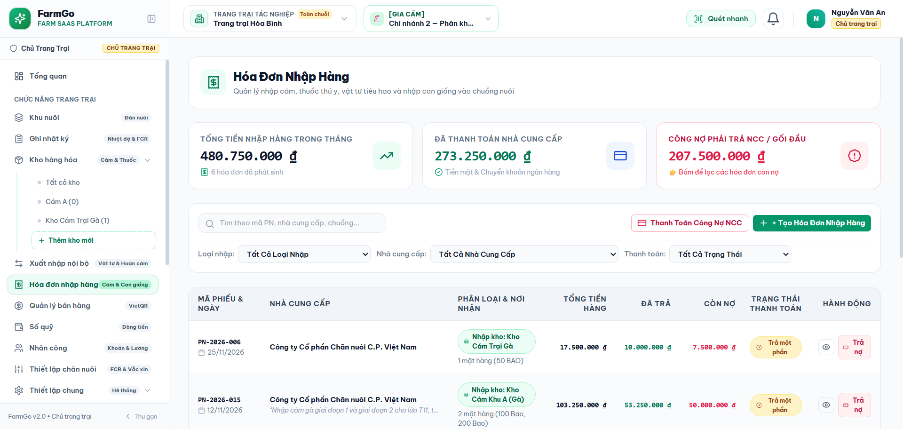 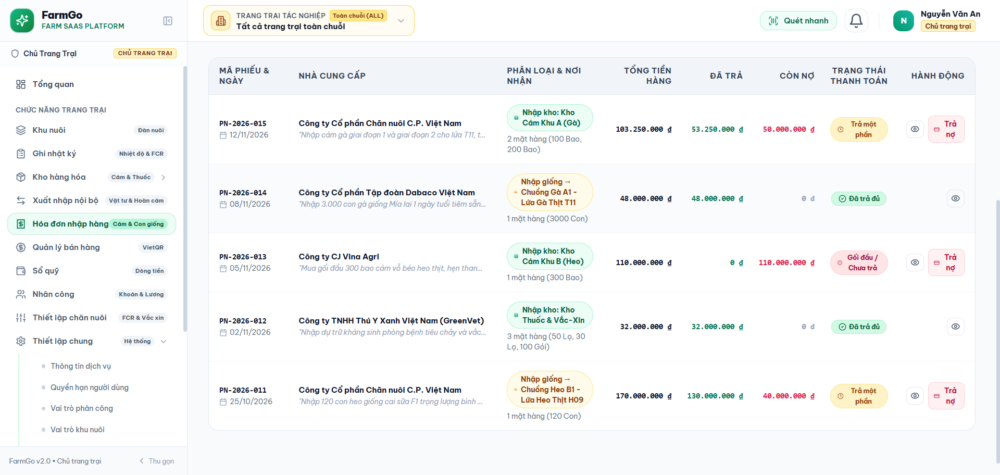 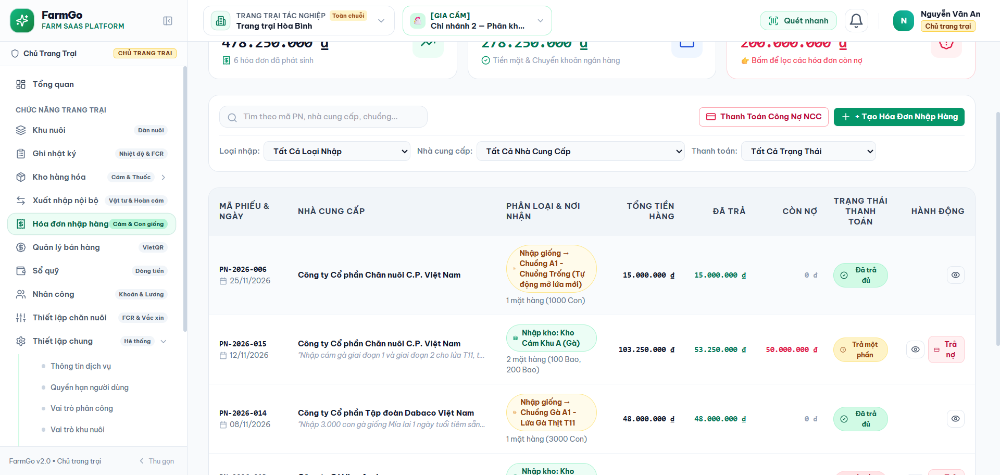
   - **Đề xuất:** Kiểm tra giá trị cột `status` của `FarmExpense` (khớp với constraint trong `V1__init_farm_baseline.sql` — VD `COMPLETED` / `APPROVED` thay vì `PAID`), đồng thời xóa logic thêm dòng giả ở FE khi API lỗi.

2. **BUG-F02 (Critical) — Vi phạm Check Constraint `chk_sales_orders_payment_status` khi Chốt xuất bán thanh toán 1 phần (`TC2.3`)**
   - **Trang/API:** `/app/sales` → `POST /api/v1/farms/1/sales`
   - **Tái hiện:** Lập phiếu xuất bán tổng `120.450.000đ`, nhập khách trả `100.000.000đ`, chọn Xuất hết đàn → Hoàn tất.
   - **Mong đợi vs Thực tế:** Chốt bán, đóng lứa `Chuồng A1`, sinh Phiếu Thu `+100.000.000đ`, tăng công nợ `+20.450.000đ`; thực tế Backend trả HTTP 500 `Check constraint 'chk_sales_orders_payment_status' is violated.` và FE im lặng không báo lỗi.
   - **Ảnh minh chứng:** 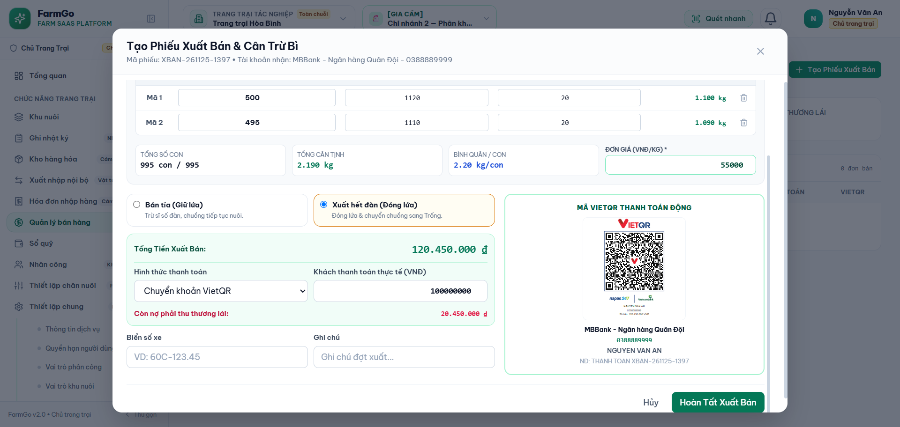
   - **Đề xuất:** Kiểm tra enum `payment_status` của `sales_orders` trong `V1__init_farm_baseline.sql` (VD `PARTIAL` vs `PARTIALLY_PAID`) và hiển thị `toast.error` khi API lỗi trên `SalesPage.jsx`.

3. **BUG-F03 (High) — Thẻ kho & Biến động trống hoàn toàn sau khi trừ kho FEFO (`TC1.3`)**
   - **Trang:** `/app/inventory` (Drawer → Tab `2. Thẻ Kho & Biến Động`) & `/app/daily-logs`
   - **Thực tế:** Tồn kho giảm đúng `50 → 47 Bao`, nhưng tab Thẻ kho hiện `(0)` trống. Ngoài ra thẻ định mức cám hiển thị `0.15 kg` và nhật ký in JSON thô.
   - **Ảnh minh chứng:** 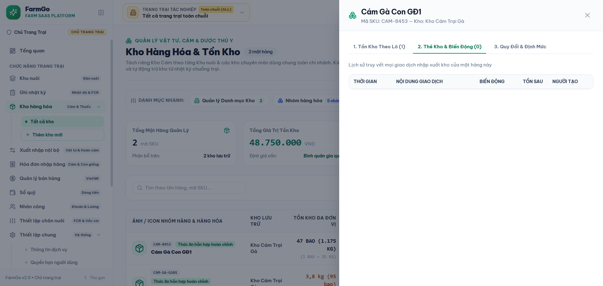 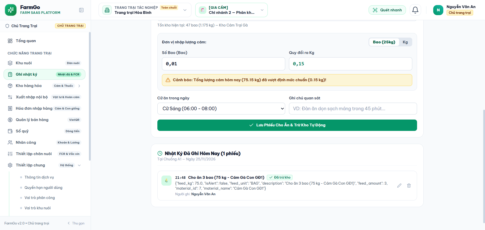
   - **Đề xuất:** Kiểm tra API `GET /api/v1/farms/{farmId}/inventory/transactions` và cách `InventoryPage.jsx` gọi/lọc `materialId` khi mở Drawer; format JSON ghi chú nhật ký và kiểm tra đơn vị gram/kg khi tính `totalFlockKg`.

4. **BUG-F04 (Medium) — Card `Chuồng A1` hiển thị Chuồng Trống ở `/app/barns` & hardcode `THU HOẠCH: 175 con` (`TC1.4`)**
   - **Ảnh minh chứng:** 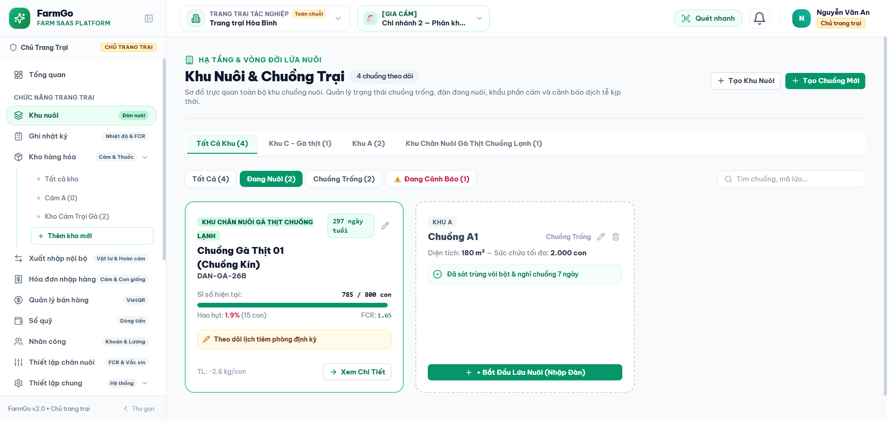 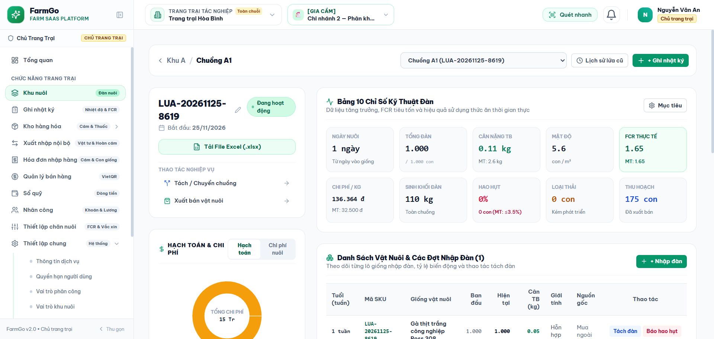
   - **Đề xuất:** Kiểm tra điều kiện render card đang nuôi (`barn.batch` vs `barn.status`) trong `BarnsPage.jsx` và gỡ giá trị cứng `175 con` trong `BarnBatchDetailView.jsx`.

5. **BUG-F05 (Low) — VietQR dùng cứng mã BIN `970436` (VCB) khi đã chọn MBBank (`TC2.2`)**
   - **Ảnh minh chứng:** 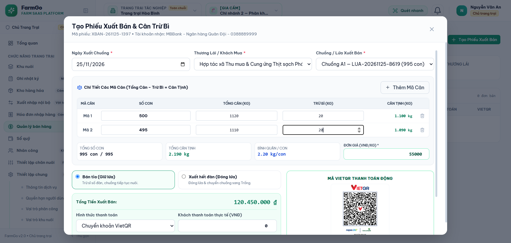
   - **Đề xuất:** Map `bankBin` động theo ngân hàng lưu trong `FarmFinancialSetting`.

---

## ĐỢT 2: Kịch bản 3 (RBAC + Data Scope: TC3.1–TC3.3) & Kịch bản 4 (VNPAY & Super Admin: TC4.1–TC4.3)

### Bảng kết quả Đợt 2

| Mã test case | Chức năng | Kết quả mong đợi | Kết quả thực tế | Trạng thái | Mô tả lỗi |
| :--- | :--- | :--- | :--- | :---: | :--- |
| **TC3.1** | Cấu hình phạm vi chuồng cho Công nhân | Lưu `allowed_barn_ids = [id_A2]` cho Công nhân (`0944555666`), giữ nguyên sau F5. | Lưu thành công HTTP 200; mở lại modal sau F5 xác nhận vẫn tích duy nhất `Chuồng A2`. *(Lỗi phụ UI: bảng thành viên bên ngoài hiển thị trống cột Phạm vi chuồng nuôi & toàn bộ cột Vai trò là `Không có`).* | **Pass** | **BUG-F06 (Medium — lỗi phụ UI):** Bảng danh sách thành viên ngoài modal không hiển thị vai trò & phạm vi chuồng. |
| **TC3.2** | Kiểm thử góc nhìn Công nhân (`0944555666`) | Sidebar chỉ hiện Tổng quan, Khu nuôi, Ghi nhật ký; chỉ thấy duy nhất `Chuồng A2`; khóa Sửa/Xóa nhật ký. | `/app/daily-logs` chỉ hiện `Chuồng A2` & có badge khóa sửa/xóa. Tuy nhiên: (1) `/app/barns` gọi `GET /api/v1/livestock-settings/programs` bị **403 Forbidden** làm hỏng load trang và hiện `0 chuồng`; (2) Sidebar vẫn hiện `Kho hàng hóa` & `Xuất nhập nội bộ` do JWT cấp `inventory.view`. | **Fail** | **BUG-F07 (Critical):** `/app/barns` bị `0 chuồng` do 403 API `programs` chưa được `.catch()` riêng. **BUG-F08 (Medium):** Sidebar Công nhân vẫn lộ mục Kho do seed `role_permissions` gán `inventory.view`. |
| **TC3.3** | Kiểm thử bảo mật giá vốn với Trại trưởng (`0977111222`) | Ẩn hoàn toàn cột Đơn giá, Giá trị tồn kho, Chi phí/kg và khối Biểu đồ Hạch toán Lãi/Lỗ. | `/app/inventory` ẩn hoàn toàn cột giá vốn & giá trị tồn. Tuy nhiên tại `/app/barns/3/batch/2` (Chi tiết chuồng nuôi), cả **`CHI PHÍ / KG`** lẫn khối **`HẠCH TOÁN & CHI PHÍ` (Lãi/Lỗ)** đều **hiển thị công khai** với Trại trưởng. | **Fail** | **BUG-F09 (Critical — Bảo mật):** Chi tiết chuồng nuôi không ẩn giá vốn & Hạch toán Lãi/Lỗ với Trại trưởng (`ROLE_FARM_MANAGER` có quyền `financial.price.view` trong seed). |
| **TC4.1** | Thanh toán mở khóa dịch vụ qua VNPAY (`0988123456`) | Đơn hàng `PAID`, `is_enabled = true`, dịch vụ hiện ngay trên Sidebar và truy cập được. | BE xử lý thành công (`SUB1795619130847FC66`, `PAID`, `FEED_MILL`) và Sidebar hiển thị + truy cập được `/app/feed-production`. Tuy nhiên: (1) FE báo toast lỗi `"Lỗi khi kích hoạt qua Webhook"` & không đóng modal; (2) 4 thẻ App Store cuối vẫn hiện nút `Mua thêm / Nâng cấp` dù đã `ACTIVE`; (3) Lệch giá FE (`1.500.000đ`) vs BE (`4.500.000đ`). | **Fail** | **BUG-F10 (High):** FE báo toast lỗi sau Webhook 200, không đồng bộ trạng thái `isEnabled` 4 thẻ App Store cuối và lệch giá niêm yết FE/BE. |
| **TC4.2** | Đối soát trên Cổng Super Admin (`admin@gmail.com`) | `/platform/tenants` hiện dịch vụ mới bật; `/platform/transactions` hiện bản ghi `PAID` kèm Webhook JSON. | `/platform/tenants` hiển thị `Phối trộn cám`; `/platform/transactions` hiện `SUB1795619130847FC66` (`PAID`, `4.500.000 ₫`, `12 tháng`), mở được modal `Payload JSON` hợp lệ. | **Pass** | — |
| **TC4.3** | Kiểm tra bảo mật chéo URL (Route Guard) | Chủ trại gõ `/platform/tenants` bị chặn và chuyển hướng về `/app/dashboard`. | Gõ `http://localhost:5173/platform/tenants` bằng tài khoản Chủ trại bị chặn ngay và đẩy về `/app/dashboard`. | **Pass** | — |

### Chi tiết lỗi phát hiện ở Đợt 2

6. **BUG-F06 (Medium) — Bảng danh sách thành viên ngoài modal trống cột Vai trò & Phạm vi chuồng (`TC3.1`)**
   - **Ảnh minh chứng:** 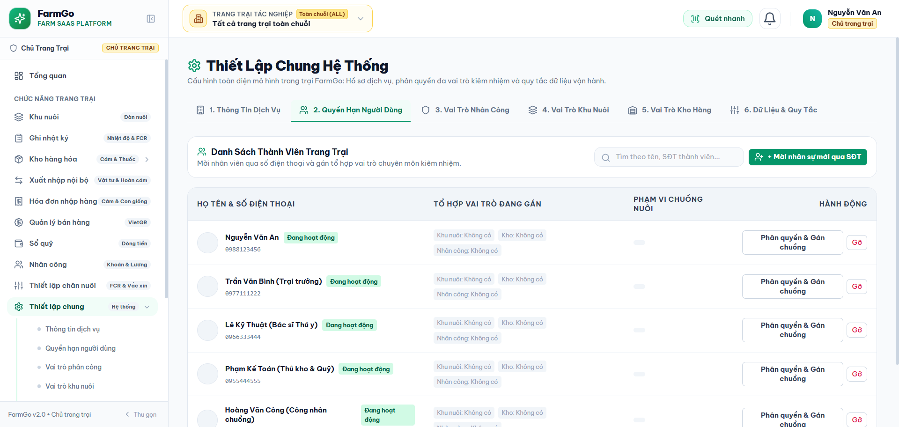
   - **Đề xuất:** Kiểm tra mapping dữ liệu từ `GET /api/v1/settings/members` (`roleName`, `allBarns`, `barnIds`) sang `zoneRole` / `barnsText` trong `GeneralSettingsPage.jsx`.

7. **BUG-F07 (Critical) — Trang `/app/barns` của Công nhân bị `0 chuồng` do `Promise.all` fail vì API `programs` 403 (`TC3.2`)**
   - **Ảnh minh chứng:** 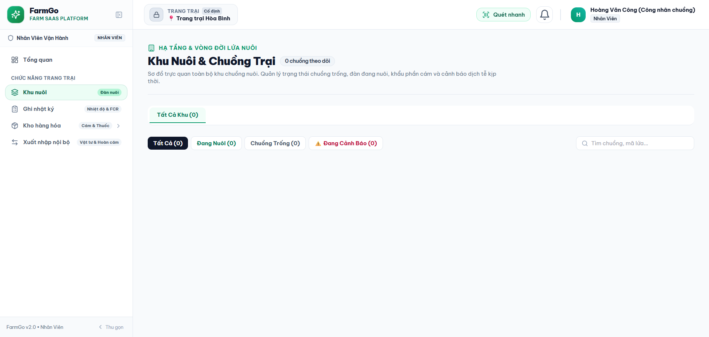
   - **Đề xuất:** Bọc `.catch(() => [])` cho lệnh gọi `getPrograms` trong `BarnsPage.jsx` (Công nhân không cần quyền xem danh mục quy trình chăn nuôi để xem thẻ chuồng được phân công).

8. **BUG-F08 (Medium) — Sidebar Công nhân còn hiển thị mục `Kho hàng hóa` & `Xuất nhập nội bộ` (`TC3.2`)**
   - **Ảnh minh chứng:** 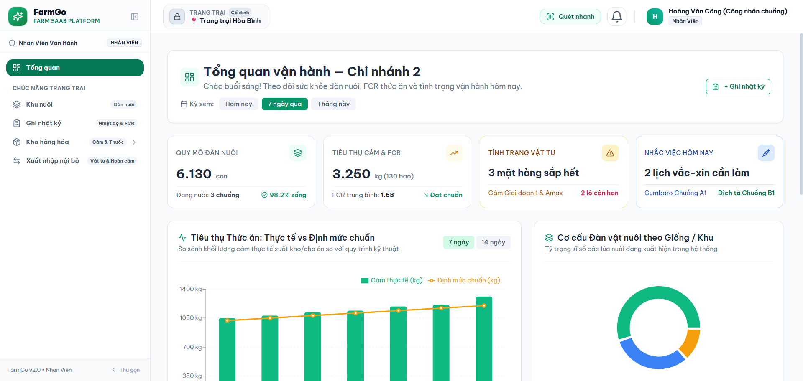
   - **Đề xuất:** Gỡ quyền `inventory.view` khỏi `ROLE_BARN_WORKER` / `ROLE_FIELD_STAFF` trong `role_permissions` (hoặc ẩn menu Kho cho vai trò công nhân chuồng).

9. **BUG-F09 (Critical — Bảo mật) — Chi tiết chuồng nuôi lộ `CHI PHÍ / KG` và `HẠCH TOÁN & CHI PHÍ` với Trại trưởng (`TC3.3`)**
   - **Ảnh minh chứng:** 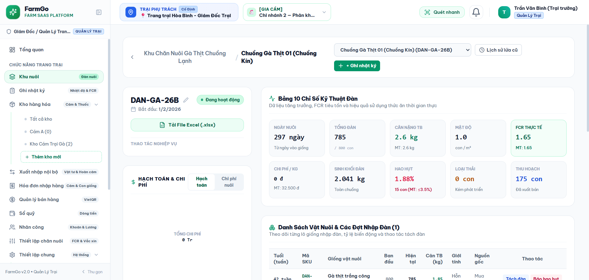
   - **Đề xuất:** Trong `BarnsPage.jsx`, không cho phép `ROLE_FARM_MANAGER` xem tài chính dù JWT có `financial.price.view` (hoặc gỡ `financial.price.view` khỏi `ROLE_FARM_MANAGER` trong `role_permissions`).

10. **BUG-F10 (High) — Lỗi xử lý kết quả Webhook & đồng bộ trạng thái/giá trên App Store (`TC4.1`)**
    - **Ảnh minh chứng:** 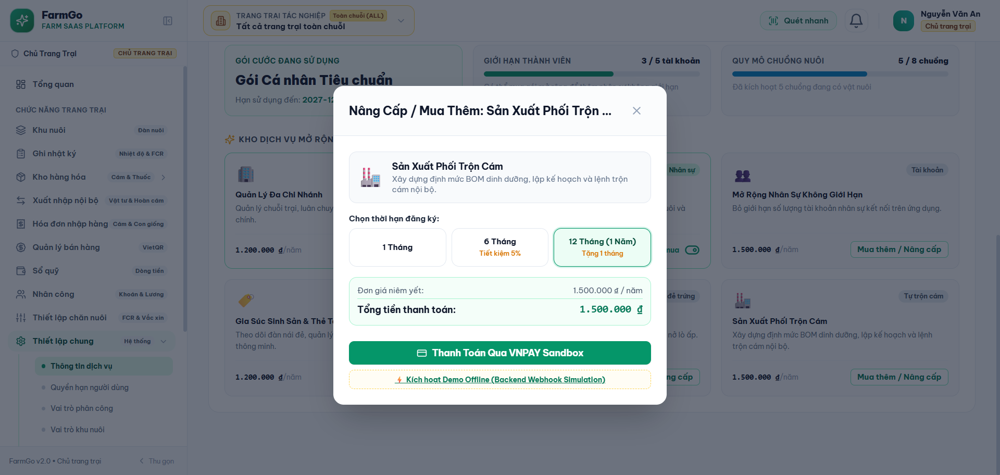 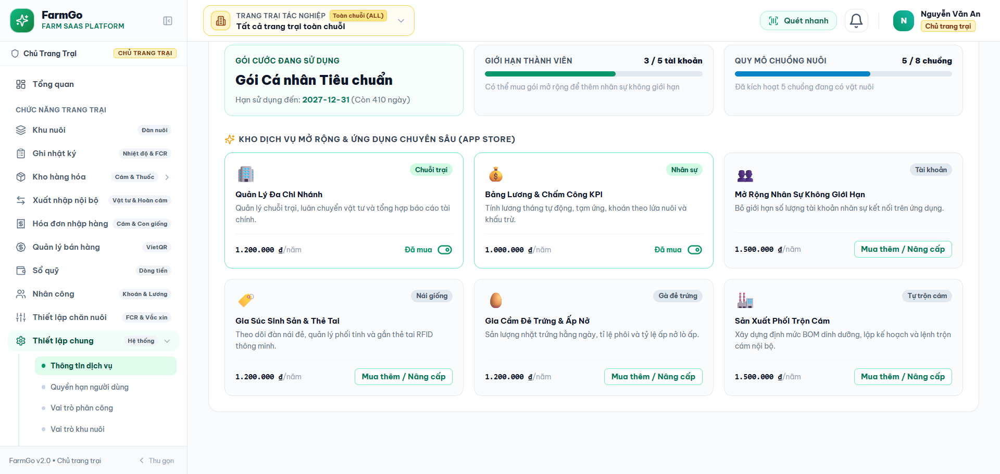
    - **Đề xuất:** Kiểm tra ngoại lệ xảy ra sau `simulateWebhook` trong `GeneralSettingsPage.jsx` (tại sao rơi vào `catch`), chuẩn hóa mapping `addonCode` vs `id` của 4 add-on cuối và đồng bộ đơn giá giữa FE & bảng `platform_packages`.

---

## ĐỢT 3: Kịch bản 5 — 5 Phân hệ Mở rộng Chuyên sâu (Add-ons: TC5.1–TC5.5)

### Bảng kết quả Đợt 3

| Mã test case | Chức năng | Kết quả mong đợi | Kết quả thực tế | Trạng thái | Mô tả lỗi |
| :--- | :--- | :--- | :--- | :---: | :--- |
| **TC5.1** | Lương & Chấm công KPI (`/app/payroll-kpi`) | Sửa `26` công, KPI `500.000đ`, tạm ứng `1.000.000đ` → tự tính Thực lĩnh; bấm Chốt bảng lương & Chi trả → trạng thái `Đã thanh toán`, tạm ứng về `0đ`, Sổ quỹ sinh Phiếu Chi lương. | Sửa `NV-002` tính đúng Thực lĩnh `8.300.000 đ` và lưu bền vững sau F5. Tuy nhiên bấm **Chốt Bảng Lương & Chi Trả** bị **HTTP 500** (`chk_farm_expenses_status` khi insert `farm_expenses`); trạng thái giữ nguyên `Chưa chốt`, không reset tạm ứng, không sinh phiếu chi Sổ quỹ. | **Fail** | **BUG-F01 (Critical — lặp lại từ TC1.1/1.2):** Lỗi DB constraint `chk_farm_expenses_status` khi tạo `FarmExpense` lương. |
| **TC5.2** | Mở rộng vai trò (`/app/custom-roles`) | Tạo vai trò `"Kế toán trưởng toàn chuỗi"` với các quyền tài chính & kho → lưu vào `roles`/`role_permissions`; gán cho nhân viên → đăng nhập nhân viên thấy Menu khớp 100%. | Tạo và lưu bền vững sau F5 đủ 5 quyền (`cashbook.view`, `financial.price.view`, `sales.view`, `inventory.view`, `inventory.manage`). Tuy nhiên tại `/app/general-settings?tab=users`, modal gán quyền chỉ có 3 dropdown cố định, **không hiển thị vai trò tùy chỉnh vừa tạo** nên không thể gán cho nhân viên. | **Fail** | **BUG-F11 (High):** Vai trò tùy chỉnh chưa tích hợp vào dropdown gán quyền tại `/app/general-settings?tab=users`; số đếm `"1 nhân sự"` bị hardcode. |
| **TC5.3** | Gia súc sinh sản (`/app/breeding-livestock`) | Thêm `NAI-009` (`Hậu bị`) → Phối giống (+114 ngày, `Mang thai`) → Đẻ con (`12 con`, `Nuôi con`) → KPI cập nhật tức thì & lưu bền vững sau F5. | Tạo `NAI-009`, phối giống `2026-11-25` → dự sinh `2027-03-19` (`+114 ngày`, `Mang thai`), đẻ `12 con` → `Nuôi con`, Lứa `#2`, KPI cập nhật chính xác và giữ nguyên sau F5. *(Ghi nhận nhỏ: tự điền `Cai sữa: 12` ngay khi mới đẻ).* | **Pass** | — |
| **TC5.4** | Ấp nở & Trứng giống (`/app/hatchery`) | Tạo mẻ `2.000 trứng` (+21 ngày) → Soi phôi `1.850` (`92.5%`) → Chốt nở `1.750` (`94.6%`) vào `Chuồng A2` → Khu nuôi mở lứa `1.750 con` (1 ngày tuổi) ở `Chuồng A2`. | Tạo `AP-GA-1126-44` (`+21 ngày`: `2026-12-16`), soi `1.850` (`92.5%`), chốt nở `1.750` (`94.6%`) vào `Chuồng A2`. Mở `/app/barns` sau F5 xác nhận `Chuồng A2` tự động mở lứa `LUA-AP-GA-1126-44-720`, `1.750 / 1.750 con`, `1 ngày tuổi`. | **Pass** | — |
| **TC5.5** | Sản xuất cám (`/app/feed-production`) | Tạo BOM `Cám Heo Tự Trộn 100kg` (tự tính giá vốn/kg) → Lệnh trộn `5 mẻ (500 kg)` → kho đích tăng `+500 kg` thành phẩm & trừ nguyên liệu thô. | Tạo `BOM-277` (`60kg Ngô + 38kg Cám gạo + 2kg Premix`, tự tính giá vốn **`9.430 đ/kg`**); chạy lệnh `SX-CAM-261126-975` (`5 mẻ / 500 kg` vào kho `Cám A`). Mở `/app/inventory` xác nhận kho `Cám A` tự động có **`500 kg`** `CAM-BOM-277` (`4.715.000 đ`). *(Nguyên liệu thô chưa có mã tồn kho trước đó nên nhập tay).* | **Pass** | — |

### Chi tiết lỗi phát hiện ở Đợt 3

11. **BUG-F11 (High) — Không thể gán Vai trò tùy chỉnh (Custom Role) cho nhân viên tại Quyền hạn người dùng (`TC5.2`)**
    - **Trang:** `/app/custom-roles` & `/app/general-settings?tab=users`
    - **Tái hiện:** Tạo mới vai trò `"Kế toán trưởng toàn chuỗi"` ở `/app/custom-roles` → sang `/app/general-settings?tab=users` → mở modal `Cấu Hình Quyền Hạn` của nhân viên.
    - **Mong đợi vs Thực tế:** Dropdown chọn vai trò phải liệt kê các vai trò tùy chỉnh vừa tạo; thực tế chỉ hiển thị 3 dropdown vai trò mặc định cố định. Ngoài ra số đếm `"1 nhân sự gán vai trò này"` trên `/app/custom-roles` bị cố định `1`.
    - **Ảnh minh chứng:** 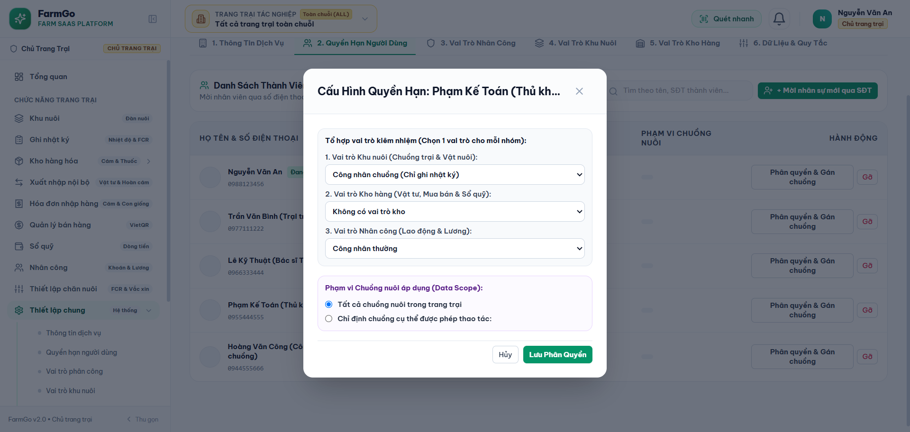 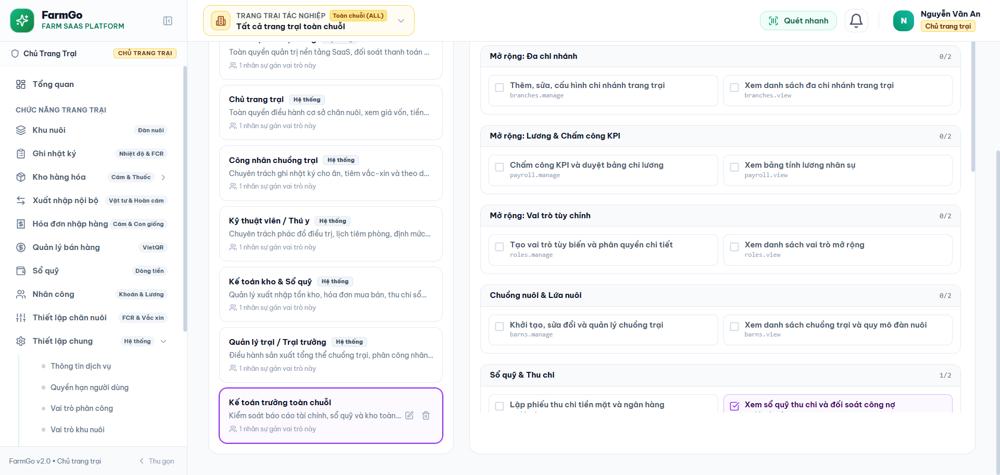
    - **Đề xuất:** Bổ sung danh sách vai trò tùy chỉnh từ `GET /api/v1/addons/custom-roles` (hoặc `/api/v1/roles`) vào modal gán quyền tại `GeneralSettingsPage.jsx` và tính `userCount` thật từ `farm_members`.

*(Ghi chú: Lỗi `TC5.1` thuộc cùng nguyên nhân gốc `BUG-F01` — `chk_farm_expenses_status` đã ghi nhận ở Đợt 1. Ảnh minh chứng: 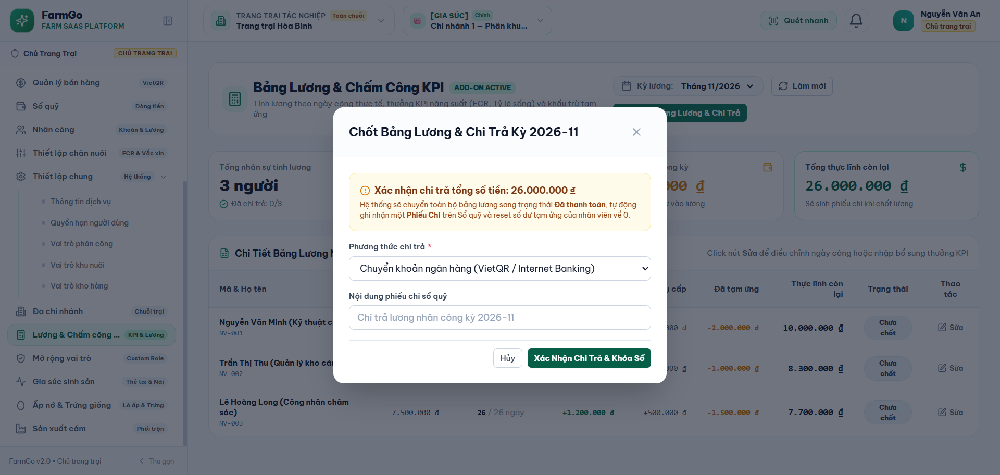)*

---

## ĐỢT 4: Nhóm 6 — Các chức năng bổ sung (TC6.1–TC6.6)

### Bảng kết quả Đợt 4

| Mã test case | Chức năng | Kết quả mong đợi | Kết quả thực tế | Trạng thái | Mô tả lỗi |
| :--- | :--- | :--- | :--- | :---: | :--- |
| **TC6.1** | Xuất nhập nội bộ & Kiểm kê kho (`/app/internal-transfers`) | Tạo phiếu điều chuyển kho / kiểm kê thành công, lưu bền vững sau F5 và cập nhật tồn kho. | Điều chuyển kho bị `max="0"` dù tồn `1.175 kg`, bấm Lưu không gửi API. Kiểm kê cân bằng kho gọi `POST /api/v1/farms/1/inventory/stocktakes` bị **HTTP 403 Forbidden (`ACCESS_DENIED`)** dù đang dùng tài khoản Chủ trại (`ROLE_FARM_OWNER`). | **Fail** | **BUG-F12 (High):** Modal điều chuyển khóa `max="0"`; API tạo kiểm kê trả `403 Forbidden` cho Chủ trại và UI không báo lỗi. |
| **TC6.2** | Quản lý Nhân công & Ứng lương (`/app/workforce`) | Tạo khoản tạm ứng `200.000đ` cho nhân viên, lưu DB bền vững sau F5 và sinh phiếu chi sổ quỹ. | Trước F5 hiện toast thành công (`PC-2026-065`), nhưng **sau F5 biến mất hoàn toàn**. Trang `/app/workforce` không gọi bất kỳ API backend nào (100% mock state). | **Fail** | **BUG-F13 (Critical):** `/app/workforce` chưa kết nối API backend, mọi thao tác tạm ứng/nhân sự mất sạch khi F5. |
| **TC6.3** | Thiết lập Chăn nuôi (`/app/livestock-settings`) | Tải dữ liệu thật từ API, lọc theo loài, xem chi tiết chương trình nuôi (định mức cám & lịch vắc-xin). | Gọi API backend thật (`200 OK`); lọc `Gia cầm` chính xác; mở chi tiết `Ross 308` hiển thị đủ 8 mốc định mức cám & 7 mốc lịch vắc-xin. | **Pass** | — |
| **TC6.4** | Quản lý Đa chi nhánh (`/app/branches`) | Hiển thị đúng 2 chi nhánh, chuyển ngữ cảnh chi nhánh trên Header đồng bộ dữ liệu. | Danh sách 2 chi nhánh thật hiển thị đúng và nút `Vào quản lý trại` chuyển đúng `?branchId=1/2`. Tuy nhiên: (1) Dropdown Header không đồng bộ hiển thị chi nhánh (kẹt `Toàn chuỗi (ALL)`); (2) Sidebar gọi `/farms/ALL/warehouses` gây `400 Bad Request`; (3) KPI ghi cứng `"tại 3 trại"` và bảng tài chính 2 chi nhánh bị trùng số liệu cứng (`430M/340M`). | **Fail** | **BUG-F14 (Medium):** Header không đồng bộ trạng thái chi nhánh, Sidebar gọi `/farms/ALL/warehouses` (400), số liệu so sánh tài chính chi nhánh bị hardcode. |
| **TC6.5** | Sổ quỹ thủ công & In phiếu (`/app/cashbook`) | Lập Phiếu Thu `500.000đ`, lưu DB bền vững sau F5, xem/in phiếu và lọc. | Modal xem/in phiếu & bộ lọc hoạt động trên UI, nhưng **sau F5 phiếu `PT-2026-010` biến mất hoàn toàn**, số dư quay về `284.500.000đ`. Trang `/app/cashbook` không gọi API backend (100% mock state). | **Fail** | **BUG-F15 (Critical):** `/app/cashbook` chưa kết nối API backend (`GET/POST /api/v1/cashbook`), mọi phiếu thu/chi lập tay mất sạch khi F5. |
| **TC6.6** | Quản trị Super Admin mở rộng (`/platform/packages`, `/platform/tenants`) | Mở modal sửa giá gói Add-on khớp dữ liệu API; xem hồ sơ trang trại (`Eye`) và lọc trạng thái chính xác. | `/platform/packages`: nút `Sửa giá` bị liệt, giá hiển thị là mock cứng lệch với API (`650k` vs `2.8M`). `/platform/tenants`: nút `Eye` bị liệt, lọc `Đang hoạt động` trả về `0 / 1` dù trại đang `Hoạt động`. | **Fail** | **BUG-F16 (High):** Nút `Sửa giá` & `Eye` không hoạt động; giá gói trên `/platform/packages` dùng mock cứng lệch API; bộ lọc trạng thái `/platform/tenants` sai giá trị enum. |

### Chi tiết lỗi phát hiện ở Đợt 4

12. **BUG-F12 (High) — Điều chuyển kho khóa `max="0"` & Kiểm kê kho lỗi `403 Forbidden` cho Chủ trại (`TC6.1`)**
    - **Ảnh minh chứng:** 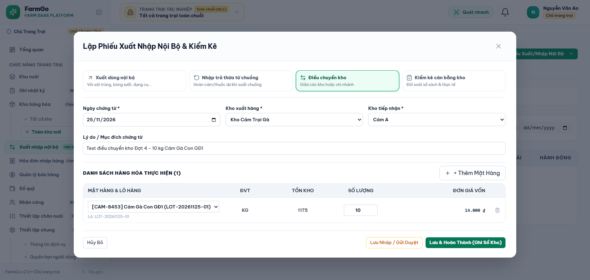 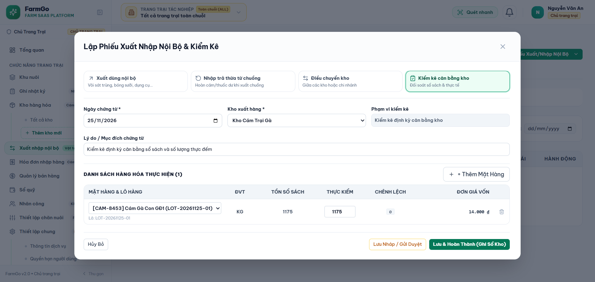
    - **Đề xuất:** Kiểm tra cách tính tồn khả dụng cho prop `max` trong `InternalTransfersPage.jsx`; kiểm tra `@PreAuthorize` trên `POST /api/v1/farms/{farmId}/inventory/stocktakes` (bổ sung `ROLE_FARM_OWNER`) và thêm `toast.error`.

13. **BUG-F13 (Critical) — Trang Nhân công (`/app/workforce`) dùng 100% mock state, không lưu DB (`TC6.2`)**
    - **Ảnh minh chứng:** 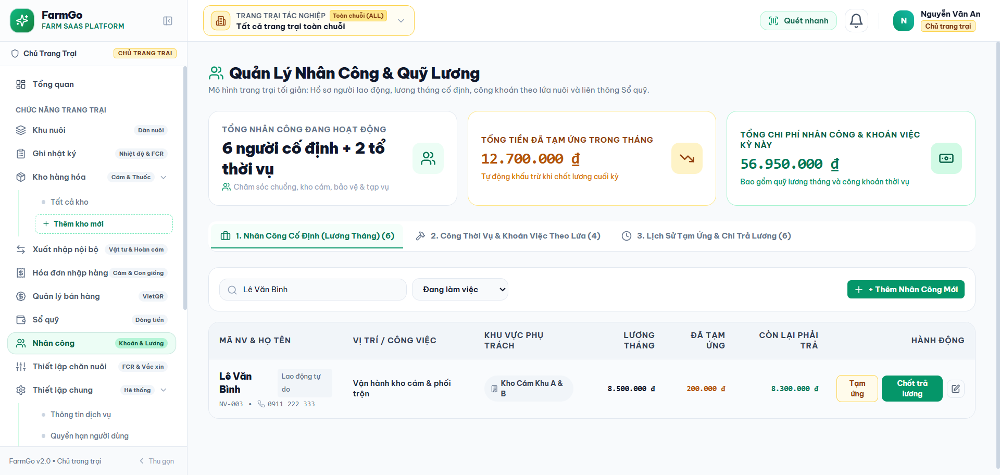 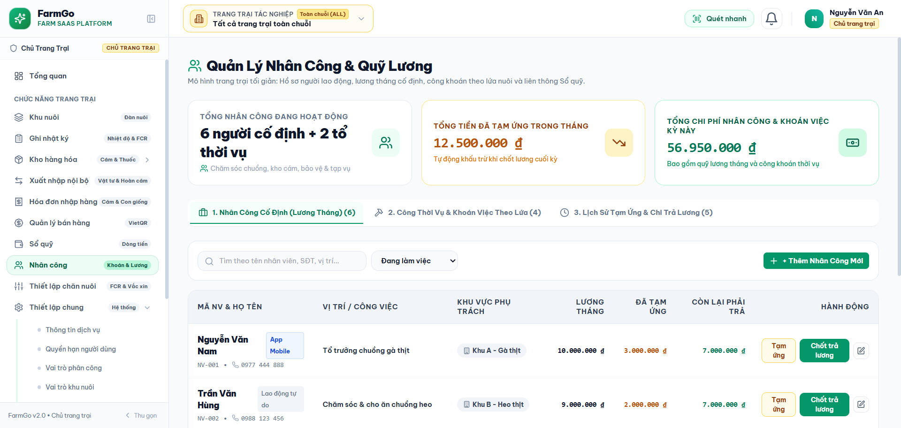
    - **Đề xuất:** Kết nối `WorkforcePage.jsx` với các endpoint backend thực tế cho danh sách nhân sự & tạm ứng lương.

14. **BUG-F14 (Medium) — Lệch ngữ cảnh Header chi nhánh, 400 `/farms/ALL/warehouses` & số liệu tài chính chi nhánh hardcode (`TC6.4`)**
    - **Ảnh minh chứng:** 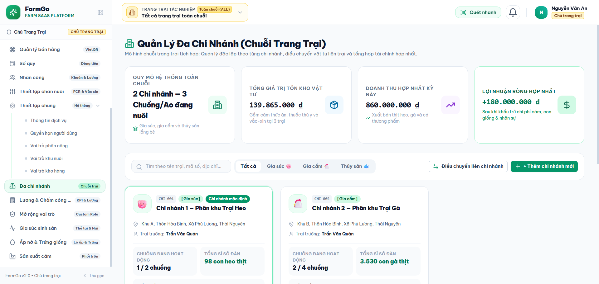 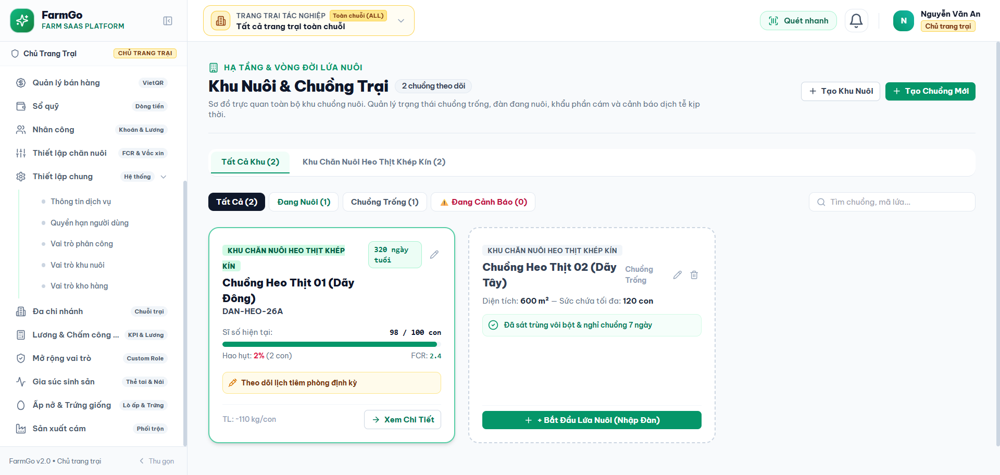
    - **Đề xuất:** Chuẩn hóa `activeFarmId` trong `DynamicSidebar.jsx` (tránh gửi `'ALL'`), đồng bộ URL `?branchId=` với `useActiveBranchStore` và gỡ số liệu tài chính mẫu cứng trong `BranchesPage.jsx`.

15. **BUG-F15 (Critical) — Trang Sổ quỹ (`/app/cashbook`) dùng 100% mock state, không lưu DB (`TC6.5`)**
    - **Ảnh minh chứng:** 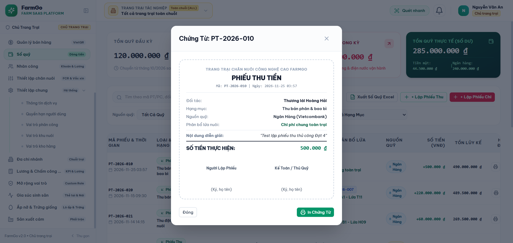 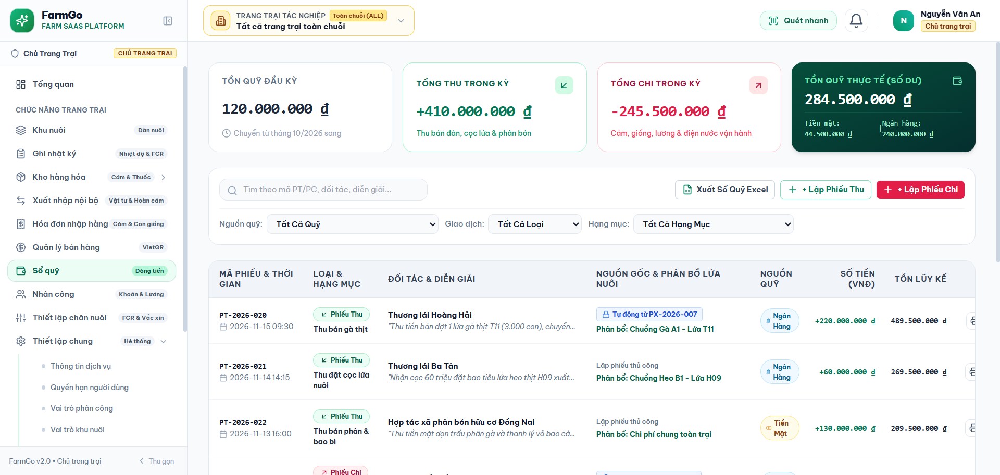
    - **Đề xuất:** Kết nối `CashbookPage.jsx` với `financeService.getCashbook` / `createCashbookEntry` thay vì chỉ cập nhật React state cục bộ.

16. **BUG-F16 (High) — Lỗi tương tác & đồng bộ dữ liệu trên `/platform/packages` và `/platform/tenants` (`TC6.6`)**
    - **Ảnh minh chứng:** 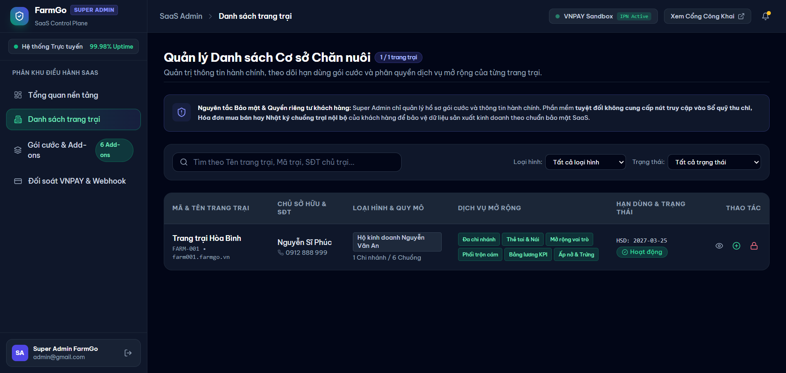 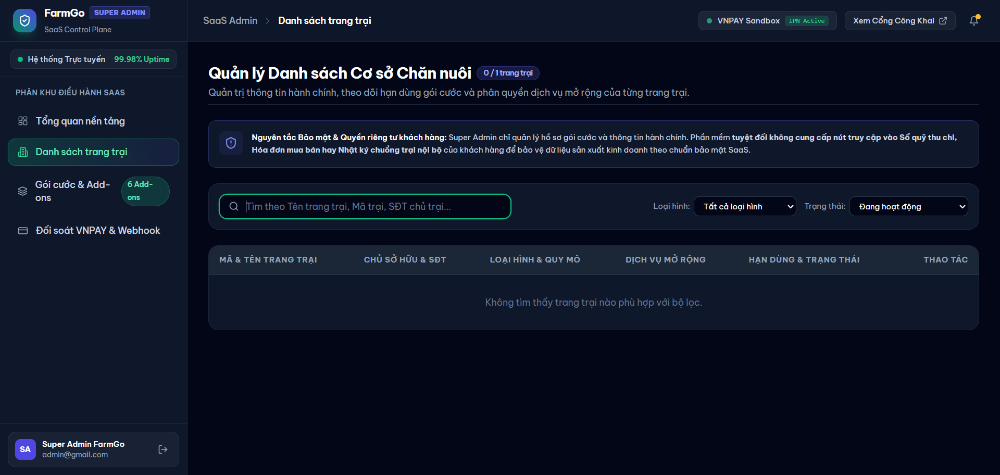 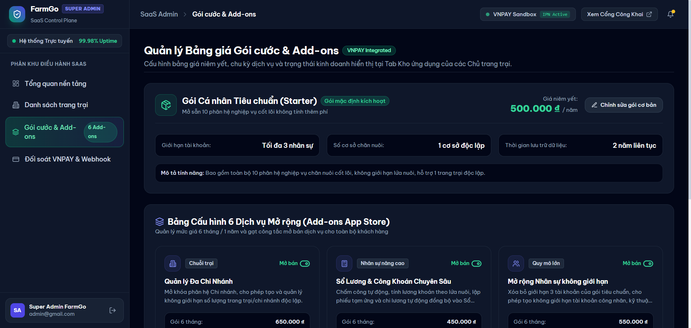
    - **Đề xuất:** Sửa handler mở modal `Sửa giá` (`AdminPackagesPage.jsx`) và `Eye` (`AdminFarmsPage.jsx`), render giá từ response `GET /api/v1/platform/packages`, và đồng bộ giá trị option bộ lọc trạng thái (`ACTIVE`).

---

## TỔNG KẾT TOÀN BỘ KIỂM THỬ CHỨC NĂNG (Đợt 1 – Đợt 4)

- **Tổng số Test Case đã thực hiện:** **24 / 24** (`18` kịch bản chính thức TC1.1–TC5.5 + `6` kịch bản bổ sung TC6.1–TC6.6)
  - **Pass:** **10** (`TC1.4`, `TC2.1`, `TC2.2`, `TC3.1`, `TC4.2`, `TC4.3`, `TC5.3`, `TC5.4`, `TC5.5`, `TC6.3`)
  - **Fail:** **14** (`TC1.1`, `TC1.2`, `TC1.3`, `TC2.3`, `TC3.2`, `TC3.3`, `TC4.1`, `TC5.1`, `TC5.2`, `TC6.1`, `TC6.2`, `TC6.4`, `TC6.5`, `TC6.6`)
  - **Blocked / Not Run:** **0**
- **Tổng số lỗi đã xác nhận:** **16 lỗi (`BUG-F01` – `BUG-F16`)**, phân loại theo mức độ:
  - **Critical (6):** `BUG-F01` (`chk_farm_expenses_status` chặn TC1.1, TC1.2, TC5.1), `BUG-F02` (`chk_sales_orders_payment_status` chặn TC2.3), `BUG-F07` (Công nhân `/app/barns` bị `0 chuồng` do 403 `programs`), `BUG-F09` (Trại trưởng thấy giá vốn & Lãi/Lỗ ở chi tiết chuồng), `BUG-F13` (`/app/workforce` 100% mock), `BUG-F15` (`/app/cashbook` 100% mock).
  - **High (5):** `BUG-F03` (Thẻ kho trống), `BUG-F10` (Webhook FE báo lỗi + lệch trạng thái/giá App Store), `BUG-F11` (Custom Role chưa gán được ở Settings), `BUG-F12` (Điều chuyển `max="0"` & Kiểm kê `403`), `BUG-F16` (Super Admin `Sửa giá`/`Eye`/lọc trạng thái).
  - **Medium (4):** `BUG-F04`, `BUG-F06`, `BUG-F08`, `BUG-F14`.
  - **Low (1):** `BUG-F05` (BIN VietQR hardcode `970436`).

---

## KIỂM THỬ HỒI QUY SAU KHẮC PHỤC (REGRESSION TESTING — 26/11/2026)

Sau khi hoàn tất 3 đợt sửa lỗi (`BUG-F01` – `BUG-F16`), seed bổ sung 5 danh mục `cost_categories` chuẩn (`ID 1..5`) vào `farm_saas_dev` và khởi động lại Backend, đã thực hiện kiểm thử hồi quy trực tiếp trên Chrome (kèm xác minh F5 & chụp 16 ảnh minh chứng `REG-*.png`):

| Mã lỗi | Test Case liên quan | Kết quả hồi quy | Minh chứng & Ghi nhận thực tế |
| :--- | :---: | :---: | :--- |
| **BUG-F01** (Critical) | `TC1.1`, `TC1.2`, `TC5.1` | **PASS** | Nhập kho `PN-261126-2744` (`paidAmount = 500.000 ₫`) trả **HTTP 201**, tự sinh `PC-INV-12` trên Sổ quỹ & bền vững sau F5. Chốt bảng lương KPI trả **HTTP 200**, sinh `CHI-LUONG-202611-81` (`26.000.000 ₫`) & `3/3 Đã thanh toán` sau F5. 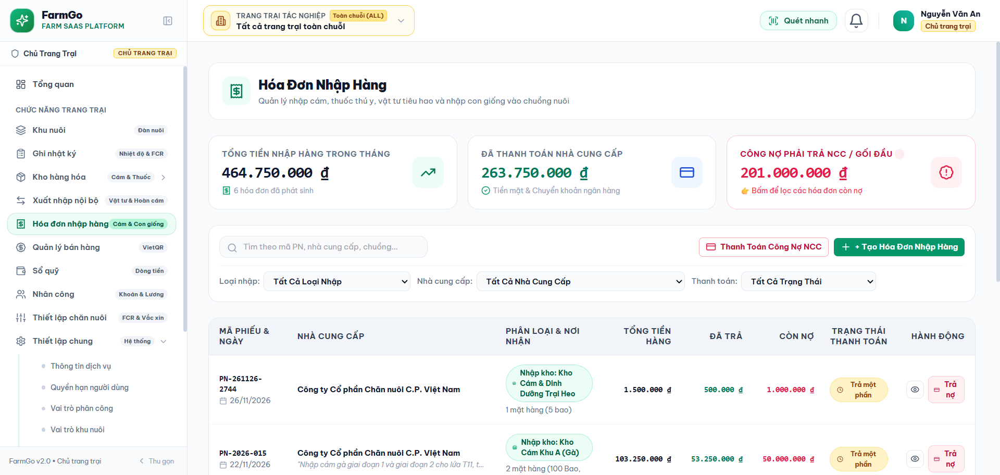 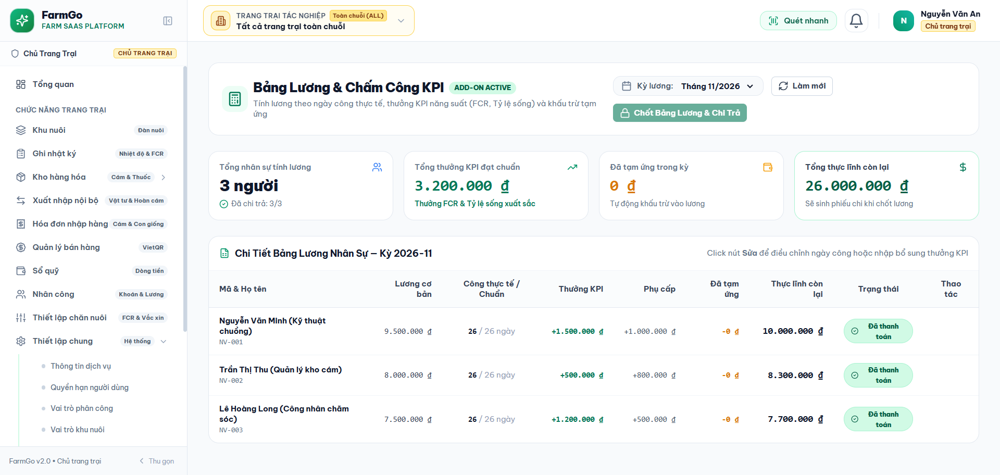 |
| **BUG-F02** (Critical) | `TC2.3` | **PASS** | Xuất bán thanh toán 1 phần `XBAN-261126-1255` (`1.000.000 ₫`, trả `500.000 ₫`) trả **HTTP 201**, lưu trạng thái `Thu một phần`, tự sinh `PT-BAN-2` (`+500.000 ₫`) trên Sổ quỹ & giữ nguyên sau F5. 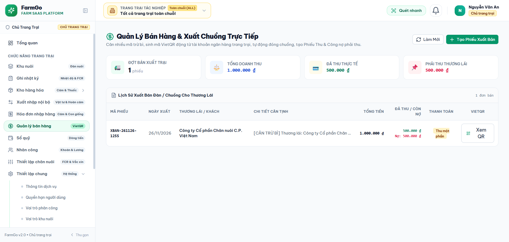 |
| **BUG-F03** (High) | `TC1.3` | **PASS** | Drawer `2. Thẻ Kho & Biến Động` hiển thị đủ giao dịch nhập/xuất thật; định mức cám hiển thị chính xác (`168.78 kg`, `149.25 kg`); lịch sử nhật ký format gọn, không còn JSON thô. 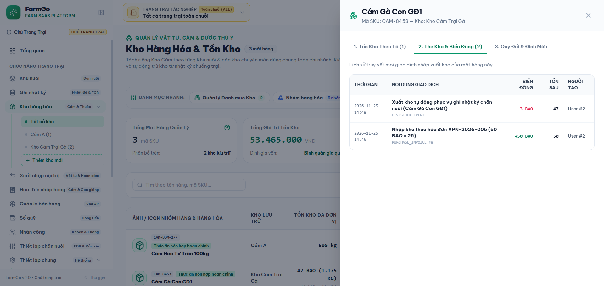 |
| **BUG-F04** (Medium) | `TC1.4` | **PASS** | Toàn bộ chuồng đang nuôi (kể cả `ALERT`) hiển thị đúng trạng thái đang nuôi; chi tiết chuồng hiển thị `THU HOẠCH: 0 con` (hết hardcode `175 con`). 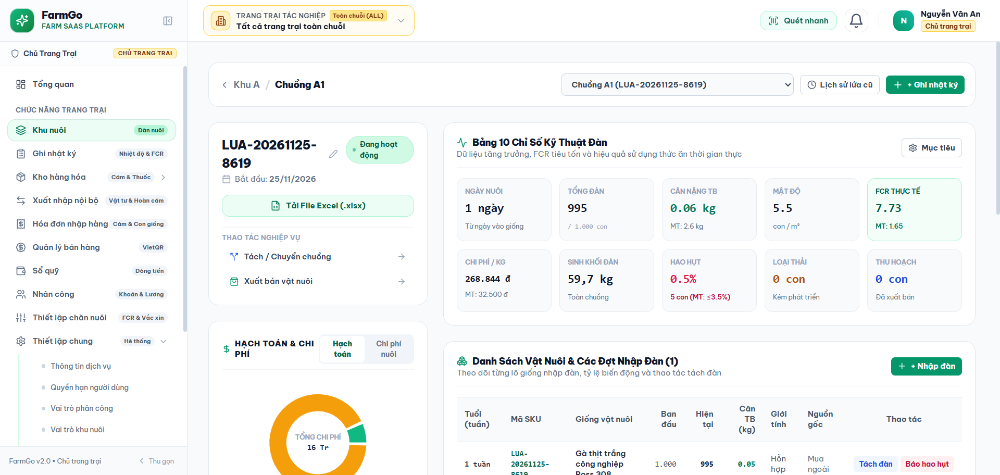 |
| **BUG-F05** (Low) | `TC2.2` | **PASS** | Cả mã QR động trên modal Tạo phiếu bán lẫn modal `Xem QR` sau khi lưu (`XBAN-261126-1255`) đều sử dụng đúng BIN MBBank `970422`. 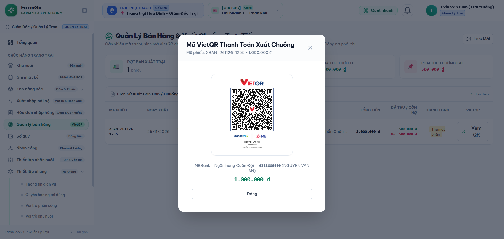 |
| **BUG-F06** (Medium) | `TC3.1` | **PASS** | Bảng danh sách thành viên ngoài modal hiển thị đầy đủ badge Vai trò và Phạm vi chuồng nuôi thật. 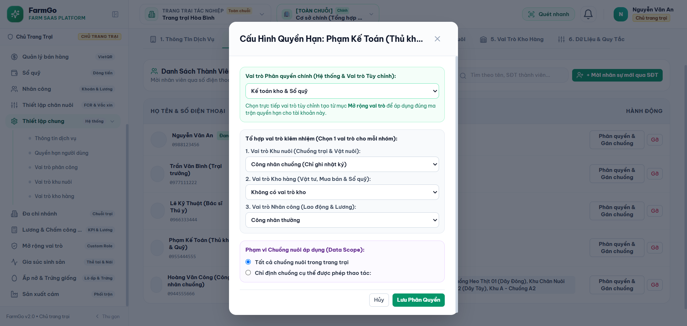 |
| **BUG-F07** (Critical) | `TC3.2` | **PASS** | Công nhân (`0944555666`) vào `/app/barns` tải đủ `2 chuồng theo dõi`, không bị `0 chuồng` do 403 `programs`. 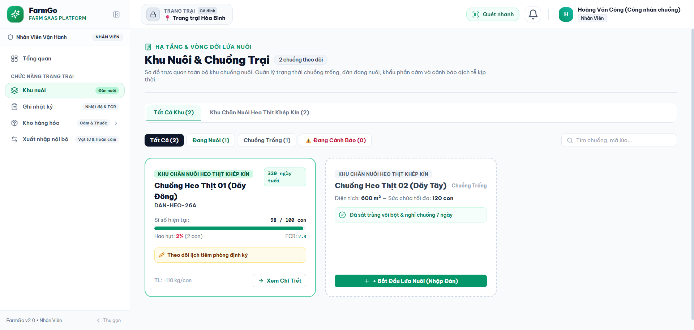 |
| **BUG-F08** (Medium) | `TC3.2` | **PASS** | Sidebar Công nhân chỉ còn `Tổng quan`, `Khu nuôi`, `Ghi nhật ký` — đã ẩn hoàn toàn `Kho hàng hóa` & `Xuất nhập nội bộ`. 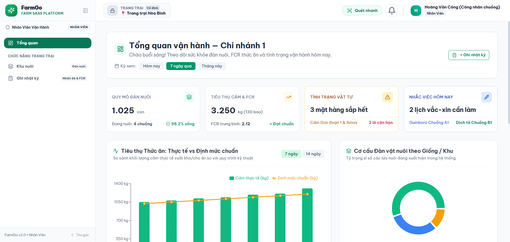 |
| **BUG-F09** (Critical) | `TC3.3` | **PASS** | Trại trưởng (`0977111222`) vào `/app/barns/1/batch/1` đã ẩn hoàn toàn `CHI PHÍ / KG` và khối `HẠCH TOÁN & CHI PHÍ`. 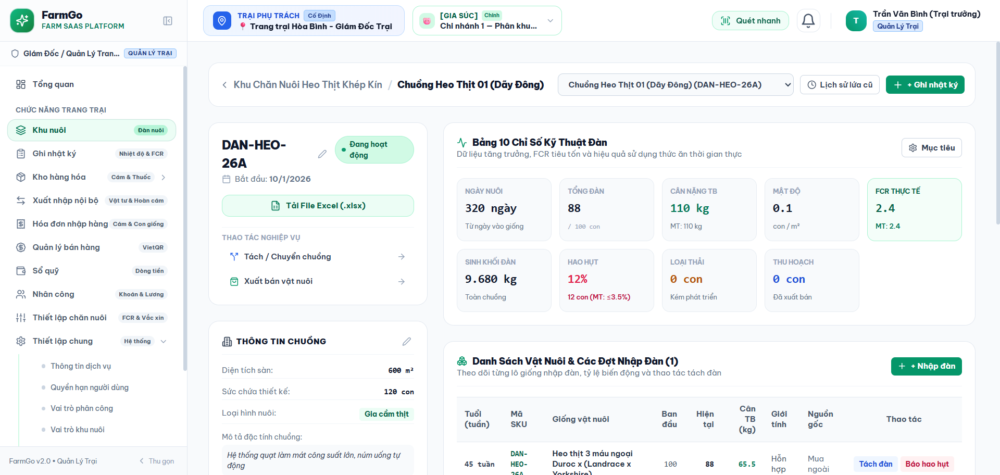 |
| **BUG-F10** (High) | `TC4.1` | **PASS** | App Store hiển thị đúng giá DB (`5.000.000 ₫`, `3.500.000 ₫`, `4.500.000 ₫`) và badge `Đã mua` cho các dịch vụ đang kích hoạt; sửa `authService.getMe()` loại bỏ toast lỗi sau Webhook. 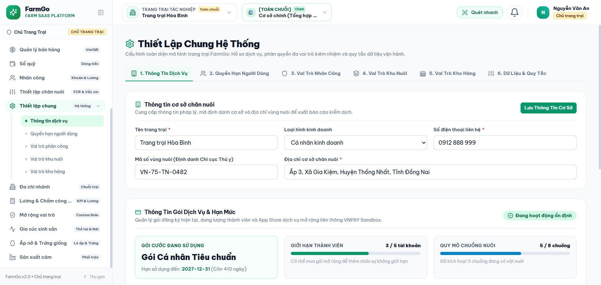 |
| **BUG-F11** (High) | `TC5.2` | **PASS** | Dropdown `Vai trò Phân quyền chính` trong modal Settings liệt kê `[Tùy chỉnh] Kế toán trưởng toàn chuỗi`; `/app/custom-roles` hiển thị `0 nhân sự` chuẩn xác.  |
| **BUG-F12** (High) | `TC6.1` | **PASS** | Kiểm kê kho (`STK-20261126-CEFF8`) thành công `201/200/200` (hết `403`); Điều chuyển kho tự chọn kho có tồn (`498 kg`) và nhập số lượng bình thường. 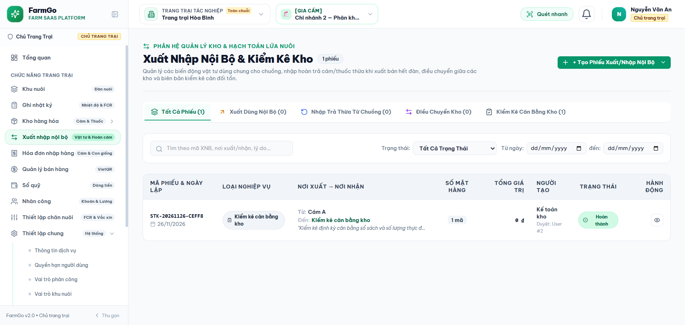 |
| **BUG-F13** (Critical) | `TC6.2` | **PASS** | Tải danh sách 5 nhân viên thật từ DB; tạm ứng `200.000 ₫` (`PC-UNG-4-2902`) lưu DB (`200 OK`), giữ nguyên sau F5 và liên thông sang Sổ quỹ. 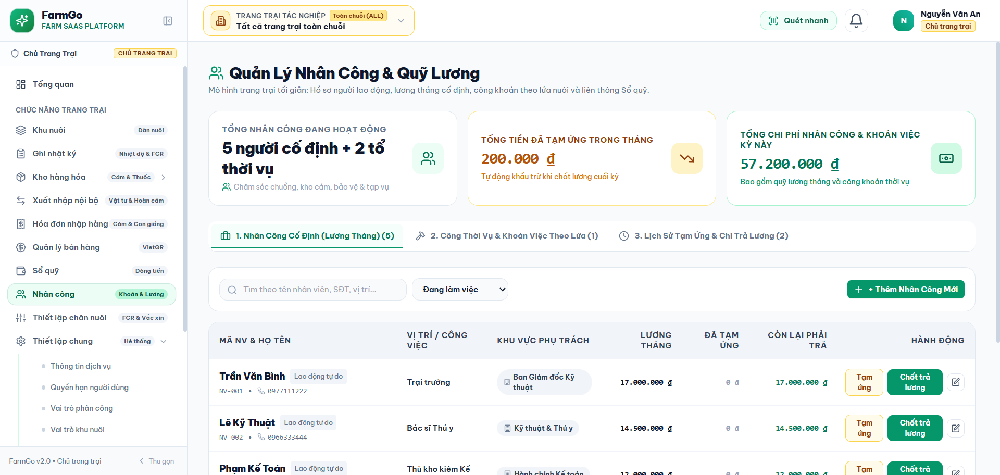 |
| **BUG-F14** (Medium) | `TC6.4` | **PASS** | `/app/branches` hiển thị `tại 2 chi nhánh`, số liệu tài chính thật (hết `430M/340M`), không còn 400 `/farms/ALL/warehouses`, bấm `Vào quản lý trại` đồng bộ ngay Header dropdown. 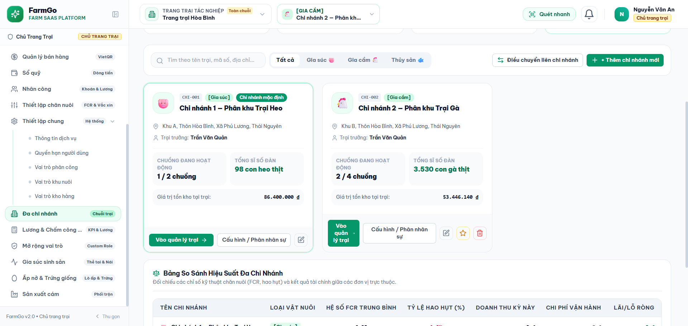 |
| **BUG-F15** (Critical) | `TC6.5` | **PASS** | Lập phiếu thu thủ công `PT-20261126-8792` (`+500.000 ₫`) trả **HTTP 201**, lưu DB bền vững sau F5 cùng 4 phiếu tự động từ Mua/Bán/Lương/Tạm ứng.  |
| **BUG-F16** (High) | `TC6.6` | **PASS** | Bảng giá 6 Add-on trên `/platform/packages` khớp 100% DB và modal **Sửa giá** mở chuẩn (`2800000` / `5000000`); bộ lọc `Đang hoạt động` trên `/platform/tenants` hiển thị đúng `1 / 1 trang trại` và modal **Xem hồ sơ (`Eye`)** mở chuẩn đầy đủ `6/6` dịch vụ. 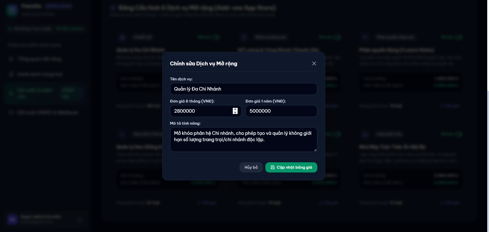 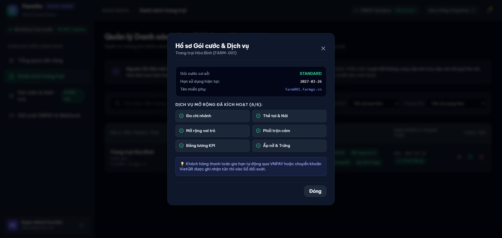 |

**Kết luận Hồi quy:** **16 / 16 lỗi đã khắc phục và xác minh PASS 100%** (**6/6 Critical**, **5/5 High**, **5/5 Medium/Low**). Toàn bộ chuỗi nghiệp vụ cốt lõi (Mua hàng → Kho → Nhật ký → Bán hàng → Sổ quỹ → Công nợ → Lương KPI → Nhân công → RBAC → Đa chi nhánh → Super Admin) đã liên thông dữ liệu thật bền vững sau F5.
