# Báo Cáo Kiểm Tra & Đánh Giá Giao Diện Tổng Thể (UI/UX Audit) — FarmGo

- **Ngày kiểm tra:** 25/11/2026
- **Môi trường kiểm thử:** `http://localhost:5173` (Frontend Vite/React) + `http://localhost:8080` (Backend Spring Boot)
- **Phương pháp:** Kiểm tra trực tiếp trên trình duyệt Chrome ở chế độ chỉ đọc (Read-only), không chỉnh sửa mã nguồn/CSS hay dữ liệu nghiệp vụ thật.
- **Tài khoản kiểm thử đã sử dụng:**
  - Chủ trang trại (`0988123456`)
  - Trại trưởng (`0977111222`)
  - Công nhân chuồng (`0944555666`)
  - Super Admin (`admin@gmail.com`)
- **Video ghi hình phiên kiểm tra:**
  - [recording.mp4](file:///C:/Users/Phuc/.gemini/antigravity/brain/ed386556-2cfa-4dc8-8e51-57d67718c187/recording.mp4)
  - [recording_2.mp4](file:///C:/Users/Phuc/.gemini/antigravity/brain/ed386556-2cfa-4dc8-8e51-57d67718c187/recording_2.mp4)

---

## Phần 1: Tổng quan hệ thống

- **Tổng số màn hình / route chức năng đã xác định:** **32 màn hình** (7 Public & Auth, 18 Tenant App `/app/*` gồm cả chi tiết chuồng & 5 Add-ons, 4 Super Admin `/platform/*`, 1 `/admin/*` alias, 1 `/onboarding`, 1 `/force-change-password`). *(Không tính các route redirect tương thích ngược).*
- **Tổng số màn hình đã kiểm tra trực tiếp:** **29 màn hình** (7 Public & Auth + 18 Tenant App dưới góc nhìn Chủ trang trại + 4 Super Admin `/platform/*`, đồng thời kiểm tra chéo góc nhìn RBAC của Trại trưởng và Công nhân).
- **Tổng số màn hình chưa kiểm tra / Blocked:** **3 màn hình**:
  - `/admin/dashboard` (`/admin/*`): **Blocked / Redirect** — Khi điều hướng trực tiếp bị chuyển hướng về `/login` (hệ thống hiện phục vụ Super Admin qua prefix `/platform/*`).
  - `/onboarding`: Chưa kiểm tra trực tiếp do toàn bộ tài khoản kiểm thử trong seed data đều đã có trang trại.
  - `/force-change-password`: Chưa kiểm tra trực tiếp do các tài khoản kiểm thử đều có `must_change_password = 0`.
- **Tổng quan về mức độ đồng nhất của giao diện:**
  - Giao diện có nền tảng thiết kế hiện đại, bảng màu xanh ngọc trên nền sáng sạch sẽ, các thành phần UI (Card, Table, Button, Modal, Filter bar) khá đồng nhất.
  - Tuy nhiên, hệ thống còn **thiếu đồng nhất ở 3 điểm**: (1) tên thương hiệu hiển thị lẫn lộn (`FarmGo`, `GREENFARM`, `Agri-ERP v2.0`, `AGRI`), (2) một số màn hình vẫn còn dữ liệu mẫu tĩnh hoặc mã code thô chưa Việt hóa, và (3) lặp dấu sao bắt buộc (`* *`) ở nhiều biểu mẫu.

---

## Phần 2: Bảng kết quả kiểm tra

| STT | Trang / Chức năng | Tiêu chí kiểm tra | Kết quả | Mức độ lỗi | Mô tả |
| :--- | :--- | :--- | :--- | :--- | :--- |
| 1 | `/` (HomePage) | Bố cục, thiết kế & Responsive (4 màn hình) | Đạt | — | Hiển thị đầy đủ, rõ ràng, không tràn ngang trên cả 4 kích thước. |
| 2 | `/features` | Bố cục & nội dung | Đạt | — | Trình bày rõ ràng, cân đối. |
| 3 | `/guides` | Bố cục & nội dung | Đạt | — | Trình bày rõ ràng, dễ theo dõi. |
| 4 | `/contact` | Bố cục & biểu mẫu | Đạt | — | Hiển thị đầy đủ, sạch sẽ. |
| 5 | `/platform-intro` | Nội dung & tính nhất quán | Chưa đạt | Low | Tiêu đề ghi "6 vai trò" nhưng bảng phân quyền bên dưới chỉ liệt kê 5 dòng. |
| 6 | `/login` | Form, Validation & Thiết kế chung | Chưa đạt | Medium | Validation form trống hoạt động tốt; nhưng lặp 2 nút "Quay lại trang chủ", lặp dấu `* *` ở label và lộ `(ADR-02 In-Memory Token)` ở footer. |
| 7 | `/register` | Form & Thiết kế chung | Chưa đạt | Medium | Lặp 2 nút "Quay lại trang chủ", lặp dấu `* *` và lộ `(ADR-02 In-Memory Token)` tương tự `/login`. |
| 8 | `/app/dashboard` | Bố cục, thương hiệu, biểu đồ & Responsive | Chưa đạt | Medium | Lẫn lộn thương hiệu (`GREENFARM`, `Agri-ERP v2.0`); chọn `Toàn chuỗi (ALL)` nhưng tiêu đề vẫn ghi `Chi nhánh 2`; nhãn trục Y biểu đồ rớt chữ `kg`. |
| 9 | `/app/barns` | Thẻ chuồng nuôi & số liệu | Chưa đạt | High | Card chuồng đang nuôi hiển thị chuỗi khuyết số `Hao hụt: % ( con)`. |
| 10 | `/app/barns/3/batch/2` | Chi tiết lứa nuôi & nút thao tác | Chưa đạt | Low | Lặp 2 nút "Kết thúc lứa nuôi" ở 2 vị trí với kiểu viết hoa khác nhau. |
| 11 | `/app/daily-logs` | Chọn chuồng, biểu mẫu & dữ liệu | Chưa đạt | High | Badge ngày tuổi chỉ hiện chữ `ngày` (thiếu số), tên chuồng bị cắt chữ, ô input chứa số float chưa làm tròn (`168.77999877929688`). |
| 12 | `/app/inventory` | Bảng tồn kho, API & Responsive | Chưa đạt | High | Phát sinh 2 lỗi console `400 Bad Request`; sai logic đơn vị (`95 kg (95 bao)` với `1 kg = 0.04 bao`); hạn dùng hiển thị số âm `Còn -224 ngày`. |
| 13 | `/app/internal-transfers` | Bảng điều chuyển & API | Chưa đạt | High | Giao diện bảng ổn nhưng phát sinh 2 lỗi console `400 Bad Request` khi tải trang. |
| 14 | `/app/purchase-invoices` | Bố cục & tính đồng nhất | Chưa đạt | Low | Thiếu khối Page Header (Tiêu đề + Mô tả trang) so với các trang khác. |
| 15 | `/app/sales` | Bố cục & Empty state | Đạt | — | Hiển thị gọn gàng, trạng thái trống rõ ràng. |
| 16 | `/app/cashbook` | Bảng thu chi & Responsive 1366px | Chưa đạt | Low | Ở màn hình 1366×768, cột `MÃ PHIẾU & THỜI GIAN` và badge `Phiếu Thu` bị ngắt dòng hơi chật. |
| 17 | `/app/workforce` | Bảng nhân công & thao tác | Đạt | — | Bố cục cân đối, nút thao tác rõ ràng. |
| 18 | `/app/livestock-settings` | Thiết lập quy trình & bảng | Đạt | — | Hiển thị sạch sẽ, đầy đủ. |
| 19 | `/app/general-settings` | Các tab thiết lập & bảng phân quyền | Chưa đạt | High | Tab 2 gắn nhầm `Chờ xác nhận` cho mọi user & lặp `Kho: Không có` ở 2 cột; Tab 1 & 6.2 lặp `* *`; Tab 4 & 5 dùng dữ liệu mẫu cứng; Sidebar thiếu sub-link Tab 6. |
| 20 | `/app/branches` | Quản lý đa chi nhánh | Đạt (có ghi chú) | Low | Bố cục tốt; có chênh lệch nhỏ giữa tổng quan (2 chi nhánh) và thẻ KPI (3 trại). |
| 21 | `/app/payroll-kpi` | Lương & Chấm công KPI (Add-on) | Đạt | — | Empty state rõ ràng; badge sidebar `KPI & Lương` hơi lặp từ với tiêu đề. |
| 22 | `/app/custom-roles` | Ma trận vai trò tùy chỉnh (Add-on) | Chưa đạt | Medium | Nhiều nhóm quyền hiện mã thô (`ADDON_BRANCHES`, `ADDON_PAYROLL`, `BARN`, `DAILY_LOG`); Quản trị viên Hệ thống hiện `0/2` quyền. |
| 23 | `/app/breeding-livestock` | Gia súc sinh sản (Add-on) | Chưa đạt | Low | Các nút icon Sửa/Xóa thiếu `aria-label` hỗ trợ truy cập (A11y). |
| 24 | `/app/hatchery` | Ấp nở & Trứng giống (Add-on) | Chưa đạt | Medium | Bảng báo chưa có mẻ ấp nào nhưng 4 thẻ KPI vẫn hiển thị số liệu giả lập (7.000 quả, 94.3%...). |
| 25 | `/app/feed-production` | Sản xuất cám (Add-on) | Chưa đạt | High | Bảng BOM & lệnh trộn hiển thị ổn sau khi tải nhưng phát sinh 2 lỗi console `400 Bad Request`. |
| 26 | RBAC — Trại trưởng (`0977111222`) | Sidebar, Kho, Khu nuôi, Dashboard | Đạt một phần | Medium | Đã ẩn đúng 3 Add-on và cột giá vốn ở Kho; nhưng Dashboard vẫn hiện số liệu Tài chính/Doanh thu. |
| 27 | RBAC — Công nhân (`0944555666`) | Sidebar, Khu nuôi, Nhật ký | Chưa đạt | **Critical** | Vào `/app/barns` bị API `403 Forbidden` (2 lần), hiện 0 chuồng + tab khu nuôi giả lập; `/app/daily-logs` chưa chọn chuồng vẫn mở form và hiện chuỗi khuyết `"Tại  — Ngày..."`. |
| 28 | `/admin/dashboard` | Truy cập cổng Admin | Blocked | — | Redirect về `/login` do cổng Super Admin dùng đường dẫn `/platform/*`. |
| 29 | `/platform/dashboard` | Tổng quan Super Admin | Chưa đạt | High | Bảng giao dịch trống cột `TRANG TRẠI`, `CỔNG`, cột `SỐ TIỀN` hiện số thô `5000000`; cơ cấu loại hình cộng thành 3 dù chỉ có 1 trại. |
| 30 | `/platform/tenants` | Danh sách trang trại | Chưa đạt | High | Badge sidebar ghi `128` nhưng thực tế chỉ có `1 / 1` trang trại; cột dịch vụ hiện mã thô `CUSTOM_ROLES`. |
| 31 | `/platform/packages` | Quản lý gói dịch vụ | Đạt | — | Hiển thị đầy đủ, rõ ràng. |
| 32 | `/platform/transactions` | Đối soát giao dịch VNPAY | Chưa đạt | High | Hiển thị `0 giao dịch`, `0 ₫`, trống danh sách — mâu thuẫn với 5 giao dịch trên Dashboard và badge `2 lỗi` ở Sidebar. |

---

## Phần 3: Danh sách lỗi

### ERR-01: Công nhân bị 403 ở Khu nuôi & lỗi form khuyết dữ liệu ở Ghi nhật ký
- **Trang xảy ra lỗi:** `/app/barns`, `/app/daily-logs` (Tài khoản Công nhân `0944555666`)
- **Vị trí thành phần:** Danh sách chuồng nuôi (`/app/barns`) và khối chọn chuồng / tiêu đề form nhập liệu (`/app/daily-logs`).
- **Mô tả lỗi:**
  - Khi đăng nhập bằng tài khoản Công nhân và vào `/app/barns`, hệ thống gọi API bị lỗi `403 Forbidden` (2 lần), hiển thị `0 chuồng theo dõi` kèm các tab khu nuôi giả lập (`Khu A - Gà thịt CP (0)`...) và không có thông báo phân quyền rõ ràng.
  - Khi vào `/app/daily-logs`, danh sách chuồng trống nhưng form cho ăn vẫn mở cho phép nhập và render chuỗi khuyết tên chuồng: `"Tại  — Ngày 25/11/2026"`.
- **Ảnh chụp minh chứng:**
  - 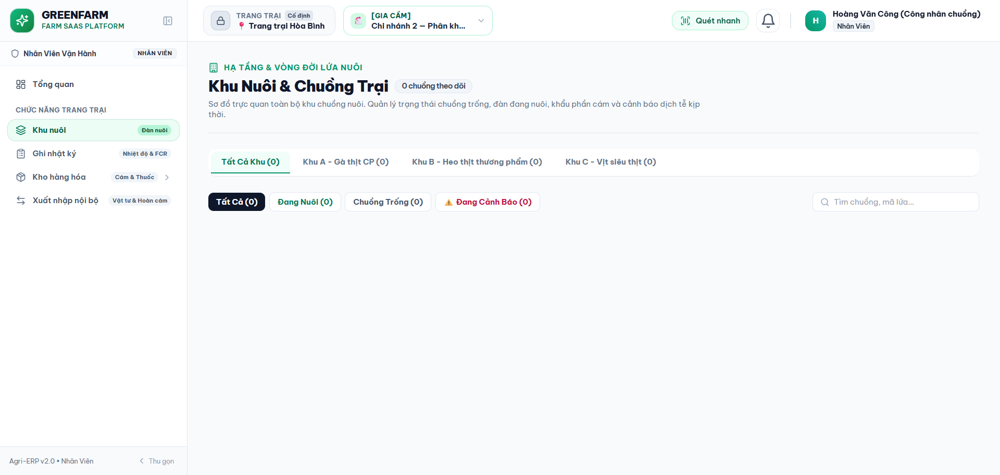
  - 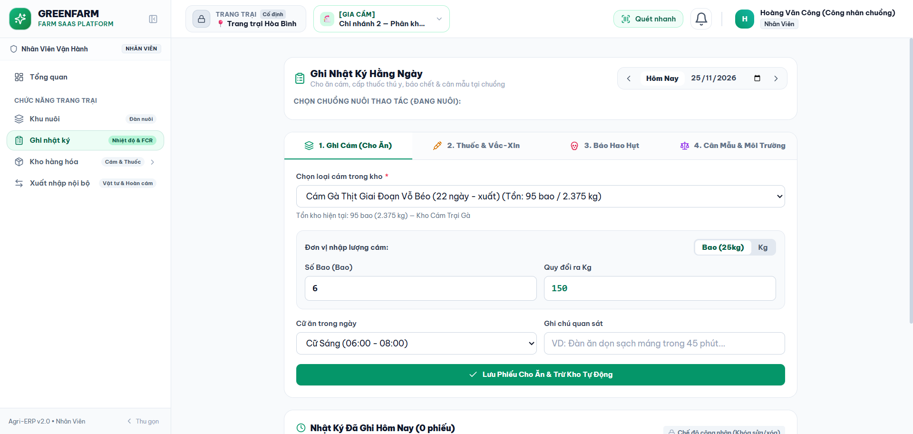
- **Mức độ nghiêm trọng:** **Critical**
- **Đề xuất hướng khắc phục:** Kiểm tra quyền gọi API lấy danh sách chuồng được phân công cho `ROLE_FIELD_STAFF`; bổ sung Empty State hướng dẫn khi công nhân chưa được gán chuồng và vô hiệu hóa/ẩn form ghi nhật ký khi chưa có chuồng hợp lệ được chọn.

---

### ERR-02: Tab "Quyền hạn người dùng" gắn sai trạng thái & lặp dữ liệu giữa các cột
- **Trang xảy ra lỗi:** `/app/general-settings?tab=users`
- **Vị trí thành phần:** Bảng danh sách nhân sự tại Tab 2 (Quyền hạn người dùng).
- **Mô tả lỗi:** Toàn bộ người dùng (bao gồm cả Chủ trang trại) đều hiển thị badge `Chờ xác nhận`. Cột `TỔ HỢP VAI TRÒ ĐANG GÁN` hiển thị `Kho: Không có`, trong khi cột `PHẠM VI CHUỒNG NUÔI` lại hiển thị lặp `Kho: Không có` và `Nhân công: Không có`.
- **Ảnh chụp minh chứng:**
  - 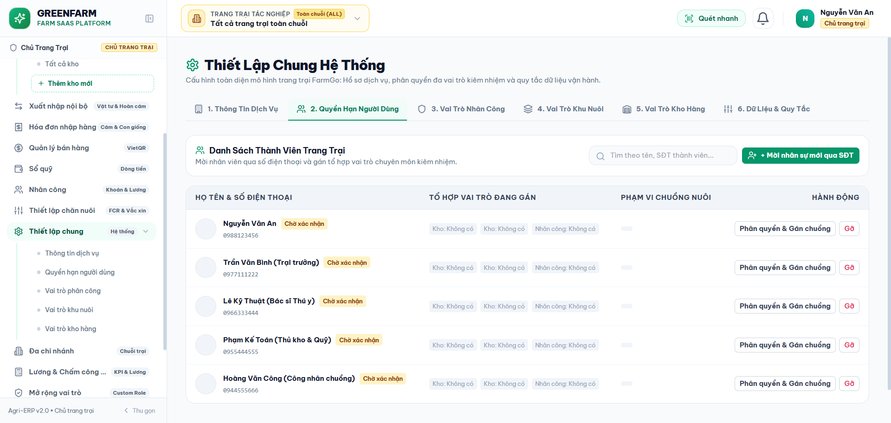
- **Mức độ nghiêm trọng:** **High**
- **Đề xuất hướng khắc phục:** Kiểm tra lại mapping trường trạng thái tài khoản (`ACTIVE` vs `PENDING`) và tách đúng dữ liệu hiển thị cho cột Vai trò với cột Phạm vi chuồng nuôi.

---

### ERR-03: Lỗi hiển thị chuỗi khuyết số hao hụt, thiếu ngày tuổi & số thực chưa làm tròn
- **Trang xảy ra lỗi:** `/app/barns`, `/app/daily-logs`
- **Vị trí thành phần:** Thẻ chuồng nuôi (`/app/barns`), thẻ chọn chuồng và ô nhập `Quy đổi ra Kg` (`/app/daily-logs`).
- **Mô tả lỗi:**
  - Tại `/app/barns`, card Chuồng Gà Thịt 01 hiển thị `Hao hụt: % ( con)` do thiếu giá trị số.
  - Tại `/app/daily-logs`, badge ngày tuổi trên card chọn chuồng chỉ hiện chữ `ngày`, tên chuồng bị cắt (`Chuồng Gà Thịt 01 (Chuồng ...`), và ô input `Quy đổi ra Kg` chứa giá trị float chưa làm tròn (`168.77999877929688`).
- **Ảnh chụp minh chứng:**
  - 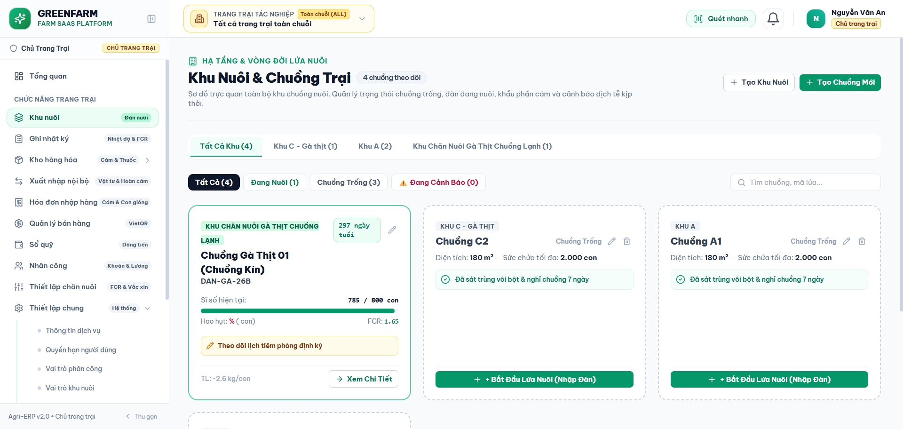
  - 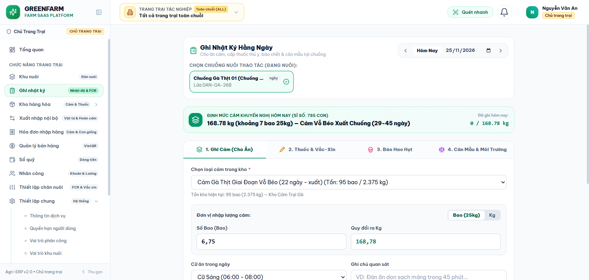
- **Mức độ nghiêm trọng:** **High**
- **Đề xuất hướng khắc phục:** Bổ sung fallback `0` hoặc kiểm tra lại tên trường dữ liệu tỷ lệ hao hụt/ngày tuổi trả về từ API; làm tròn giá trị kg quy đổi (tối đa 2 chữ số thập phân) trước khi binding vào input.

---

### ERR-04: Dữ liệu Super Admin không đồng bộ, trống cột và thiếu định dạng tiền tệ
- **Trang xảy ra lỗi:** `/platform/dashboard`, `/platform/tenants`, `/platform/transactions`
- **Vị trí thành phần:** Bảng giao dịch & biểu đồ cơ cấu trên `/platform/dashboard`, Sidebar & bảng trang trại trên `/platform/tenants`, bảng đối soát trên `/platform/transactions`.
- **Mô tả lỗi:**
  - `/platform/dashboard`: Bảng giao dịch gần đây bị trống cột `TRANG TRẠI`, trống cột `CỔNG`, cột `SỐ TIỀN` hiển thị số nguyên thô `5000000`; khối Cơ cấu loại hình cộng tổng thành 3 trại trong khi hệ thống chỉ có 1 trại.
  - `/platform/tenants`: Badge trên Sidebar ghi `128` nhưng bảng thực tế chỉ có `1 / 1` trang trại; cột Dịch vụ mở rộng hiển thị mã thô `CUSTOM_ROLES`.
  - `/platform/transactions`: Hiển thị `0 giao dịch`, `0 ₫` và bảng trống, mâu thuẫn với 5 giao dịch hiển thị ở Dashboard và badge `2 lỗi` trên Sidebar.
- **Ảnh chụp minh chứng:**
  - 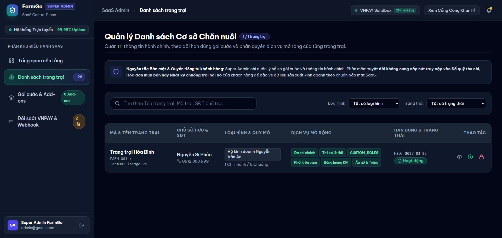
  - 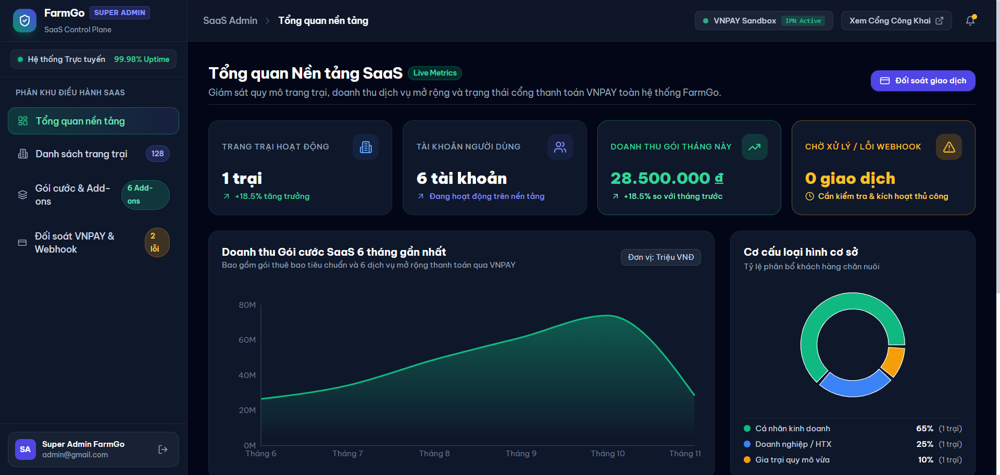
  - 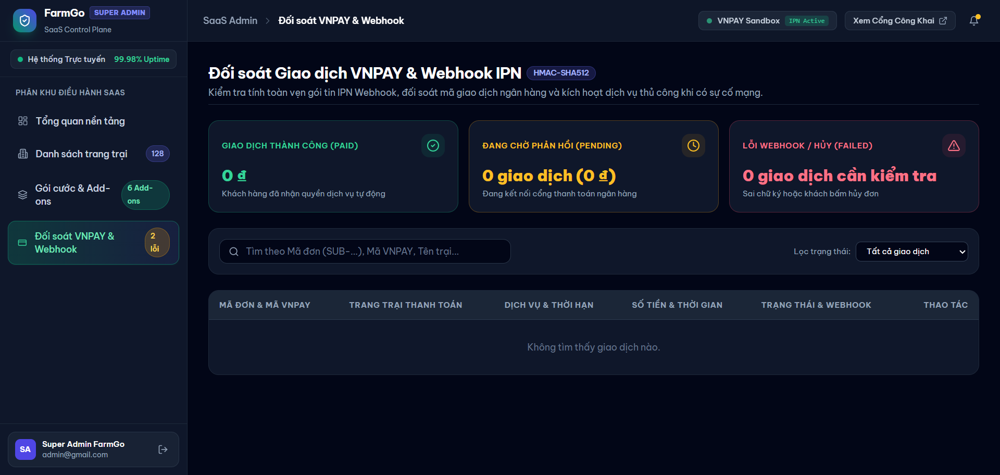
- **Mức độ nghiêm trọng:** **High**
- **Đề xuất hướng khắc phục:** Đồng bộ nguồn dữ liệu API giữa Dashboard, Sidebar badges và Transactions; áp dụng `formatCurrency` cho cột số tiền; ánh xạ tên tiếng Việt cho tất cả mã Add-on.

---

### ERR-05: Lỗi Console `400 Bad Request` tại Kho, Xuất nhập nội bộ, Sản xuất cám & sai logic đơn vị
- **Trang xảy ra lỗi:** `/app/inventory`, `/app/internal-transfers`, `/app/feed-production`
- **Vị trí thành phần:** API tải dữ liệu trang và cột Tồn kho / Hạn sử dụng trên `/app/inventory`.
- **Mô tả lỗi:**
  - Cả 3 trang đều phát sinh 2 lỗi `400 Bad Request` trong Console khi tải dữ liệu.
  - Tại `/app/inventory`, dòng hàng hiển thị sai logic quy đổi đơn vị (`95 kg (95 bao)` với ghi chú `1 kg = 0.04 bao`) và hạn sử dụng hiển thị số ngày âm (`Còn -224 ngày`).
- **Ảnh chụp minh chứng:**
  - 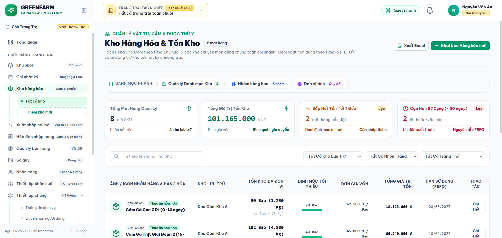
  - 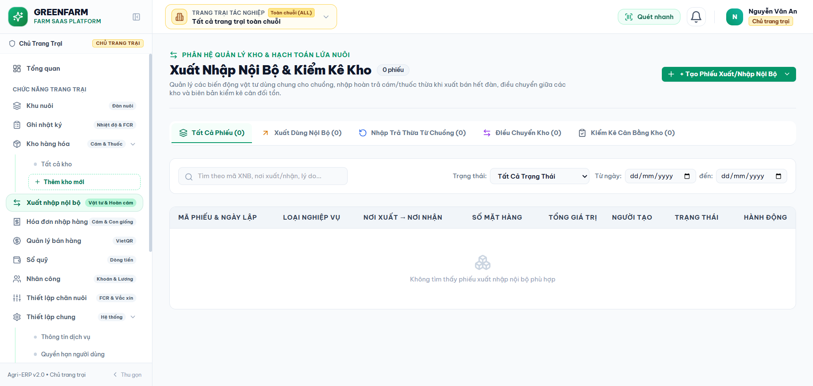
  - 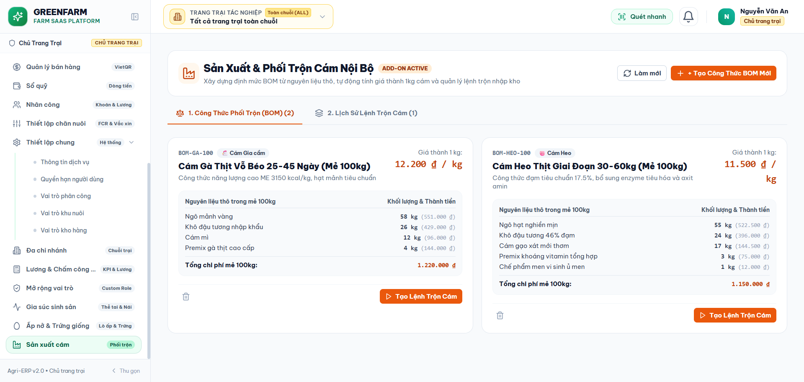
- **Mức độ nghiêm trọng:** **High**
- **Đề xuất hướng khắc phục:** Kiểm tra tham số query gửi lên các endpoint bị `400`; sửa thứ tự phép quy đổi đơn vị (`bao` ↔ `kg`) và hiển thị `"Đã quá hạn X ngày"` cho lô quá hạn.

---

### ERR-06: Số liệu KPI giả lập mâu thuẫn với bảng rỗng tại Ấp nở & Trứng giống
- **Trang xảy ra lỗi:** `/app/hatchery`
- **Vị trí thành phần:** 4 thẻ KPI phía trên bảng danh sách mẻ ấp.
- **Mô tả lỗi:** Bảng danh sách bên dưới hiển thị `"Chưa có mẻ ấp nào trong hệ thống."`, nhưng 4 thẻ KPI phía trên vẫn hiển thị số liệu giả lập (7.000 quả, 94.3%, 28.4%, 2.680 con).
- **Ảnh chụp minh chứng:**
  - 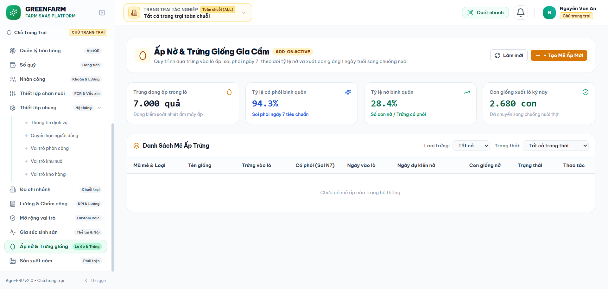
- **Mức độ nghiêm trọng:** **Medium**
- **Đề xuất hướng khắc phục:** Tính toán hoặc trả về số liệu KPI bằng `0` khi chưa có mẻ ấp nào trong database.

---

### ERR-07: Hiển thị mã code tiếng Anh thô trong Ma trận quyền hạn
- **Trang xảy ra lỗi:** `/app/custom-roles`
- **Vị trí thành phần:** Khung Ma trận quyền hạn bên phải.
- **Mô tả lỗi:** Nhiều nhóm quyền hiển thị mã hằng số chưa Việt hóa (`ADDON_BRANCHES`, `ADDON_PAYROLL`, `ADDON_ROLES`, `BARN`, `DAILY_LOG`) và vai trò Quản trị viên Hệ thống hiển thị `0/2` quyền được chọn.
- **Ảnh chụp minh chứng:**
  - 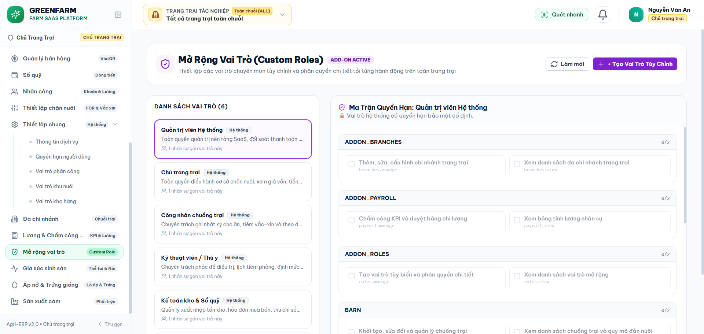
- **Mức độ nghiêm trọng:** **Medium**
- **Đề xuất hướng khắc phục:** Bổ sung đầy đủ từ điển ánh xạ tên tiếng Việt cho mọi `module` trong `MODULE_LABELS`.

---

### ERR-08: Lặp nút "Quay lại trang chủ", lặp dấu `* *` và lộ thuật ngữ kỹ thuật
- **Trang xảy ra lỗi:** `/login`, `/register`, `/app/general-settings`
- **Vị trí thành phần:** Header/Footer trang Auth và nhãn trường nhập liệu bắt buộc.
- **Mô tả lỗi:** Trang `/login` và `/register` có 2 nút `Quay lại trang chủ` trên cùng màn hình, footer lộ ghi chú kỹ thuật `(ADR-02 In-Memory Token)`. Nhãn trường bắt buộc trên `/login`, `/register`, `/app/general-settings` bị lặp 2 dấu sao (`* *`).
- **Ảnh chụp minh chứng:**
  - 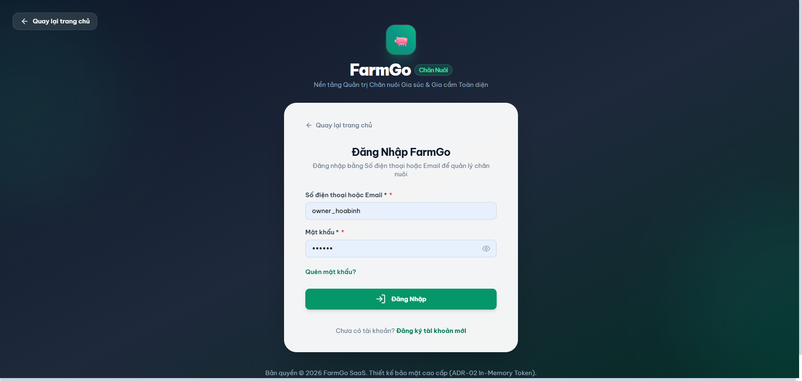
  - 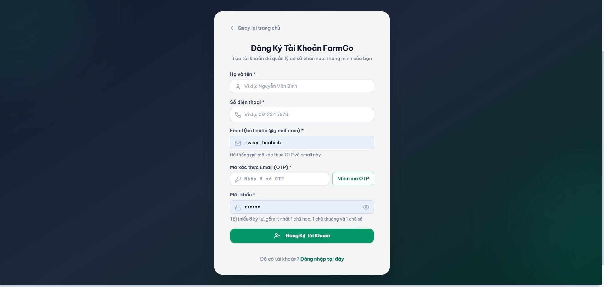
  - 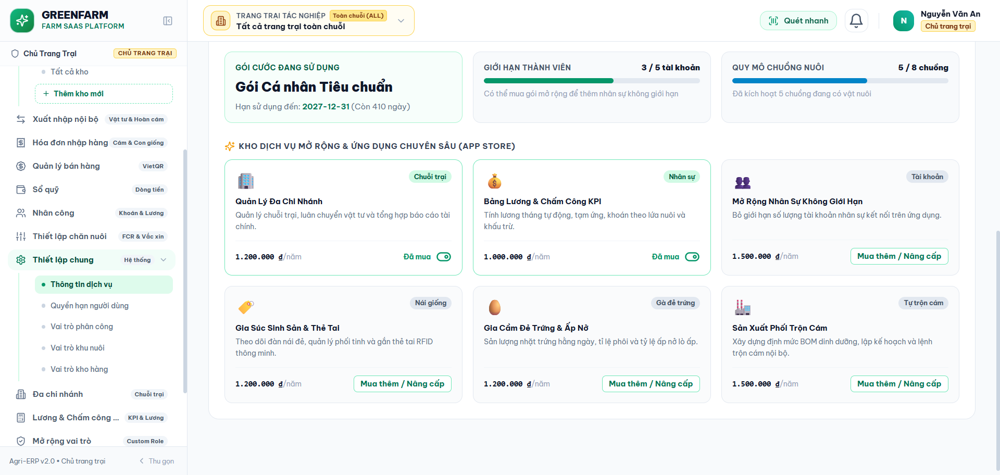
- **Mức độ nghiêm trọng:** **Medium**
- **Đề xuất hướng khắc phục:** Xóa 1 nút "Quay lại trang chủ" bị trùng; bỏ ký tự `*` cứng trong prop `label` khi `FormField` đã tự render dấu `*` đỏ khi có `required`; thay thế nội dung footer bằng thông điệp bảo mật thân thiện.

---

### ERR-09: Không nhất quán tên thương hiệu, tiêu đề chi nhánh & nhãn biểu đồ bị rớt dòng
- **Trang xảy ra lỗi:** `/app/dashboard` và toàn bộ `/app/*`
- **Vị trí thành phần:** Sidebar Logo/Footer, tiêu đề Dashboard, trục Y biểu đồ cột.
- **Mô tả lỗi:** Hệ thống dùng lẫn lộn 4 tên khác nhau (`FarmGo` ở Public/Auth, `AGRI` ở màn hình loading, `GREENFARM` và `Agri-ERP v2.0` ở Sidebar). Khi chọn phạm vi `Toàn chuỗi (ALL)`, tiêu đề Dashboard vẫn ghi cứng `Tổng quan vận hành — Chi nhánh 2`. Nhãn trục Y biểu đồ (`1400 kg`) bị rớt chữ `kg` xuống dòng.
- **Ảnh chụp minh chứng:**
  - 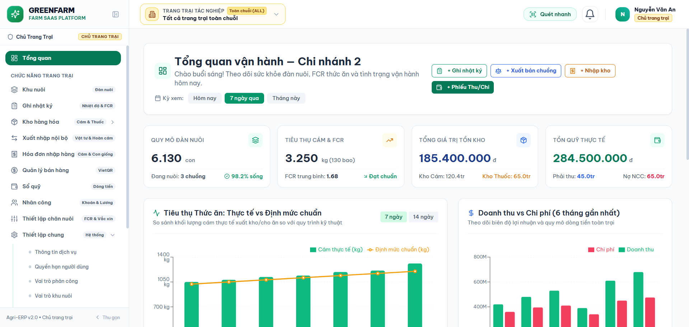
- **Mức độ nghiêm trọng:** **Medium**
- **Đề xuất hướng khắc phục:** Thống nhất một thương hiệu **FarmGo** xuyên suốt; đồng bộ tiêu đề Dashboard theo bộ lọc chi nhánh đang chọn; nới rộng `width` của `YAxis` trên biểu đồ.

---

### ERR-10: Tối ưu hiển thị Responsive trên Tablet (768×1024) và Mobile (390×844)
- **Trang xảy ra lỗi:** `/app/dashboard`, `/app/inventory`, `/app/general-settings`
- **Vị trí thành phần:** Sidebar trên Tablet 768px; Bottom Bar và Header trên Mobile 390px.
- **Mô tả lỗi:**
  - Trên Tablet 768×1024, Sidebar vẫn mở cố định (~250px) làm vùng nội dung chính hơi chật, nút và badge trong bảng bị xuống 2 dòng.
  - Trên Mobile 390×844, Bottom Navigation hiển thị `Menu 10` (thừa số `10`) và nút chọn trang trại trên header rớt thành 3 dòng làm header cao.
- **Ảnh chụp minh chứng:**
  - 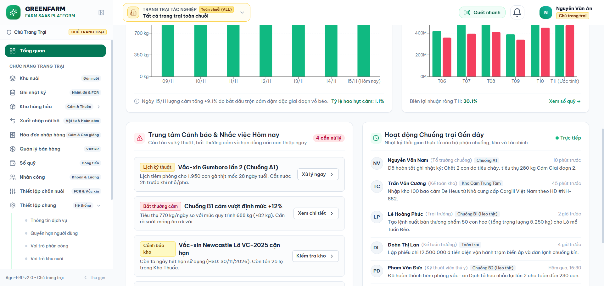
  - 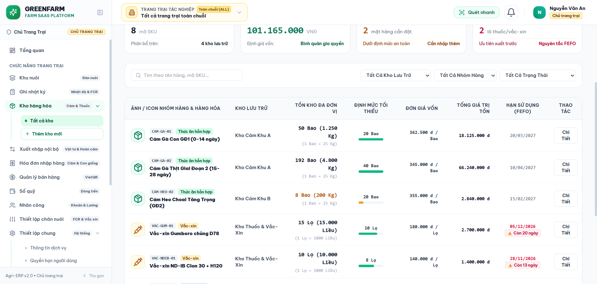
  - 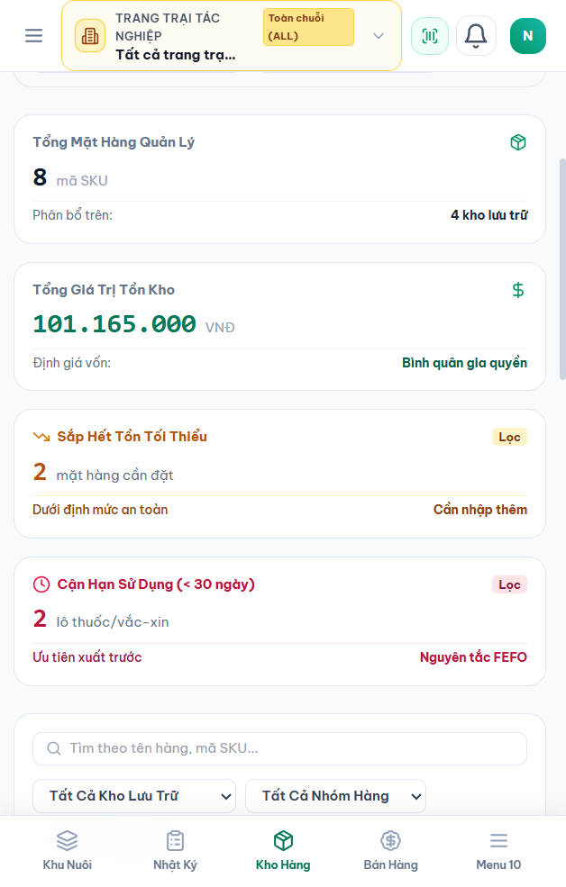
- **Mức độ nghiêm trọng:** **Low - Medium**
- **Đề xuất hướng khắc phục:** Thu gọn Sidebar thành Drawer từ breakpoint `< 1024px`; sửa nhãn `Menu 10` thành `Menu` hoặc `Thêm`; giới hạn 1 dòng (`truncate`) cho nút chọn trang trại trên Mobile.

---

### ERR-11: Các lỗi thẩm mỹ, trùng lặp và Accessibility nhỏ khác
- **Trang xảy ra lỗi:** `/platform-intro`, `/app/barns/3/batch/2`, `/app/purchase-invoices`, `/app/breeding-livestock`, `/app/cashbook`
- **Vị trí thành phần:** Nút thao tác, Page Header, nút icon Sửa/Xóa.
- **Mô tả lỗi:**
  - `/platform-intro`: Tiêu đề ghi "6 vai trò" nhưng bảng chỉ có 5 dòng. *(Ảnh: `ERR-11-platform-intro-roles.png`)*
  - `/app/barns/3/batch/2`: Lặp 2 nút "Kết thúc lứa nuôi" (`Kết thúc lứa nuôi` và `Kết Thúc Lứa Nuôi`). *(Ảnh: `ERR-11-barn-detail-duplicate-btn.png`)*
  - `/app/purchase-invoices`: Thiếu Page Header tiêu đề & mô tả trang. *(Ảnh: `ERR-11-purchase-invoices-header.png`)*
  - `/app/breeding-livestock` & `/app/general-settings?tab=data-rules`: Nút icon Sửa/Xóa thiếu `aria-label`. *(Ảnh: `ERR-11-breeding-a11y.png`)*
  - `/app/cashbook` (1366×768): Cột `MÃ PHIẾU & THỜI GIAN` và badge `Phiếu Thu` bị ngắt dòng hơi chật.
- **Mức độ nghiêm trọng:** **Low**
- **Đề xuất hướng khắc phục:** Chuẩn hóa tiêu đề, gộp 1 nút Kết thúc lứa nuôi, bổ sung Page Header cho Hóa đơn nhập hàng và thêm `aria-label` cho các nút chỉ có icon.

---

## Phần 4: Đánh giá tổng thể

### 1. Những điểm giao diện đã làm tốt
- **Nhóm Public Landing (`/`, `/features`, `/guides`, `/contact`):** Thiết kế chuyên nghiệp, hiện đại, bố cục rõ ràng và hiển thị mượt mà trên cả 4 kích thước màn hình.
- **Trải nghiệm Mobile cho thực địa:** Có sẵn Mobile Drawer và Bottom Navigation Bar, thẻ KPI xếp 1 cột gọn gàng, thuận tiện cho người dùng thao tác nhanh tại chuồng.
- **Tư duy phân quyền (RBAC) trực quan:** Đã có sự tách biệt rõ ràng các mục menu theo từng vai trò (Chủ trại, Trại trưởng, Công nhân) và ẩn cột giá vốn/giá trị tồn kho với Trại trưởng.

### 2. Những vấn đề xuất hiện trên nhiều trang
1. **Dữ liệu mẫu cứng (Mock/Hardcode) còn sót:** Xuất hiện ở KPI `/app/hatchery`, badge `128` / `2 lỗi` ở Super Admin, tiêu đề `Chi nhánh 2` trên Dashboard, dữ liệu khu chuồng ở Tab 4 Settings.
2. **Lỗi Console `400` / `403` chưa có xử lý giao diện thân thiện:** Xuất hiện ở `/app/inventory`, `/app/internal-transfers`, `/app/feed-production` (400) và `/app/barns` với tài khoản Công nhân (403).
3. **Lặp dấu sao bắt buộc (`* *`)** trên nhiều biểu mẫu (`/login`, `/register`, `/app/general-settings`).
4. **Sót mã hằng số / thuật ngữ kỹ thuật tiếng Anh:** `CUSTOM_ROLES`, `ADDON_BRANCHES`, `BARN`, `DAILY_LOG`, `(ADR-02 In-Memory Token)`.

### 3. Các vấn đề cần ưu tiên khắc phục
1. **ERR-01 (Critical):** Phân quyền API và trạng thái rỗng/khóa form cho tài khoản Công nhân tại `/app/barns` & `/app/daily-logs`.
2. **ERR-02, ERR-03, ERR-05 (High):** Sửa dữ liệu bảng Nhân sự Settings, chuỗi khuyết `% ( con)` / `ngày` / số float chưa làm tròn, lỗi `400 Bad Request` & logic quy đổi đơn vị ở Kho.
3. **ERR-04 (High):** Đồng bộ dữ liệu thật và định dạng tiền tệ trên cổng Super Admin (`/platform/dashboard`, `/platform/tenants`, `/platform/transactions`).

### 4. Đề xuất cải thiện giao diện & trải nghiệm người dùng (UX)
- Khóa/ẩn form Ghi nhật ký kèm thông báo hướng dẫn khi danh sách chuồng được phân công đang trống.
- Thống nhất nhận diện thương hiệu **FarmGo** ở mọi màn hình (kể cả Sidebar và trạng thái Loading).
- Tự động thu gọn Sidebar thành Drawer ở màn hình Tablet (`<= 1024px`) để mở rộng không gian hiển thị bảng dữ liệu.

---

## Phần 5: Kết luận

Giao diện tổng thể của hệ thống **FarmGo** đã đạt khoảng **75%–80% mức độ hoàn thiện** về mặt thẩm mỹ, bố cục và cấu trúc phân hệ nghiệp vụ. Tuy nhiên, trước khi tiến hành kiểm thử chức năng chi tiết (Functional Testing), cần ưu tiên xử lý dứt điểm các lỗi ảnh hưởng trực tiếp đến khả năng sử dụng và độ tin cậy của số liệu theo thứ tự sau:

1. **Đợt 1 (Chặn luồng & Dữ liệu sai — Critical/High):** `ERR-01` (Công nhân 403 & form trống), `ERR-05` (API 400 & quy đổi đơn vị Kho), `ERR-03` (thiếu số hao hụt, ngày tuổi, làm tròn kg), `ERR-02` (bảng Quyền hạn người dùng), `ERR-04` (đồng bộ Super Admin).
2. **Đợt 2 (Tính nhất quán & Dữ liệu hiển thị — Medium):** `ERR-06` (KPI Hatchery), `ERR-07` (Việt hóa Custom Roles), `ERR-08` (lặp nút & `* *` ở Auth/Settings), `ERR-09` (thống nhất thương hiệu & tiêu đề Dashboard).
3. **Đợt 3 (Tối ưu Responsive & Thẩm mỹ — Low):** `ERR-10` (Tablet Drawer & Mobile Bottom Bar/Header) và `ERR-11` (Page Header, `aria-label`, trùng nút chi tiết chuồng).

---

## Phần 6: Kiểm Thử Bổ Sung 3 Khu Vực Còn Lại (25/11/2026)

- **Tài khoản kiểm thử đã sử dụng:**
  - Super Admin: `admin@gmail.com` / `123456`
  - Onboarding: `0999000001` (`test_onboarding@gmail.com`) / `123456`
  - Force Change Password: `0999000002` (`test_forcepwd@gmail.com`) / `123456` (đã test đổi sang `Test@123456`)
- **Video ghi hình phiên kiểm thử:** Thư mục artifacts của hội thoại `41d85ae5-6ad5-4959-afc4-51c83e5d4feb`.

### 6.1. Bảng kết quả kiểm tra 3 khu vực bổ sung

| Khu vực | Route chính xác | Trạng thái | Kết quả đối chiếu chức năng & UI |
| :--- | :--- | :--- | :--- |
| **1. Cổng Super Admin** | `/platform/dashboard` | **Đạt có điều kiện** | Đăng nhập `admin@gmail.com` → mặc định vào `/platform/tenants`, mở được `/platform/dashboard` (hiển thị 4 KPI, 2 biểu đồ, bảng giao dịch). Tuy nhiên phát hiện lỗi reload `/platform/dashboard` bị đẩy về `/login`, header sticky đè nội dung khi cuộn, bảng tràn/cắt ngang ở Tablet/Mobile, và số liệu cũ trên tiến trình backend đang chạy. |
| **2. Onboarding** | `/onboarding` | **Đạt có điều kiện** | Đăng nhập `0999000001` tự chuyển sang `/onboarding`; màn hình `WELCOME` và luồng `WIZARD` (Bước 1 → 2 → 3) hiển thị đẹp, responsive tốt cả 4 kích thước. Tuy nhiên Modal "Tìm cơ sở chăn nuôi để tham gia" bị lỗi `401 Unauthorized` và Bước 2 chọn gói `2 Năm (Tiết kiệm 10%)` chưa trừ 10% (`5.300.000đ`). |
| **3. Force Change Password** | `/force-change-password` | **Đạt** | Đăng nhập `0999000002` tự chuyển sang `/force-change-password`; Guard khóa cứng không cho vào `/app/dashboard` khi chưa đổi mật khẩu; validation mật khẩu yếu/trùng hiển thị rõ ràng; đổi sang `Test@123456` thành công và tự chuyển hướng vào `/app/dashboard`; Responsive `768×1024` & `390×844` sạch đẹp. |

### 6.2. Danh sách lỗi phát hiện thêm (ERR-12 – ERR-17)

#### ERR-12: Mất phiên Super Admin khi F5/truy cập trực tiếp `/platform/dashboard` & lỗi click Sidebar lần đầu
- **Trang:** `/platform/dashboard`, `/platform/tenants`
- **Mức độ:** **High**
- **Mô tả:** Truy cập trực tiếp (hoặc tải lại) `/platform/dashboard` bị đẩy về `/login` do `PlatformDispatcher` chưa bọc `AuthGuard` để Silent Refresh Token. Ngoài ra, khi đang ở `/platform/tenants`, bấm "Tổng quan nền tảng" lần đầu không chuyển trang (phải chuyển sang mục khác rồi bấm lại mới vào `/platform/dashboard`).
- **Đề xuất:** Bọc `PlatformDispatcher` bằng `AuthGuard` (hoặc kích hoạt Silent Refresh cho nhánh `/platform/*` khi đã có cookie refresh) và kiểm tra state/link điều hướng của mục Dashboard trong `AdminLayout.jsx`.

#### ERR-13: Header sticky đè nội dung & bảng bị cắt ngang ở Tablet/Mobile trên `/platform/dashboard`
- **Trang:** `/platform/dashboard`
- **Mức độ:** **High**
- **Mô tả:** Thanh header sticky (`SaaS Admin > Tổng quan nền tảng`) đè lên tiêu đề biểu đồ/thẻ KPI khi cuộn trên Desktop, Tablet (`768×1024`) và Mobile (`390×844`). Ở Tablet/Mobile, bảng giao dịch bị cắt ngang cột `TRẠNG THÁI` & `THỜI GIAN`, còn ở `768×1024` Sidebar cố định làm nút "Đối soát giao dịch" bị rớt thành 3–4 dòng.
- **Ảnh minh chứng:**
  - 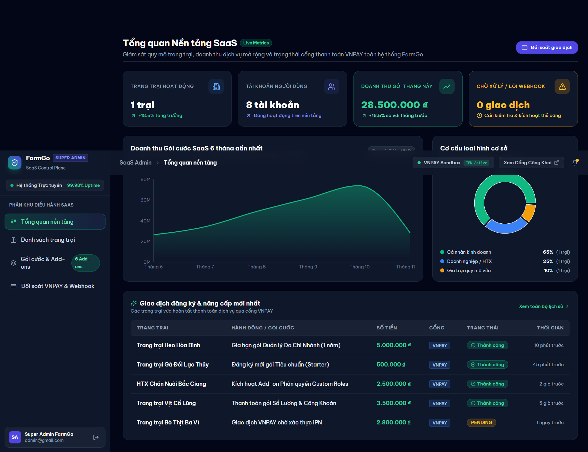
  - 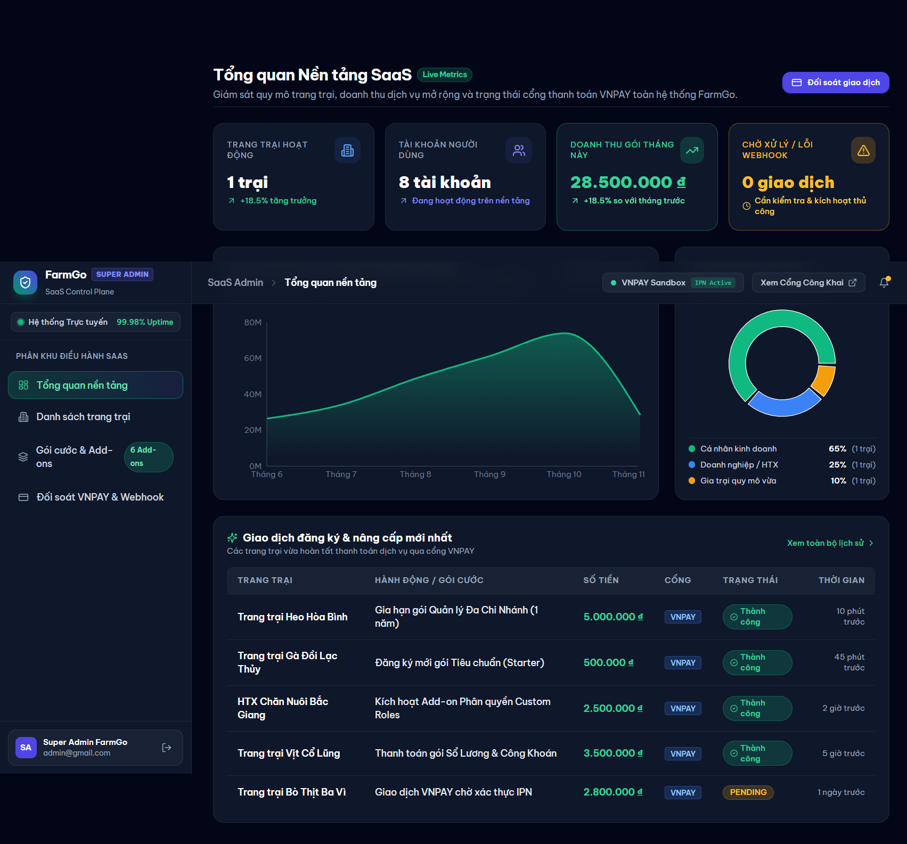
  - 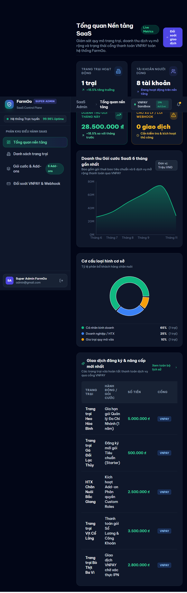
  - 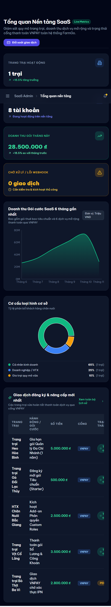
- **Đề xuất:** Cân chỉnh `z-index` / `overflow` của vùng nội dung chính, ẩn Sidebar thành Drawer ở `<= 1024px` cho `AdminLayout`, và đảm bảo bảng có wrapper `overflow-x-auto` chuẩn trên Mobile.

#### ERR-14: Lỗi `401 Unauthorized` khi mở Modal "Tìm cơ sở chăn nuôi để tham gia" tại `/onboarding`
- **Trang:** `/onboarding`
- **Mức độ:** **High**
- **Mô tả:** Khi bấm mở Modal tìm kiếm cơ sở, API `GET /api/v1/user/livestock-facilities/search` trả về `401 Unauthorized` và hiện toast `"Lỗi khi tìm kiếm cơ sở chăn nuôi"`.
- **Ảnh minh chứng:**
  - 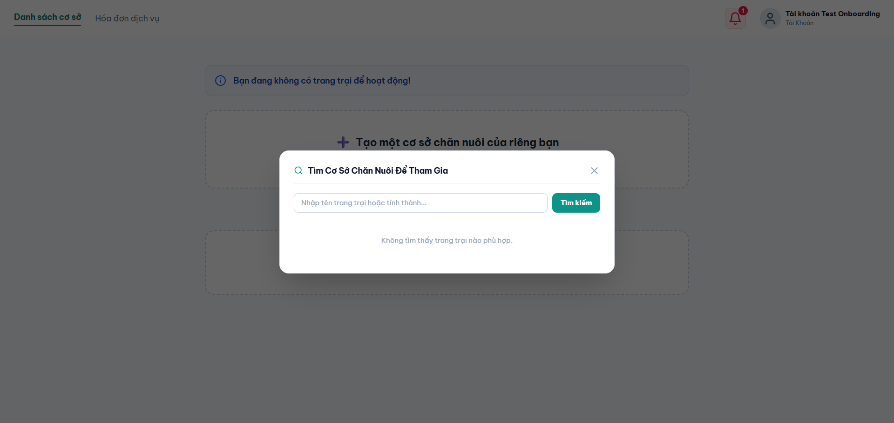
  - 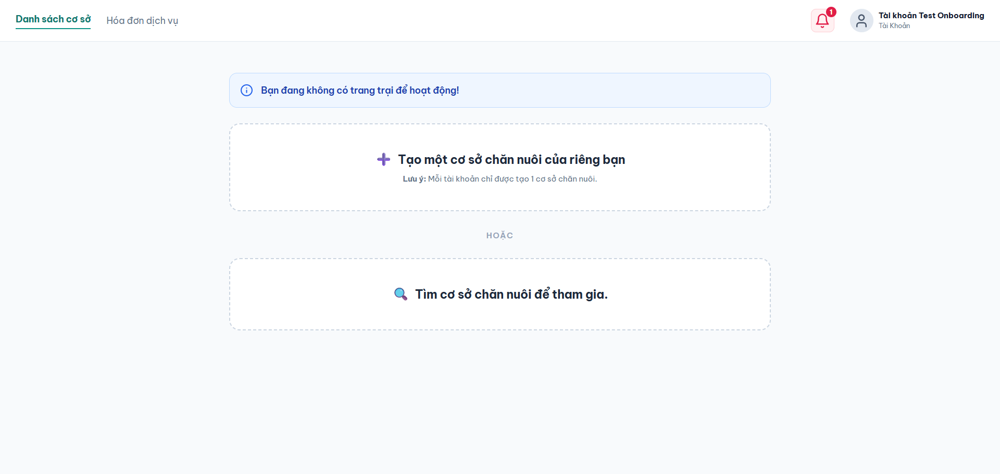
- **Đề xuất:** Kiểm tra `OnboardingPage.jsx` có truyền header `Authorization: Bearer ${accessToken}` (lấy đúng `accessToken` từ `useAuthStore`, lưu ý dòng 35 hiện đang destructure `token` thay vì `accessToken`) và kiểm tra endpoint backend tương ứng.

#### ERR-15: Chưa áp dụng giảm 10% khi chọn gói 2 năm ở Bước 2 Onboarding & link `/admin/transactions` trên Super Admin
- **Trang:** `/onboarding` (Bước 2), `/platform/dashboard`
- **Mức độ:** **Medium**
- **Mô tả:**
  - Ở Bước 2 `/onboarding`, chọn `2 Năm (Tiết kiệm 10%)` vẫn tính nguyên `2.650.000đ × 2 = 5.300.000đ` thay vì trừ 10%.
  - Trên `/platform/dashboard`, nút `Đối soát giao dịch` trỏ sang `/admin/transactions` thay vì `/platform/transactions`.
  - Sau khi `test_forcepwd` đổi mật khẩu và vào `/app/dashboard`, Console ghi nhận lỗi `403` từ `useActiveFarmStore` khi fetch danh sách farms.
- **Ảnh minh chứng:**
  - 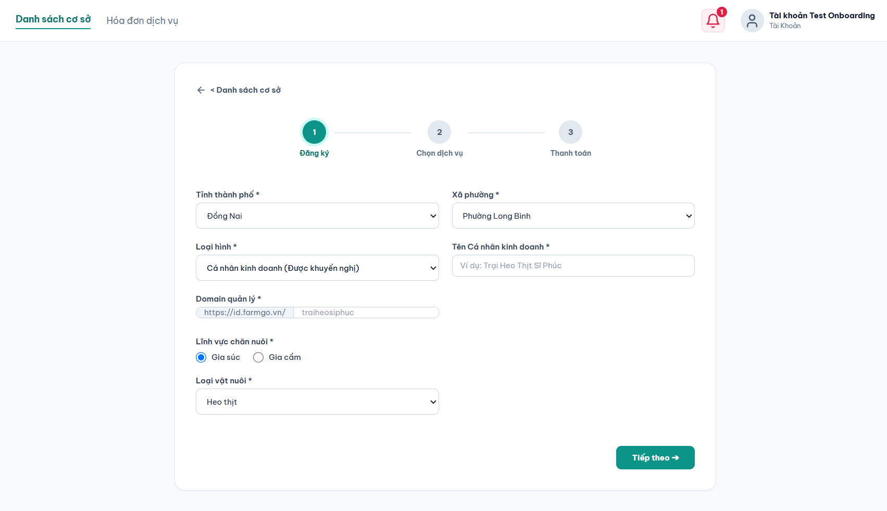
  - 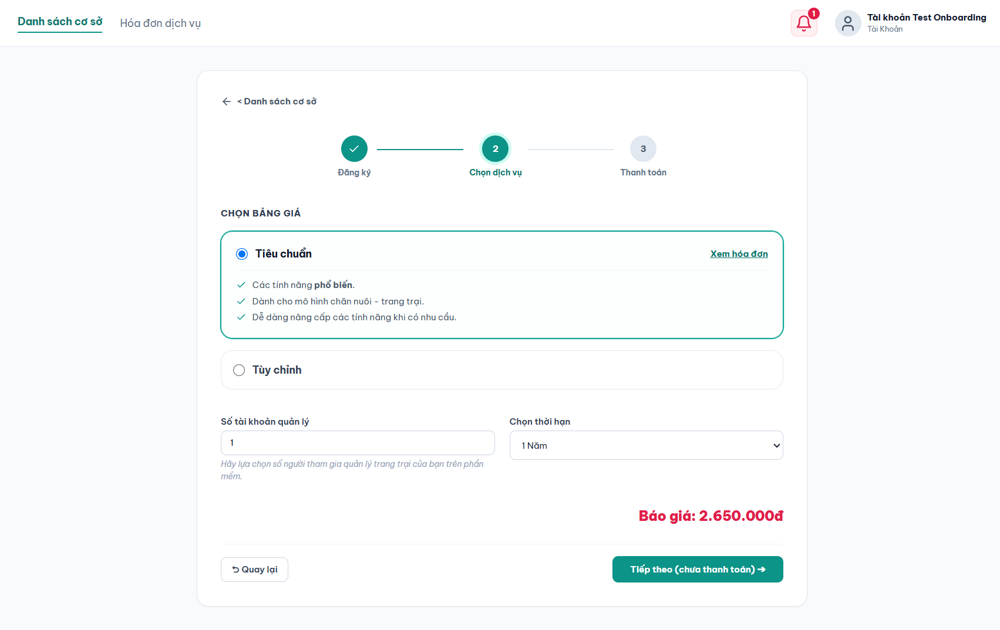
  - 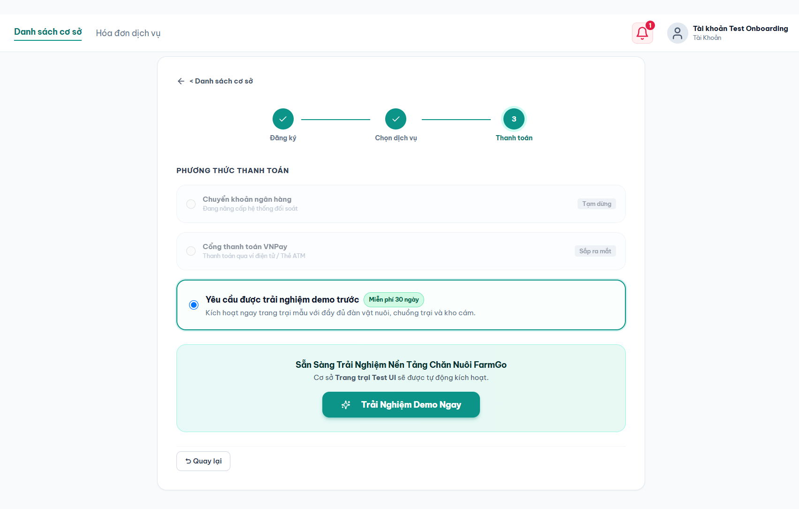
  - 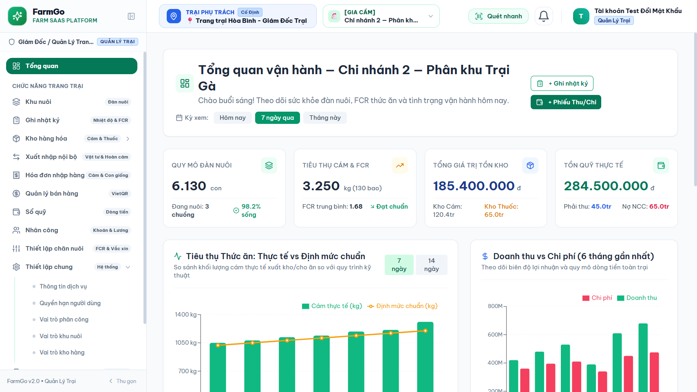
- **Đề xuất:** Cập nhật hàm `calculatePrice()` trong `OnboardingPage.jsx` áp dụng hệ số `0.9` cho gói 2 năm; đổi link nút `Đối soát giao dịch` sang `/platform/transactions`; kiểm tra quyền API fetch farms trong `useActiveFarmStore` cho vai trò Trại trưởng.

#### ERR-16: Lỗi thẩm mỹ nhỏ tại `/onboarding` và `/force-change-password`
- **Trang:** `/onboarding`, `/force-change-password`
- **Mức độ:** **Low**
- **Mô tả:**
  - `/onboarding`: Header không có nút Đăng xuất; nút quay lại hiển thị thừa mũi tên (`← < Danh sách cơ sở`); ở `390×844` tab header và badge "Miễn phí 30 ngày" bị rớt 2 dòng.
  - `/force-change-password`: Footer AuthLayout có 2 dấu chấm cuối câu (`"chuẩn doanh nghiệp.."`).
- **Ảnh minh chứng:**
  - 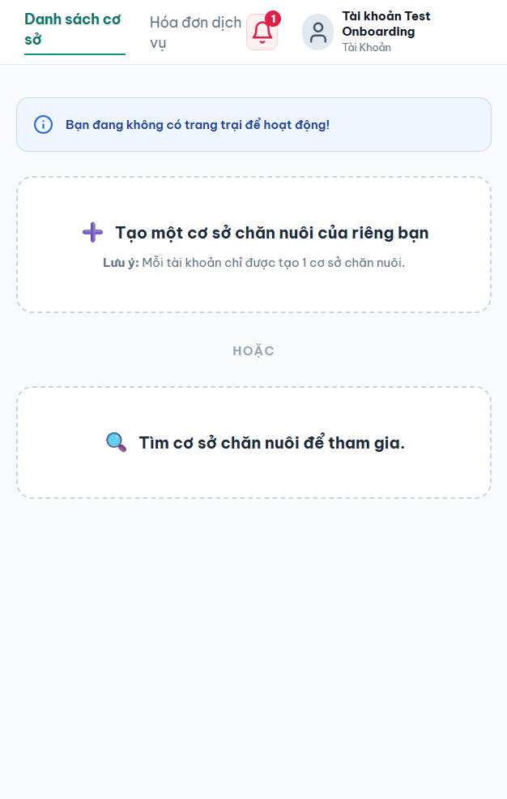
  - 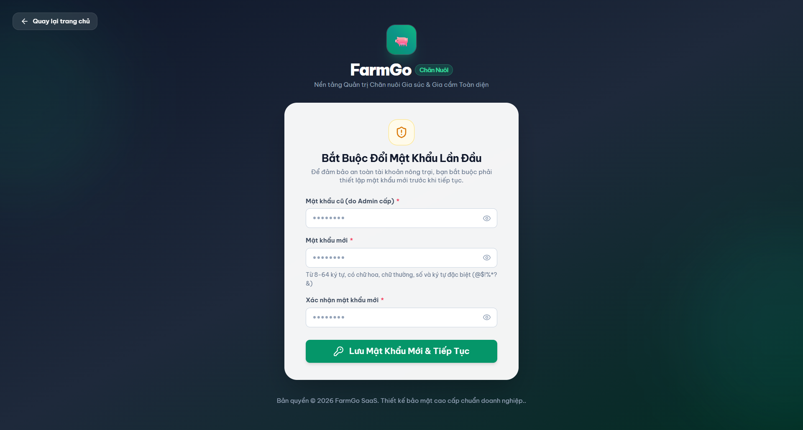
  - 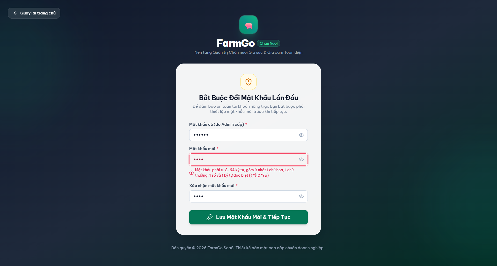
  - 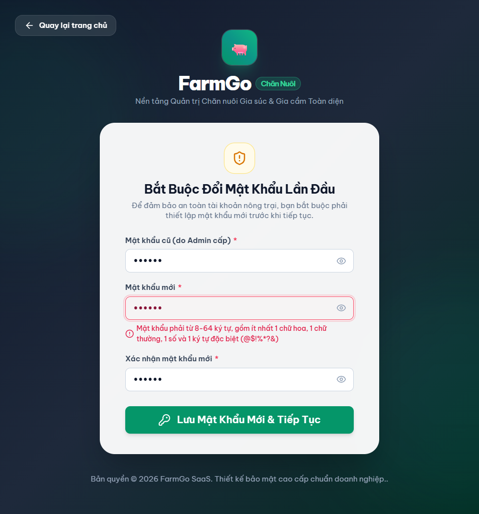
  - 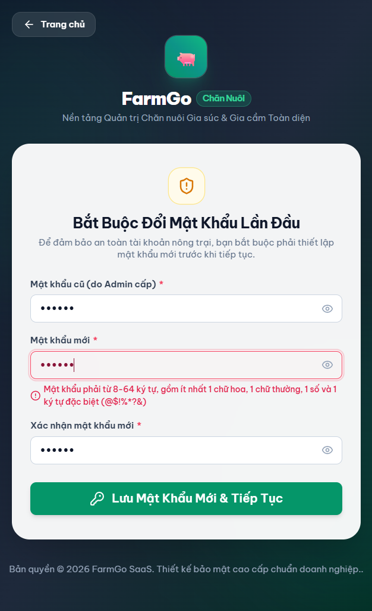
- **Đề xuất:** Bổ sung nút Đăng xuất ở Header `/onboarding`, bỏ ký tự `<` thừa trên nút quay lại, và xóa 1 dấu chấm thừa ở `AuthLayout.jsx`.
